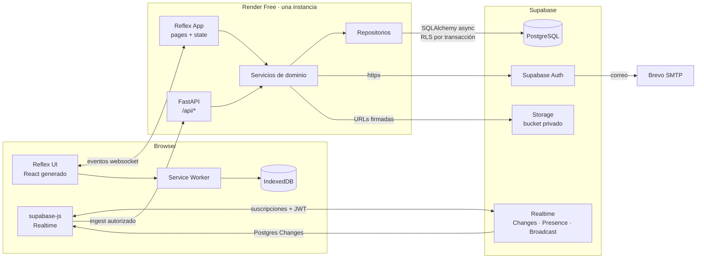

# Chatly — Arquitectura técnica

> **Estado:** propuesta para revisión del equipo.
> **Base funcional:** `docs/chatly.md` (Q1–Q108) y `docs/roadmap.md`.
> **Stack:** Python 3.13.7, Reflex 0.10.1, FastAPI integrado, SQLAlchemy 2 async, Psycopg 3, Alembic, Supabase (Postgres, Auth, Realtime, Storage), Brevo SMTP, PWA + IndexedDB, Render Free.
> **Alcance:** este documento define capas, responsabilidades, flujos y mecanismos. No sustituye al esquema SQL (`database-schema.md`), la matriz de permisos (`authorization-matrix.md`) ni los contratos de API (`api-contracts.md`).

---

## 1. Principios rectores

1. **La lógica de negocio vive en Python.** Validaciones, reglas de membresía, permisos funcionales y auditoría se resuelven en servicios; React/JS solo presenta datos y transporta eventos.
2. **La identidad sale del JWT, nunca del cliente.** Ningún endpoint ni evento acepta un `user_id` como fuente de verdad.
3. **Dos barreras de autorización.** El servicio valida reglas de dominio y la base de datos aplica RLS como segunda barrera. Una consulta que se salte el servicio sigue topando con RLS.
4. **Borrado lógico.** Nada se elimina físicamente salvo decisiones administrativas fuera del producto (Q31, Q42).
5. **Una sola instancia del backend, sin Redis.** El estado en memoria (registro de sesiones para Realtime) es aceptable y está documentado como limitación.
6. **No duplicar mecanismos de distribución.** Tiempo real solo por Supabase Realtime (Q16); no hay polling de mensajes.
7. **La PWA es progresiva y acotada.** Lectura de lo cacheado y cola de texto; nada que requiera validación del servidor se ejecuta offline (Q17).

---

## 2. Vista de contexto



**Decisiones de infraestructura asociadas**

- Render ejecuta un único servicio web que expone el frontend compilado por Reflex y el backend (`api_transformer`). No se despliega un segundo FastAPI.
- El sistema de archivos de Render es efímero: nada persistente se guarda localmente. Avatares y datos viven en Supabase.
- El navegador usa el cliente de Supabase solo para Realtime y para descargar avatares mediante URLs firmadas. Nunca usa `service_role`.

---

## 3. Capas y estructura de carpetas

La aplicación ejecutable es el paquete `Chatly/` (coincide con `app_name` en `rxconfig.py`). `src/chatly/` es únicamente el paquete de distribución creado por `uv`; no contiene la app y no debe recibir lógica de negocio.

```text
Chatly/
├── Chatly.py                  # rx.App(), add_page(), api_transformer, plugins
├── backend/
│   ├── api/
│   │   ├── deps.py            # verify_jwt, db_session, require_verified, rate_limit
│   │   └── routes/
│   │       ├── health.py
│   │       ├── auth.py
│   │       ├── profiles.py
│   │       ├── conversations.py
│   │       ├── messages.py
│   │       ├── polls.py
│   │       └── realtime.py    # ingest del puente JS
│   ├── core/                  # settings, jwt, errors, logging, ids, clock
│   ├── database/
│   │   ├── base.py            # Base, naming_convention, mixins (uuid, timestamps, soft delete)
│   │   ├── session.py         # engine async, sessionmaker, contexto RLS
│   │   └── models/            # una clase por tabla
│   ├── integrations/
│   │   ├── supabase/
│   │   │   ├── auth.py        # httpx contra Supabase Auth (signup, token, refresh, admin)
│   │   │   ├── storage.py     # upload, signed URL, delete
│   │   │   └── realtime.py    # nombres de canal y helpers de fan-out
│   │   └── smtp/              # verificación de configuración Brevo (solo lectura)
│   ├── repositories/          # consultas SQL; no contienen reglas de negocio
│   ├── schemas/               # DTOs Pydantic de entrada/salida
│   └── services/              # reglas de negocio y transacciones
├── state/                     # estados Reflex (sesión, lista, chat, grupo, encuestas)
├── pages/                     # una función por ruta
├── components/                # UI reutilizable
└── assets/
    ├── js/realtime-bridge.js  # supabase-js + ingest + ciclo de vida de canales
    ├── js/pwa.js              # registro del Service Worker, detección de conexión
    ├── sw.js
    └── manifest.webmanifest
```

### Regla de dependencias

```text
pages/components → state → services → repositories → database/models
                     │
                     └─→ integrations (solo a través de servicios)
api/routes → schemas + services
```

Reglas duras:

- `components/` y `pages/` no importan repositorios ni SQLAlchemy.
- `state/` no ejecuta SQL ni llama `httpx`.
- `repositories/` no decide permisos ni reglas; recibe parámetros ya autorizados.
- `services/` es el único lugar que abre transacciones y escribe `audit_logs`.
- `api/routes/` no contiene reglas: valida con Pydantic, llama al servicio y traduce errores.

### Responsabilidad por módulo

| Módulo | Responsable | Qué hace | Qué no hace |
|---|---|---|---|
| `pages/` | Reflex | Composición de pantallas, guardas de sesión, estados vacío/carga/error | Reglas de negocio |
| `state/` | Reflex | Mantiene DTOs en memoria, invoca servicios, aplica updates de Realtime | SQL, llamadas HTTP directas |
| `api/routes/` | FastAPI | Contratos HTTP, autenticación, traducción de errores | Reglas de dominio |
| `services/` | Python | Reglas Q1–Q110, autorización funcional, transacciones, auditoría | Serialización HTTP |
| `repositories/` | SQLAlchemy | Consultas, filtros de borrado lógico, paginación por cursor | Permisos |
| `database/` | SQLAlchemy | Modelos, engine, sesión, contexto RLS | Lógica |
| `integrations/` | Python | Supabase Auth/Storage, nombres de canal | Reglas |
| `assets/js/` | JS | Suscripciones Realtime, Presence, Broadcast, PWA | Reglas de negocio |

---

## 4. Flujo de una petición autenticada

### 4.1 Evento de Reflex (interacción de UI)

1. El navegador envía el evento por el websocket de Reflex; la petición incluye la cookie de sesión.
2. El estado de sesión (`SessionState`) resuelve el actor: lee la cookie de `self.router.headers.cookie`, verifica el JWT y carga el perfil mínimo (id, alias, `email_verified_at`).
3. Si el token expiró, redirige a refresh o a login; si el correo no está confirmado, bloquea la acción (Q15).
4. El handler delega en el servicio correspondiente.
5. El servicio abre una sesión async, fija `app.current_user_id` en la transacción, valida reglas, consulta/escribe, registra auditoría y hace commit.
6. El handler actualiza los vars del estado con los DTOs devueltos; Reflex envía el diff al navegador.

### 4.2 Endpoint REST

```text
Request → verify_jwt (Depends) → db_session (Depends, fija contexto RLS)
        → route (Pydantic) → service → repository → PostgreSQL
        ← DTO + código HTTP
```

El endpoint `/api/health` es público; el resto exige JWT válido. Los errores de dominio se traducen de forma uniforme (400 validación, 401 sin sesión, 403 sin permiso, 404 no visible, 409 conflicto, 422 regla incumplida).

### 4.3 Evento Realtime recibido por el navegador

1. `realtime-bridge.js` mantiene la suscripción al canal de la conversación abierta usando el `access_token` en memoria.
2. Al llegar un cambio, el JS **no** modifica el DOM ni confía en el payload: envía a `POST /api/realtime/ingest` los identificadores afectados (`conversation_id`, `entity`, `entity_id`, `kind`).
3. El backend verifica el JWT, **relee la fila desde PostgreSQL bajo RLS** y descarta el evento si el usuario no tiene acceso.
4. Con el dato autoritativo, el backend actualiza el estado Reflex de todas las sesiones de ese usuario mediante `app.modify_state` y un registro en memoria `user_id → {client_token}`.
5. Si la conversación abierta coincide, el estado inserta/actualiza el mensaje, la reacción o el resultado de la encuesta; si no, solo actualiza contadores y el orden de la lista.

**Por qué así:** mantiene la lógica y la autorización en Python, hace imposible falsificar contenido desde el navegador y evita duplicar el evento con una consulta silenciosa. El coste es una reread por evento; con cinco usuarios de demostración es irrelevante y se mide en la iteración 6.

### 4.4 Registro de sesiones para fan-out

- En `on_load` de la aplicación, el estado registra `user_id → client_token` en un diccionario en memoria protegido por `asyncio.Lock`.
- Se elimina al cerrar sesión y al expirar la sesión de Reflex.
- **Limitación asumida:** no sobrevive reinicios ni escala horizontalmente. Es coherente con la decisión de no usar Redis y una sola instancia. Si el proyecto necesitara escalar, se sustituye por el state manager de Reflex con Redis.

---

## 5. Autenticación y sesión

### 5.1 Responsabilidades

| Pieza | Responsable |
|---|---|
| Registro, login, refresh, recuperación, confirmación | Supabase Auth |
| Envío de correos | Brevo SMTP configurado en Supabase |
| Verificación de JWT | Backend Python (PyJWT + JWKS) |
| Sesión de UI y guardas de ruta | Reflex |
| Token para Realtime | `supabase-js` en el navegador |

### 5.2 Verificación del JWT

- Claves públicas desde `SUPABASE_JWKS_URL` con `PyJWKClient` y caché en proceso.
- Validaciones: firma, `alg` permitido, `iss` = `${SUPABASE_URL}/auth/v1`, `aud` = `authenticated` cuando aplique, `exp`, `iat`, `sub`.
- El actor es `sub` (UUID). El rol de aplicación se lee de `profiles`, no de `user_metadata`.
- El estado de confirmación de correo **no** se asume desde el JWT: se consulta `profiles.email_verified_at`, sincronizado desde `auth.users` (ver `database-schema.md`).
- Resultado cacheado por `session_id` + `exp` para no verificar en cada evento.

### 5.3 Sesión en el navegador

- `POST /api/auth/login` y `/api/auth/register` delegan en Supabase Auth vía `httpx` y devuelven **solo** el `access_token` en el cuerpo.
- El backend fija dos cookies `Secure`, `SameSite=Lax`:
  - `chatly_at` (`Path=/`, `Max-Age` = vida del access token, ~10 min): la leen los eventos de Reflex.
  - `chatly_rt` (`Path=/api/auth`, `HttpOnly`, duración del refresh): solo la usa `/api/auth/refresh`.
- El JS guarda el `access_token` **en memoria** y lo pasa a `supabase.realtime.setAuth()`; nunca en `localStorage`.
- Al recargar, el JS pide `/api/auth/refresh` (cookie `HttpOnly`) para obtener un token nuevo con el que reabrir Realtime y actualizar `chatly_at`.
- `POST /api/auth/logout` revoca el refresh en Supabase, borra cookies y limpia IndexedDB (Q62).

**Riesgo a validar en la iteración 2:** que el header `Cookie` llegue a los eventos de Reflex a través del proxy de Next en desarrollo (`localhost:3000 → 8000`) y en Render. Además, Reflex captura el `router_data` (incluidos headers) al cargar la página, por lo que tras un refresh el header puede quedar obsoleto; el estado debe guardar la expiración y forzar `/api/auth/refresh` en lugar de confiar indefinidamente en el header. Si el header no llegara, la alternativa es un `rx.Cookie` con el access token (menos seguro) o un endpoint de sesión que el estado consulte por token de cliente. La verificación es parte del criterio de salida de la iteración 2.

### 5.4 Guardas

- `SessionState.require_authenticated()`: sin actor válido, `rx.redirect` a `/login`.
- `SessionState.require_verified()`: sin `email_verified_at`, `rx.redirect` a `/verificacion-pendiente`.
- Las páginas declaran `on_load=[SessionState.guard_page]`; las rutas se marcan como protegidas en una sola lista para no olvidar ninguna.
- Cada endpoint usa `Depends(require_verified)` salvo auth y health.

---

## 6. Autorización en dos barreras

### 6.1 Barrera de servicio

Cada operación pasa por una función de autorización explícita antes de tocar el repositorio:

```python
def assert_can_write(actor, conversation, *, membership) -> None: ...
def assert_visible_period(actor, conversation, message, memberships) -> None: ...
def assert_poll_open(poll) -> None: ...
```

Las reglas se derivan de Q1–Q110 y se prueban de forma negativa (intentar acceder a lo ajeno y esperar 403/404).

### 6.2 Barrera de base de datos (RLS)

- Todas las tablas expuestas tienen `enable row level security`.
- El rol de conexión (`chatly_app`) **no** tiene `BYPASSRLS` ni es propietario de las tablas; solo tiene `select/insert/update` donde corresponde y `execute` sobre funciones auxiliares. El propietario de las tablas es el rol de migraciones.
- Contexto por transacción:

```python
async with session.begin():
    await session.execute(
        text("select set_config('app.current_user_id', :uid, true)"),
        {"uid": str(actor_id)},
    )
    ...
```

`true` hace el ajuste local a la transacción, por lo que no se filtra a la siguiente petición que reutilice la conexión del pool. Al terminar la transacción, PostgreSQL descarta el valor.

- Función única de identidad usada por todas las políticas:

```sql
create or replace function app.current_actor_id() returns uuid
language sql stable as $$
  select coalesce(
    auth.uid(),
    nullif(current_setting('app.current_user_id', true), '')::uuid
  );
$$;
```

  - `auth.uid()` funciona cuando el navegador habla con PostgREST/Realtime usando su JWT.
  - `app.current_user_id` funciona en la conexión directa de SQLAlchemy.
  - Ambas rutas comparten las mismas políticas.

- Consecuencia de diseño: las políticas deben ser válidas en ambos contextos. No se usan `auth.jwt()` ni claims que no existan en la conexión directa.
- Prueba obligatoria: dos peticiones consecutivas con usuarios distintos no comparten contexto (iteración 1).

### 6.3 Qué protege cada barrera

| Riesgo | Servicio | RLS |
|---|---|---|
| Leer conversación ajena | 404 | Bloquea filas |
| Leer mensajes de un periodo sin membresía | 404 | Bloquea filas |
| Escribir tras expulsión | 403 | Bloquea `insert` |
| Editar mensaje ajeno | 403 | Bloquea `update` |
| Votar dos veces | 409 | Unique parcial |
| Consultar correo de otro | N/A | `user_contacts` sin política de `select` + función `security definer` |
| Auditar con datos falsos | Servicio | Tabla solo-insert del backend |

---

## 7. Tiempo real

### 7.1 Distribución (Q37)

| Función | Mecanismo | Canal |
|---|---|---|
| Mensajes, ediciones, borrados, reacciones, votos, encuestas | Postgres Changes | `conversation:{id}` |
| Online/offline | Presence | `presence:conversation:{id}` |
| «escribiendo…» | Broadcast | `typing:conversation:{id}` |

Se habilita en la publicación `supabase_realtime` solo lo necesario: `messages`, `message_reactions`, `polls`, `poll_options`, `poll_votes`, `conversations`. `conversation_memberships` se usa para refrescar la lista cuando cambia la membresía.

### 7.2 Ciclo de vida del cliente

```text
login → setAuth(access_token)
al abrir conversación → suscribir canal(es) → ingest inicial (últimos 50 ya cargados por la UI)
al cambiar de conversación → desuscribir anterior, suscribir nueva
al expulsar/salir → desuscribir inmediatamente + el backend invalida acceso
al refrescar token (~10 min) → setAuth y re-suscripción si el canal cerró
al cerrar sesión → desuscribir todo
```

- Las suscripciones se autorizan con RLS sobre `realtime.messages` y con las políticas de `select` de cada tabla.
- Duplicados: el estado descarta por `entity_id` + `updated_at`; el ingest es idempotente.
- Orden: el estado ordena por `(created_at, id)`, nunca por orden de llegada.
- Revocación: el cliente se desuscribe, el backend deja de autorizar y el JWT expira en ~10 min (Q61). Se documenta que la revocación no es instantánea para un cliente que no coopere.

### 7.3 Presencia

- Una pestaña = una conexión de Presence; el usuario está online mientras tenga al menos una sesión.
- El estado Reflex no mantiene la fuente de verdad de presencia: la UI la recibe del canal. Solo se usa para mostrar el punto verde.
- No se implementa «última vez visto» (Q13).

### 7.4 Escritura

- El compositor emite un evento Broadcast con `throttle` de ~1 s.
- El receptor apaga el indicador tras 5 s sin eventos y al perder el canal (Q77).
- Los eventos de escritura nunca se guardan en Postgres ni se auditan.

---

## 8. Offline y PWA

### 8.1 Alcance

| Dato | Ubicación | Límite |
|---|---|---|
| Lista de conversaciones | IndexedDB | completa |
| Mensajes por conversación | IndexedDB | últimos 50 |
| Borradores | IndexedDB | por conversación |
| Outbox de texto | IndexedDB | sin límite definido en V1 |

### 8.2 Flujo offline

1. La UI lee de IndexedDB cuando `navigator.onLine === false` y muestra un aviso de modo offline.
2. Enviar texto crea un registro `outbox` con UUID generado en el dispositivo (idempotencia).
3. Estados: `pendiente → enviando → enviado`, o `fallido` si el servidor rechaza.
4. Al reconectar (`online`) o al abrir la app se reintenta en orden, con el mismo UUID; el backend hace `on conflict (author_id, client_message_id) do nothing` y devuelve el mensaje existente.
5. Operaciones bloqueadas offline: votar, reaccionar, editar, eliminar, crear grupos, cambiar perfil (Q17).
6. Al cerrar sesión con pendientes: advertencia, esperar o descartar explícitamente, luego limpiar IndexedDB (Q39, Q62).

### 8.3 Service Worker

- Cachea el shell estático y los assets compilados; **no** cachea respuestas de API autenticadas.
- El `sw.js` y el manifest se sirven como estáticos desde `assets/`. La ruta exacta y la estrategia de versionado se validan en la iteración 10 (riesgo alto según el roadmap).
- La app funciona sin Service Worker: el modo offline es una mejora progresiva, no un requisito de arranque.

---

## 9. Configuración y secretos

- `backend/core/settings.py` con `pydantic-settings` y `.env` (ya existe `.env.example`).
- Variables mínimas: `APP_ENV`, `DATABASE_URL`, `SUPABASE_URL`, `SUPABASE_PUBLISHABLE_KEY`, `SUPABASE_JWKS_URL`, `SUPABASE_AVATARS_BUCKET`, más las de Supabase Auth para el backend, los orígenes permitidos, `TRUSTED_PROXY_HOPS` y las variables `RATE_LIMIT_*`.
- Configuración del pool de conexiones (con defaults: 5, 10, 30 s y 1800 s) y del logging: `DB_POOL_SIZE`, `DB_MAX_OVERFLOW`, `DB_POOL_TIMEOUT`, `DB_POOL_RECYCLE` y `LOG_LEVEL` (JSON con redacción; por defecto `INFO`).
- La `service_role` **no** se usa en el flujo normal. Si algún proceso administrativo (seed) la necesita, va en una variable aparte y solo se ejecuta en local/scripts.
- Sin OpenAPI/Swagger por ahora: FastAPI se configura con `docs_url=None`, `redoc_url=None` y `openapi_url=None` en todos los entornos.
- Nunca se registran tokens, cookies, contraseñas ni correos completos en logs.

---

## 10. Observabilidad y errores

- Logs estructurados en JSON con `request_id`, `actor_id`, `action`, `entity`, `duration_ms`; sin datos sensibles.
- Errores de dominio tipados (`DomainError` → código HTTP y mensaje en español), con copy claro y directo en segunda persona.
- En Reflex, todo handler captura errores y devuelve `rx.toast` con mensaje en español, sin exponer trazas.
- Un `backend_exception_handler` global evita respuestas con stack traces.
- **Rate limiting** en memoria por instancia; al exceder devuelve `429` con `Retry-After`. Los valores concretos están en `api-contracts.md` §14. Al no haber Redis, los contadores se reinician con el proceso.

---

## 11. Pruebas por capa

| Capa | Herramienta | Qué se prueba |
|---|---|---|
| Servicios | pytest + Postgres de prueba | Reglas de grupos, membresías, encuestas, permisos |
| Repositorios | pytest + DB | Consultas, paginación por cursor, filtros de borrado lógico |
| RLS | pytest + sesión real | Aislamiento entre usuarios y contextos |
| API | httpx + ASGI | Contratos, autenticación, errores |
| Realtime | navegador/múltiples sesiones | Suscripción, duplicados, orden, desuscripción |
| Offline | Playwright o manual guiado | Cache, outbox, reconexión, idempotencia |
| UI | pytest + smoke | Rutas protegidas, estados vacío/carga/error |

La suite por defecto no depende de red: Realtime y Storage se prueban de forma manual/guionizada.

### 11.1 Pruebas contra Supabase (desvío respecto al plan original)

Este documento planteaba un Postgres local para las pruebas de servicios/repositorios/RLS. Se decidió **no usar Docker ni un Postgres local** y apuntar las pruebas de integración directamente al proyecto Supabase de nube (Session Pooler):

- `DATABASE_URL` (rol `postgres`, con `BYPASSRLS`): solo migraciones y DDL de preparación/limpieza en pruebas.
- `TEST_DATABASE_URL` (rol `chatly_app`, sin `BYPASSRLS`): las aserciones de RLS y de permisos, igual que la app en producción. En el Session Pooler el usuario es `rol.project_ref`.
- Cada evento dependiente de datos vive detrás del marker `db` registrado en `pyproject.toml` (`db: pruebas que requieren Supabase`) y de la fixture `db_available` de `tests/conftest.py`, que intenta `select 1` y salta con un mensaje claro si no hay conexión o credenciales. Sin red, el resto de la suite sigue verde.
- `conftest` además comprueba `to_regprocedure('app.current_actor_id()')`: si la migración `0001_infra` no está aplicada, el test salta pidiendo `uv run alembic upgrade head`.
- `require_app_role()` valida que la conexión de aserciones sea `chatly_app` sin `BYPASSRLS`; si la variable no está configurada salta, y si el rol no es el esperado falla.
- Los objetos de prueba (schema `pruebas_rls`, tabla `registros`) se crean y destruyen en cada corrida, con teardown garantizado.

### 11.2 Aislamiento RLS en las pruebas

`test_rls_context.py` simula peticiones autenticadas reales contra el rol de aplicación:

1. La conexión administrativa crea el schema/tabla de prueba con RLS y una política de propiedad que llama a `app.current_actor_id()` directamente, y siembra filas de los actores A y B.
2. Cada transacción simulada se abre con `TEST_DATABASE_URL` (`chatly_app`) y ejecuta `set_config('app.current_user_id', <uuid>, true)`, igual que hará `session.py` en producción.
3. Verifica que cada actor solo ve sus filas, que puede insertar las suyas (`with check`) y que insertar para otro actor falla.
4. Verifica que dos transacciones consecutivas con actores distintos sobre la misma conexión del pool no comparten contexto (`set_config` es local a la transacción) y que el ajuste desaparece tras commit/rollback.

Nota de plataforma: `postgres` no puede otorgar `usage` del schema `auth` (es propiedad de `supabase_admin` y carece de `GRANT OPTION`). El rol `chatly_app` se prepara con `alter role chatly_app inherit;` y `grant authenticated to chatly_app;`, con lo que hereda `usage` de `auth` y `EXECUTE` de `auth.uid()`; así las políticas pueden llamar a `app.current_actor_id()`/`auth.uid()` sin helpers `SECURITY DEFINER` ni roles temporales.

### 11.3 Windows y Psycopg 3

Psycopg 3 async falla con el `ProactorEventLoop` por defecto de Windows. Tanto `migrations/env.py` como `tests/conftest.py` fijan `asyncio.set_event_loop_policy(asyncio.WindowsSelectorEventLoopPolicy())` al importar; en Linux/macOS no tiene efecto.

---

## 12. Despliegue

- **Render Free:** un servicio web. Comando de arranque de Reflex; migraciones Alembic en un paso previo controlado (no en el arranque automático de cada instancia).
- **Supabase:** proyecto con Auth, Postgres, Realtime y Storage; extensiones y políticas aplicadas por migración.
- **Brevo:** SMTP configurado en Supabase Auth; probado con correos reales antes de la demo.
- **Dominio:** URL `*.onrender.com` gratuita. `SUPABASE_URL` debe aceptar esa URL en redirect URLs.
- **Arranque en frío:** Render suspende el servicio sin tráfico; se documenta y se ensaya antes de la presentación.
- **Semilla demo:** script idempotente con cinco cuentas verificadas y contenido; no se guardan contraseñas reales en el repositorio.

---

## 13. Riesgos técnicos y validaciones tempranas

| Riesgo | Impacto | Validación | Iteración |
|---|---|---|---|
| Cookie de sesión no llega a eventos Reflex | Alto | Prueba con proxy de Next en dev y en Render | 2 |
| RLS con contexto por transacción y pool | Alto | Test de dos usuarios consecutivos y fuga de contexto | 1 |
| Puente JS → `app.modify_state` | Alto | Prototipo de un mensaje que aparece sin recargar en dos navegadores | 6 |
| Service Worker y manifest en Reflex | Medio/alto | Instalación y cache del shell en dev | 10 |
| Reread por evento Realtime | Medio | Medición con cinco sesiones | 6 |
| Revocación tras expulsión | Alto | Probar canal abierto antes y después de expulsar | 6 |
| Confusión `Chatly/` vs `src/chatly/` | Bajo | Documentar que la app vive en `Chatly/` | 0 |

---

## 14. Decisiones abiertas

Sin pendientes funcionales sobre identidad y perfil. Reglas cerradas: edad **18–120 años** y género **`femenino`/`masculino`**, exigidos en el registro y visibles solo en el perfil; nombre visible obligatorio de **2–60** caracteres, editable y no único; búsqueda por alias desde **2 caracteres** y sin incluir al propio usuario.

1. **Ruta de los estáticos/PWA.** Confirmar cómo expone Reflex `assets/` para servir `sw.js` y `manifest.webmanifest`.
2. **Ubicación definitiva de la app.** Se mantiene `Chatly/` por compatibilidad con `rxconfig.py`; `src/chatly/` queda solo como paquete de distribución.
