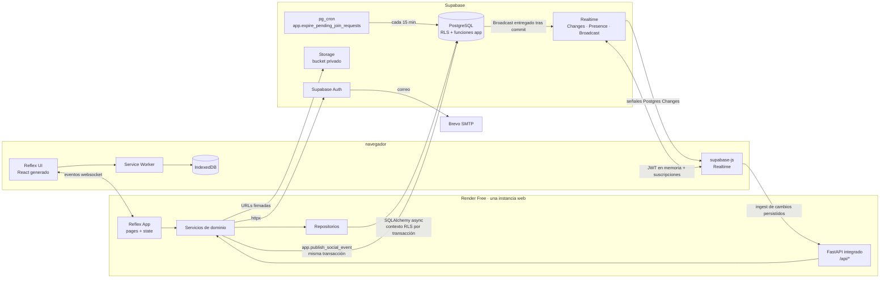

# Chatly — Arquitectura técnica

> **Estado:** aprobado para implementación; la estructura de carpetas y componentes es el objetivo técnico, no una afirmación de que todo exista. Las migraciones `0013_descubrimiento_social` y `0014_social_cron` están pendientes de implementar y probar.
> **Base funcional:** `docs/chatly.md` (Q1–Q179) y `docs/roadmap.md`.
> **Documentos relacionados:** `docs/api-contracts.md`, `docs/database-schema.md`, `docs/realtime-events.md` y `docs/authorization-matrix.md`.
> **Stack:** Python 3.13.7, Reflex 0.10.1, FastAPI integrado mediante `api_transformer`, SQLAlchemy 2 async, Psycopg 3, Alembic, Supabase (PostgreSQL, Auth, Realtime y Storage), Brevo SMTP, PWA + IndexedDB y Render Free.
> **Alcance:** define capas, responsabilidades, flujos y mecanismos. No sustituye al esquema SQL, la matriz de autorización, los contratos de API ni el documento de eventos Realtime.

---

## 1. Principios rectores

1. **La orquestación de negocio vive en Python.** Los servicios coordinan validaciones, permisos funcionales, transacciones y auditoría. PostgreSQL conserva las restricciones de integridad, RLS y funciones SQL de alcance limitado para operaciones atómicas o automáticas. React/JavaScript presenta datos y transporta eventos; no decide reglas de negocio.
2. **La identidad sale del JWT, nunca del cliente.** Ningún endpoint ni evento acepta un `user_id` enviado por el navegador como fuente de verdad. El actor se obtiene de la sesión/JWT y se establece en el contexto de la transacción.
3. **Dos barreras de autorización.** Los servicios validan las reglas del dominio y PostgreSQL aplica RLS como segunda barrera. Una consulta que evite el servicio sigue limitada por RLS.
4. **Borrado lógico.** Los registros de negocio se conservan mediante marcas de eliminación, salida, archivo o resolución. No se realizan borrados físicos como operación normal del producto; las excepciones administrativas quedan fuera del flujo de usuario (Q31, Q42).
5. **Una instancia web y sin Redis.** Render ejecuta una instancia del servicio Reflex/FastAPI. El registro de sesiones Reflex para fan-out vive en memoria y se acepta como limitación de la V1.
6. **No duplicar mecanismos de distribución.** Supabase Realtime distribuye mensajes, cambios de conversación, presencia, escritura y avisos sociales (Q16). No se implementa polling periódico de mensajes ni de presencia.
7. **La PWA es progresiva y acotada.** Permite consultar datos cacheados y encolar mensajes de texto. Toda operación que requiera validación del servidor queda bloqueada offline (Q17).
8. **Las conversaciones grupales siguen siendo la entidad de grupo.** Los grupos descubribles reutilizan `conversaciones` con `tipo = 'group'`; no existe una entidad paralela de comunidades ni un sistema de amistades/seguidores (Q150, Q179).
9. **Los avisos Realtime no son la fuente de verdad.** Los Broadcast sociales son efímeros. El estado durable de las solicitudes permanece en `solicitudes_union`, y la API devuelve los datos autorizados.

---

## 2. Vista de contexto



### Decisiones de infraestructura asociadas

- Render ejecuta un único servicio web que expone la aplicación Reflex y su backend FastAPI integrado mediante `api_transformer`. No se despliega un segundo servidor FastAPI.
- El sistema de archivos de Render es efímero: nada persistente se guarda localmente. Los avatares y los datos viven en Supabase; el almacenamiento local de la PWA se limita a IndexedDB.
- El navegador utiliza Supabase JS para Realtime y para descargar avatares mediante URLs firmadas. Nunca recibe `service_role` ni otra credencial secreta del servidor.
- Las notificaciones de solicitudes y las invalidaciones de Descubrir se publican con `app.publish_social_event(...)`, una función `SECURITY DEFINER` restringida a `chatly_app`, en la misma transacción que la operación. Realtime entrega el Broadcast después del commit; no se necesita una clave secreta de publicador en el backend.
- Los datos sociales privados (intereses, solicitudes, perfiles y listas de integrantes) se consultan a través de FastAPI. No se habilita lectura directa del navegador sobre esas tablas.

---

## 3. Capas y estructura de carpetas

La aplicación ejecutable es el paquete `Chatly/` (coincide con `app_name` en `rxconfig.py`). `src/chatly/` es únicamente el paquete de distribución creado por `uv`; no contiene la aplicación y no debe recibir lógica de negocio.

```text
Chatly/
├── Chatly.py                      # rx.App(), add_page(), api_transformer, plugins
├── backend/
│   ├── api/
│   │   ├── deps.py                # verify_jwt, db_session, require_verified, rate_limit
│   │   └── routes/
│   │       ├── health.py
│   │       ├── auth.py
│   │       ├── profiles.py
│   │       ├── interests.py       # catálogo y selección de intereses
│   │       ├── discovery.py       # personas y grupos descubribles
│   │       ├── join_requests.py   # solicitudes y decisiones del administrador
│   │       ├── conversations.py
│   │       ├── messages.py
│   │       ├── polls.py
│   │       └── realtime.py        # ingest del puente JS para Postgres Changes
│   ├── core/                      # settings, jwt, errors, logging, ids, clock
│   ├── database/
│   │   ├── base.py                # Base, naming_convention, mixins
│   │   ├── session.py             # engine async, sessionmaker, contexto RLS
│   │   └── models/                # una clase por tabla
│   ├── integrations/
│   │   ├── supabase/
│   │   │   ├── auth.py            # httpx contra Supabase Auth
│   │   │   ├── storage.py         # upload, signed URL, delete
│   │   │   └── realtime.py        # definición de topics; publica vía app.publish_social_event
│   │   └── smtp/                  # comprobación de configuración Brevo (solo lectura)
│   ├── repositories/              # consultas SQL; sin reglas de negocio
│   ├── schemas/                   # DTOs Pydantic de entrada/salida
│   └── services/
│       ├── auth_service.py
│       ├── profile_service.py
│       ├── interest_service.py
│       ├── discovery_service.py
│       ├── join_request_service.py
│       ├── conversation_service.py
│       ├── message_service.py
│       └── poll_service.py
├── state/                         # estados Reflex: sesión, chats, grupos, Descubrir
├── pages/                         # una función por ruta
├── components/                    # UI reutilizable
└── assets/
    ├── js/realtime-bridge.js       # supabase-js, ingest y ciclo de vida de topics
    ├── js/pwa.js                   # Service Worker y detección de conexión
    ├── sw.js
    └── manifest.webmanifest
```

Los nombres de archivos de `services/` representan una organización propuesta, no una afirmación de que todos existan ya en el repositorio. La expiración no vive en el repositorio: es un job de `pg_cron` en Supabase.

### Regla de dependencias

```text
pages/components → state → services → repositories → database/models
                     │          │
                     │          └─→ integrations (a través de servicios)
                     └─→ DTOs; nunca SQL ni HTTP directo

api/routes → schemas + deps + services
pg_cron (Supabase) → función SQL de alcance limitado
```

Reglas duras:

- `components/` y `pages/` no importan repositorios ni SQLAlchemy.
- `state/` no ejecuta SQL ni llama `httpx`; invoca servicios y mantiene DTOs.
- `repositories/` no decide permisos ni reglas de negocio; recibe parámetros validados por los servicios. RLS sigue aplicándose aunque una consulta llegue directamente al repositorio.
- `services/` coordina los casos de uso, abre las transacciones de las operaciones de usuario y registra auditoría. Las funciones SQL restringidas realizan únicamente transiciones automáticas concretas, como la expiración de solicitudes.
- `api/routes/` no contiene reglas de dominio: valida con Pydantic, llama al servicio y traduce errores.
- `assets/js/` administra conexiones Realtime y PWA; no interpreta sus payloads como datos autoritativos ni ejecuta reglas de negocio.
- `pg_cron` no recibe facultades administrativas generales. El job de expiración solo ejecuta `app.expire_pending_join_requests()`, que a su vez solo modifica solicitudes `pending` ya vencidas.

### Responsabilidad por módulo

| Módulo | Responsable | Qué hace | Qué no hace |
|---|---|---|---|
| `pages/` | Reflex | Composición de pantallas, guardas y estados vacío/carga/error | Reglas de negocio |
| `state/` | Reflex | Mantiene DTOs, invoca servicios y aplica cambios autorizados de Realtime | SQL, llamadas HTTP directas |
| `api/routes/` | FastAPI | Contratos HTTP, autenticación, traducción de errores | Reglas de dominio |
| `services/` | Python | Reglas Q1–Q179, autorización funcional, transacciones y auditoría | Serialización HTTP |
| `repositories/` | SQLAlchemy | Consultas, filtros de borrado lógico y paginación por cursor | Permisos o decisiones de negocio |
| `database/` | SQLAlchemy | Modelos, engine, sesión y contexto RLS | Lógica de presentación |
| `integrations/` | Python | Supabase Auth/Storage y publicación controlada de Broadcast | Reglas del dominio |
| `pg_cron` (Supabase) | Job programado | Ejecuta la expiración acotada de solicitudes vencidas | Operaciones generales de administración |
| `assets/js/` | JavaScript | Postgres Changes, Presence, Broadcast, PWA e ingest | Reglas de negocio o autorización final |

### Convención de nombres y mapeo

- Las tablas y columnas de PostgreSQL se mantienen en español: `perfiles`, `conversaciones`, `miembros_conversacion`, `intereses_usuario`, `intereses_conversacion` y `solicitudes_union`.
- Los DTOs y contratos HTTP pueden utilizar alias en inglés, por ejemplo `is_public`, `is_discoverable`, `members_count` y `shared_interests`. El mapeo se hace en schemas/servicios, no cambiando los nombres persistidos.

---

## 4. Flujo de una petición autenticada

### 4.1 Evento de Reflex (interacción de UI)

1. El navegador envía el evento por el WebSocket de Reflex; la petición incluye la cookie de sesión `chatly_at`.
2. El estado de sesión (`SessionState`) resuelve el actor a partir de la sesión y valida el JWT. Carga el perfil mínimo necesario, incluido `id` y el estado de verificación derivado de `perfiles.correo_verificado_en`.
3. Si el token expiró, se renueva mediante el flujo de refresh o se redirige a login. Si el correo no está confirmado, se bloquean las acciones que requieren verificación (Q15).
4. El handler delega en el servicio correspondiente.
5. El servicio abre una sesión async, fija `app.current_user_id` dentro de la transacción, valida las reglas, consulta/escribe mediante repositorios y registra la auditoría. Las operaciones automáticas restringidas pueden delegarse en funciones SQL específicas.
6. El handler actualiza las variables del estado con los DTOs devueltos; Reflex envía el diff al navegador.

### 4.2 Endpoint REST

```text
Request → verify_jwt (Depends) → db_session (Depends, fija contexto RLS)
        → route (Pydantic) → service → repository → PostgreSQL
        ← DTO + código HTTP
```

- `/api/health` es público. Registro, login, confirmación y recuperación tienen las reglas públicas propias del flujo de Auth.
- Los endpoints protegidos requieren JWT válido; los de chat, Descubrir y operaciones sociales exigen además correo confirmado.
- Los errores de dominio se traducen de forma uniforme según `api-contracts.md`: validación, `401`, `403`, `404`, conflictos y reglas incumplidas. Un recurso inexistente o no visible responde `404` cuando así lo establece el contrato.

### 4.3 Evento Postgres Changes recibido por el navegador

1. `realtime-bridge.js` mantiene la suscripción al topic `conversation:<conversation_id>` de la conversación abierta, utilizando el `access_token` en memoria mediante `supabase.realtime.setAuth()`.
2. Al llegar un Postgres Change, JavaScript **no** modifica el DOM ni utiliza el payload de la fila como fuente autoritativa. Envía a `POST /api/realtime/ingest` solo los identificadores y metadatos mínimos: `conversation_id`, `kind`, `event`, `entity_id` y `sent_at`.
3. El backend verifica la sesión, obtiene al actor del JWT y relee la fila desde PostgreSQL bajo el contexto de actor y RLS. Si la fila no existe o no es visible, descarta la señal.
4. Con el dato autoritativo, el backend actualiza el estado Reflex de las sesiones conectadas de ese usuario mediante `app.modify_state` y el registro en memoria `user_id → set[client_token]`.
5. Si la conversación está abierta, el estado inserta/actualiza el mensaje, la reacción, la encuesta, el voto o la membresía. Si no está abierta, actualiza lo necesario en la lista de conversaciones y el contador de no leídos.

**Alcance del ingest:** solo procesa señales de Postgres Changes asociadas a tablas de conversación/mensajería. Los eventos `typing`, `join_request.*`, `conversation.access_revoked` y `discover.*` son Broadcast y no pasan por `/api/realtime/ingest`.

**Por qué así:** conserva la autorización en Python/PostgreSQL, evita confiar en contenido enviado por el navegador y evita implementar una consulta de sondeo paralela. El coste es una relectura por evento; se mide con varias sesiones de demostración.

### 4.4 Broadcast recibido por el navegador

Los Broadcast se utilizan para datos efímeros o invalidaciones mínimas:

- `join_request.created` y `join_request.resolved`: actualizan avisos visuales de solicitudes. La interfaz vuelve a consultar los endpoints autorizados para obtener la información completa.
- `conversation.access_revoked`: solicita al cliente cerrar el topic de conversación y retirar de la interfaz el contenido que ya no puede consultar.
- `discover.person_hidden` y `discover.group_unpublished`: retiran tarjetas que ya no deben mostrarse en los resultados actualmente cargados.
- `typing`: muestra temporalmente el indicador «escribiendo…» en la conversación.

Los Broadcast no contienen correos, mensajes, listas de integrantes ni intereses completos. No se tratan como historial durable y pueden perderse si el usuario está desconectado.

### 4.5 Registro de sesiones para fan-out

- En `on_load`, el estado registra `user_id → set[client_token]` en un diccionario en memoria protegido por `asyncio.Lock`.
- Se elimina el token al cerrar sesión y al expirar/desconectarse la sesión Reflex.
- El mapa vive en el proceso web. No sobrevive reinicios ni permite escalar horizontalmente; es coherente con la V1 de una sola instancia y sin Redis.
- Si el proyecto necesitara escalar, se reemplazaría por un state manager compartido compatible con Reflex. No se incorpora Redis en el alcance actual.

---

## 5. Autenticación y sesión

### 5.1 Responsabilidades

| Pieza | Responsable |
|---|---|
| Registro, login, refresh, recuperación y confirmación | Supabase Auth |
| Envío de correos | Brevo SMTP configurado en Supabase Auth |
| Verificación de JWT | Backend Python (PyJWT + JWKS) |
| Sesión de UI y guardas de ruta | Reflex |
| Token para Realtime | `supabase-js` en el navegador, en memoria |
| Estado de confirmación para autorización de aplicación | `perfiles.correo_verificado_en`, sincronizado con `auth.users` |

### 5.2 Verificación del JWT

- Las claves públicas se obtienen desde `SUPABASE_JWKS_URL` mediante `PyJWKClient`, con caché en proceso.
- Validaciones: firma, algoritmo permitido, `iss = ${SUPABASE_URL}/auth/v1`, `aud = authenticated` cuando corresponda, `exp`, `iat` y `sub`.
- El actor es `sub` (UUID). El rol de aplicación se consulta en el perfil/estado de membresía; no se autoriza mediante `user_metadata`.
- La confirmación de correo se consulta en `perfiles.correo_verificado_en`, sincronizado desde `auth.users`; no se infiere de datos editables por el usuario.
- El resultado de verificación puede cachearse por sesión y expiración del token, nunca más allá de `exp`.

### 5.3 Sesión en el navegador

- `POST /api/auth/login` y `POST /api/auth/refresh` delegan en Supabase Auth mediante `httpx`.
- El backend fija las cookies `chatly_at` y `chatly_rt` con `HttpOnly`, `Secure` y `SameSite=Lax`, conforme al contrato de API.
- El login y el refresh devuelven el `access_token` en el cuerpo para la inicialización de Realtime; el JavaScript lo conserva **solo en memoria** y lo pasa a `supabase.realtime.setAuth()`. Nunca se guarda en `localStorage` ni `sessionStorage`.
- `chatly_at` permite autenticar las peticiones HTTP y los eventos de Reflex desde el servidor. Al ser `HttpOnly`, el JavaScript no lee la cookie directamente.
- `chatly_rt` se utiliza exclusivamente para `POST /api/auth/refresh`; el navegador no necesita leer su valor.
- Al recargar la aplicación, el cliente solicita `/api/auth/refresh` usando la cookie `HttpOnly`, obtiene un token nuevo, actualiza `chatly_at` y vuelve a configurar Realtime.
- `POST /api/auth/logout` revoca el refresh en Supabase, borra ambas cookies y aplica el procedimiento de limpieza local de IndexedDB definido en Q62.

**Validación técnica pendiente:** comprobar que la cookie de sesión llega a los eventos WebSocket de Reflex tanto detrás del proxy de desarrollo como en Render. Reflex puede conservar datos de cabeceras capturados al cargar la página; el estado debe comprobar la expiración y ejecutar refresh cuando corresponda, en lugar de confiar indefinidamente en una cabecera antigua. No se debe degradar a una cookie accesible desde JavaScript sin revisar primero una alternativa compatible y segura.

### 5.4 Guardas

- `SessionState.require_authenticated()`: sin actor válido, `rx.redirect` a `/login`.
- `SessionState.require_verified()`: sin `correo_verificado_en`, `rx.redirect` a `/verificacion-pendiente`.
- Las páginas declaran `on_load=[SessionState.guard_page]`; las rutas protegidas se centralizan en una sola lista.
- Los endpoints sociales y de chat usan `Depends(require_verified)`. Auth y health conservan las excepciones definidas en el contrato.
- Un usuario no verificado puede completar su registro/perfil dentro de los límites definidos, pero no utiliza chats ni Descubrir.

### 5.5 Límites de correo y reenvío de confirmación

- **Brevo SMTP Free:** la documentación del proyecto ha considerado una cuota de 300 envíos por día. Debe comprobarse de nuevo antes de la demo; no se asume que la cuota siga vigente. Durante la V1 se reserva para Auth.
- **Supabase Auth:** conserva límites propios para endpoints de autenticación, independientes del límite SMTP.
- **Límites de la aplicación:** reenvío de verificación y recuperación de contraseña limitados a 3 solicitudes cada 15 minutos por IP + correo, según la sección 14 del contrato de API; responde `429 rate_limited` con `Retry-After`.

**Procedimiento de reenvío:**

1. La página «Confirmación pendiente» llama a `POST /api/auth/resend-verification`; responde `202` sin revelar si la cuenta existe.
2. Para diagnóstico del equipo, revisar Supabase Dashboard → Authentication → Users y reenviar desde las acciones del usuario; comprobar spam y cuota SMTP.
3. Si se alcanza el límite diario, esperar al reinicio o utilizar un remitente alternativo documentado. No desactivar la confirmación obligatoria (Q15).

---

## 6. Autorización en dos barreras

### 6.1 Barrera de servicio

Cada operación pasa por una función de autorización explícita antes de consultar o modificar un recurso. Ejemplos:

```python
def assert_can_write(actor, conversation, *, membership) -> None: ...
def assert_visible_period(actor, conversation, message, memberships) -> None: ...
def assert_can_discover_profile(actor, profile) -> None: ...
def assert_can_manage_discoverability(actor, conversation) -> None: ...
def assert_can_resolve_join_request(actor, conversation, request) -> None: ...
```

Las reglas derivan de Q1–Q179 y de los contratos. Se prueban también de forma negativa: intentar acceder a datos ajenos, perfiles no visibles, grupos privados, solicitudes de otro administrador o periodos en los que no existía membresía.

### 6.2 Barrera de base de datos (RLS)

- Las tablas de negocio expuestas a roles de aplicación tienen RLS habilitado; las políticas y los grants se definen en `authorization-matrix.md`.
- El rol de conexión `chatly_app` **no** tiene `BYPASSRLS` ni es propietario de las tablas. Solo recibe los privilegios explícitos requeridos. El propietario de las tablas es el rol controlado de migraciones.
- Contexto por transacción:

```python
async with session.begin():
    await session.execute(
        text("select set_config('app.current_user_id', :uid, true)"),
        {"uid": str(actor_id)},
    )
    # consultas y escrituras del caso de uso
```

`true` hace que el valor sea local a la transacción; no se filtra a la siguiente petición que reutilice la conexión del pool. Al finalizar la transacción, PostgreSQL descarta el valor.

- Función única de identidad utilizada por las políticas:

```sql
create or replace function app.current_actor_id() returns uuid
language sql
stable
security definer
set search_path = public, pg_temp
as $$
  select coalesce(
    auth.uid(),
    nullif(current_setting('app.current_user_id', true), '')::uuid
  );
$$;
```

  - `auth.uid()` funciona cuando el navegador se conecta a Supabase Realtime con su JWT.
  - `app.current_user_id` funciona en la conexión directa de SQLAlchemy.
  - La función es `SECURITY DEFINER` propiedad del rol de migraciones, con `EXECUTE` revocado de `PUBLIC` y concedido solo a `authenticated` y `chatly_app`. Así el rol de aplicación no necesita heredar `authenticated` ni recibir privilegios sobre el esquema `auth`.
  - Las políticas compartidas utilizan esta identidad; las tablas sociales de acceso exclusivo del backend se limitan además por grants y reglas de servicio.

- Las políticas deben ser válidas en ambos contextos. No se asumen claims de `auth.jwt()` que no existan en la conexión directa.
- Prueba obligatoria: dos peticiones consecutivas con usuarios distintos no comparten contexto (iteración 1).

### 6.3 Funciones auxiliares y operaciones automáticas

La matriz de autorización propone funciones de alcance mínimo que deben existir en la migración social/RLS antes de habilitar todos los flujos:

| Función | Responsabilidad | Estado documental |
|---|---|---|
| `app.group_has_capacity(uuid)` | Comprueba disponibilidad de plazas sin exponer integrantes | Propuesta; incorporar y probar en la migración social |
| `app.discoverable_group_member_count(uuid)` | Devuelve únicamente el total de integrantes de un grupo descubrible | Propuesta; incorporar y probar en la migración social |
| `app.shared_interests_for_join_request(uuid)` | Devuelve solo la intersección de intereses autorizada para evaluar una solicitud pendiente | Propuesta; incorporar y probar en la migración social |
| `app.resolve_pending_request_after_joining_other_group(uuid, uuid)` | Resuelve la solicitud pendiente cuando el usuario se incorpora a otro grupo | Propuesta; restringir a `chatly_app` |
| `app.expire_pending_join_requests()` | Marca como expiradas solo las solicitudes vencidas, registra auditoría y publica `join_request.resolved` | Propuesta; restringir a `chatly_app`; la ejecuta `pg_cron` cada 15 minutos |
| `app.publish_social_event(event text, target_user_id uuid, payload jsonb)` | Publica un Broadcast social validando el evento y el destinatario; construye el topic | Propuesta; `SECURITY DEFINER` propiedad del rol de migraciones; solo `chatly_app` |

Estas funciones no deben transformarse en una vía general de administración. La función de expiración no acepta IDs ni estados elegidos por el usuario y solo puede modificar solicitudes `pending` cuyo vencimiento ya ocurrió. El wrapper de Broadcast solo acepta los eventos de la lista blanca y un `user_id` destinatario válido; no acepta un topic arbitrario.

### 6.4 Qué protege cada barrera

| Riesgo | Servicio | RLS / PostgreSQL |
|---|---|---|
| Leer conversación ajena | Devuelve `404` si no es visible | Bloquea filas no autorizadas |
| Leer mensajes de un periodo sin membresía | Comprueba periodos históricos | La política restringe las filas al periodo permitido |
| Escribir tras expulsión o salida | Devuelve `403` | Bloquea `insert`/`update` no permitido |
| Editar mensaje ajeno | Comprueba autoría y plazo/regla | Bloquea `update` ajeno |
| Votar dos veces | Devuelve conflicto | Índice/restricción única |
| Leer correo de otra persona | Evita exponerlo en DTOs | `contactos_usuario` sin política de lectura para el usuario |
| Enumerar integrantes de un grupo descubrible | Devuelve solo el agregado permitido | No concede acceso a la lista completa |
| Leer intereses de perfil privado | Aplica visibilidad/contexto | Restringe tablas sociales y vistas |
| Modificar estado de solicitud arbitrariamente | Valida la transición | Grants por columna y funciones SQL restringidas |
| Falsificar una auditoría | Servicio/control de operación | Tabla sin permisos generales de modificación |

### 6.5 Privacidad social aplicada por servicio

- **Personas:** solo se recomiendan usuarios verificados con `visibilidad_publica = true` y al menos un interés compartido. Se excluyen el propio usuario y las personas con conversación privada existente; compartir grupo no excluye. La API devuelve únicamente los intereses compartidos, no el correo.
- **Perfil público:** si `visibilidad_publica = false`, los intereses no aparecen en el perfil público y la persona no se recomienda. Nombre, alias y fotografía siguen disponibles mediante búsqueda directa según las reglas del contrato.
- **Grupos:** el grupo descubrible sigue siendo una conversación grupal. La vista pública incluye nombre, descripción, intereses, número de integrantes y plazas disponibles, no la lista de integrantes ni los mensajes.
- **Solicitudes:** el solicitante ve únicamente su solicitud pendiente actual; el administrador activo ve las pendientes de su grupo, en orden de antigüedad. No se expone el correo del solicitante ni se crea un historial de «Mis solicitudes».
- **Intereses mostrados al administrador:** al revisar una solicitud, se expone solo la intersección entre los intereses del solicitante y los del grupo. Esta excepción no vuelve público el perfil.

---

## 7. Tiempo real

### 7.1 Modelo de topics

| Topic | Mecanismo | Uso | Autorización principal |
|---|---|---|---|
| `conversation:<uuid>` | Postgres Changes + Broadcast | Cambios persistidos de chat y `typing` | Miembro activo verificado; clientes solo publican `typing` |
| `presence:user:<uuid>` | Presence | Sesiones online por usuario, aunque no tenga un chat abierto | Propietario; otros usuarios verificados si el perfil objetivo es público |
| `notifications:user:<uuid>` | Broadcast | Solicitudes recibidas/resueltas y revocación de acceso | Solo el propietario puede suscribirse; publica el backend |
| `discover:global` | Broadcast | Invalidar perfiles o grupos que dejan de ser visibles | Usuarios autenticados y verificados; publica el backend |

Los topics son privados. Realtime Authorization se aplica mediante RLS sobre `realtime.messages`; Postgres Changes también queda limitado por las políticas `SELECT` de las tablas fuente.

### 7.2 Postgres Changes

La publicación `supabase_realtime` incluye únicamente las tablas necesarias para los cambios de conversación:

- `conversaciones`
- `miembros_conversacion`
- `mensajes`
- `reacciones_mensaje`
- `encuestas`
- `opciones_encuesta`
- `votos_encuesta`

No se publican `perfiles`, `contactos_usuario`, `categorias_interes`, `intereses`, `intereses_usuario`, `intereses_conversacion`, `solicitudes_union`, `versiones_mensaje` ni `registros_auditoria`. Los cambios sociales se consultan mediante API o se anuncian con Broadcast mínimo.

### 7.3 Ciclo de vida del cliente

```text
login confirmado
 ├─ setAuth(access_token)
 ├─ suscribir notifications:user:<actor_id>
 ├─ suscribir presence:user:<actor_id> y trackear la sesión
 └─ suscribir discover:global

al abrir conversación
 ├─ suscribir conversation:<conversation_id>
 └─ cargar por REST los últimos 50 mensajes

al cambiar de conversación
 └─ desuscribir el topic anterior y suscribir el nuevo

al salir/ser expulsado
 ├─ desuscribir conversation:<conversation_id>
 └─ limpiar de la UI el contenido que ya no está autorizado

al refrescar JWT
 ├─ setAuth(access_token nuevo)
 └─ comprobar/reabrir suscripciones necesarias

al cerrar sesión
 ├─ desuscribir todos los topics
 ├─ dejar de trackear Presence
 └─ limpiar sesión y datos locales según Q62
```

### 7.4 Presencia

- La presencia es global por usuario, no por conversación. Se publica en `presence:user:<uuid>`.
- Cada pestaña/dispositivo mantiene una entrada de sesión. El usuario está online mientras exista al menos una sesión activa.
- El propietario siempre puede consultar su propia presencia. Otros usuarios verificados solo pueden verla si el perfil objetivo tiene `visibilidad_publica = true`.
- No se muestra «última vez visto» (Q13).
- Presence no se persiste en PostgreSQL ni se audita como evento de negocio.

### 7.5 Escritura («escribiendo…»)

- El compositor emite Broadcast en `conversation:<uuid>` con un throttle aproximado de 1 segundo.
- Solo un miembro activo publica `typing`.
- El receptor apaga el indicador tras 5 segundos sin eventos y al perder el canal (Q77).
- Los eventos de escritura no se guardan en PostgreSQL ni se auditan.

### 7.6 Notificaciones e invalidaciones sociales

Los eventos siguientes son Broadcast emitidos por `app.publish_social_event(...)` dentro de la transacción de la operación; Realtime los entrega después del commit:

| Evento | Destinatario/topic | Acción de UI |
|---|---|---|
| `join_request.created` | Administrador actual en `notifications:user:<admin_id>` | Mostrar aviso y volver a consultar la cola pendiente del grupo |
| `join_request.resolved` | Solicitante en `notifications:user:<requester_id>` | Mostrar estado comunicado por el evento |
| `conversation.access_revoked` | Usuario expulsado en `notifications:user:<user_id>` | Desuscribir la conversación y retirar datos no autorizados |
| `discover.person_hidden` | Suscriptores de `discover:global` | Retirar la tarjeta de esa persona |
| `discover.group_unpublished` | Suscriptores de `discover:global` | Retirar el grupo de resultados y cerrar/inutilizar su detalle |

- Los payloads contienen identificadores, estado/motivo cuando corresponda y marca temporal; no incluyen correo, mensajes, listas de integrantes ni intereses completos.
- No existe tabla de notificaciones ni bandeja histórica. Los avisos son efímeros; una desconexión puede hacer que se pierdan.
- Al reconectar, la UI consulta los endpoints autorizados para recuperar el estado que todavía está disponible. PostgreSQL sigue siendo la fuente de verdad.
- La activación de visibilidad pública o publicación de un grupo no envía recomendaciones por Broadcast. La UI vuelve a consultar Descubrir cuando se abre o actualiza.

### 7.7 Revocación y recuperación

- Al expulsar a un integrante, el backend emite `conversation.access_revoked` en su topic privado. El cliente coopera cerrando `conversation:<id>` y limpiando los datos no autorizados.
- Las nuevas consultas REST y los nuevos intentos de suscripción se bloquean mediante servicios y RLS.
- La autorización de Presence/Broadcast puede quedar cacheada durante la conexión. La expulsión no se considera instantánea para un cliente que ignore el aviso y mantenga una conexión ya abierta; esta limitación se prueba y documenta.
- Duplicados: el estado descarta DTOs por `entity_id` + `actualizado_en` o identificador de evento. Los avisos sociales se deduplican por `request_id` + estado; las invalidaciones, por ID de perfil/grupo.
- Orden: mensajes por `(creado_en, id)`, no por orden de llegada.
- Reconexión: backoff exponencial (1, 2, 4, 8, 16 y 30 segundos); tras reconectar se vuelven a suscribir los topics y se resincronizan por REST los últimos 50 mensajes.

---

## 8. Flujos de descubrimiento social

Esta sección fija cómo se conectan las piezas de arquitectura; las reglas exactas, payloads y códigos de error permanecen en los contratos de API y la matriz de autorización.

### 8.1 Descubrimiento de personas

1. El usuario verificado abre Descubrir.
2. `discovery_service` obtiene sus intereses y consulta perfiles verificados con `visibilidad_publica = true`.
3. Solo se devuelven personas con al menos un interés compartido. Se excluyen personas con una conversación privada existente; compartir un grupo no excluye.
4. El orden prioriza mayor número de intereses compartidos. Los empates se aleatorizan al iniciar/actualizar la consulta y el cursor conserva el orden dentro de la paginación.
5. La tarjeta muestra foto, nombre visible, intereses compartidos y presencia si está disponible. No muestra alias ni contador de coincidencias.
6. Al seleccionar una persona se abre o reutiliza el chat privado. Una conversación nueva se persiste al enviar el primer mensaje (Q146).

Si el usuario no tiene intereses, no recibe recomendaciones automáticas de personas. La selección de intereses es opcional y puede cambiarse posteriormente desde el perfil.

### 8.2 Descubrimiento y publicación de grupos

- Los grupos son privados por defecto (`conversaciones.es_descubrible = false`).
- Para publicar, el administrador define una descripción de 10–300 caracteres y entre 1 y 5 intereses del catálogo. Puede modificar esos datos o volver a hacer privado el grupo.
- La recomendación automática requiere al menos un interés compartido. La búsqueda manual es parcial por nombre y no requiere intereses coincidentes.
- No se recomiendan grupos en los que el usuario ya sea integrante activo o administrador.
- Un grupo completo puede aparecer en resultados, pero no acepta solicitudes.
- La información pública se limita al nombre, descripción, intereses, cantidad de integrantes y plazas disponibles. No se publican perfiles de los integrantes ni mensajes.
- Al volver privado un grupo, desaparece de Descubrir y las solicitudes pendientes de ese grupo se rechazan automáticamente. Los miembros actuales permanecen.

### 8.3 Solicitudes de unión

- Solo usuarios verificados pueden solicitar incorporarse a un grupo activo y descubrible.
- Un usuario puede tener como máximo una solicitud pendiente en toda Chatly. Puede explorar otros grupos, pero no enviar otra solicitud mientras exista la actual.
- El solicitante no puede cancelar ni consultar historial de solicitudes. `GET /api/me/join-request` devuelve únicamente la pendiente actual o `null`.
- La solicitud vence a los 14 días si no se resuelve. Un rechazo manual aplica una espera de 7 días para volver a solicitar ingreso a ese mismo grupo; los rechazos automáticos no generan esa espera.
- El administrador activo ve las solicitudes pendientes de su grupo ordenadas de la más antigua a la más reciente. Puede aceptar o rechazar; la aceptación incorpora al solicitante inmediatamente si hay plaza.
- Si el administrador añade al solicitante directamente al mismo grupo, la solicitud se resuelve como aceptada. Si el usuario se incorpora a otro grupo, su solicitud pendiente anterior se rechaza automáticamente.
- Si el grupo alcanza 10 integrantes o deja de ser descubrible, las solicitudes pendientes correspondientes se rechazan mediante las transiciones definidas.
- Las notificaciones son avisos visuales internos por Broadcast, no notificaciones push ni una bandeja persistente.

### 8.4 Membresía histórica

Cada periodo de pertenencia se conserva. Una persona que se incorpora por primera vez no ve mensajes anteriores a su ingreso. Una persona que vuelve a un grupo recupera los mensajes de sus periodos previos y del nuevo periodo, pero no los mensajes del intervalo en el que no pertenecía al grupo. Los servicios y RLS deben aplicar el historial de membresías al consultar mensajes.

### 8.5 Exclusiones de la V1

No se implementan amistades, seguidores/seguidos, solicitudes de contacto, solicitudes de conversación, bloqueo, reportes ni moderación avanzada. La relación entre usuarios se limita a chats privados y membresías grupales.

---

## 9. Offline y PWA

### 9.1 Alcance

| Dato | Ubicación | Límite |
|---|---|---|
| Lista de conversaciones | IndexedDB | Lista disponible para consulta offline |
| Mensajes por conversación | IndexedDB | Últimos 50 |
| Borradores | IndexedDB | Por conversación |
| Outbox de texto | IndexedDB | Sin límite definido en V1; controlar errores y reintentos |
| Datos de Descubrir y solicitudes | No se consideran datos offline de autoridad | Se revalidan online mediante API |

### 9.2 Flujo offline

1. La UI lee desde IndexedDB cuando `navigator.onLine === false` y muestra el aviso de modo offline.
2. Enviar texto crea un registro `outbox` con UUID generado en el dispositivo para idempotencia.
3. Estados: `pendiente → enviando → enviado`, o `fallido` si el servidor rechaza.
4. Al reconectar (`online`) o abrir la app, los mensajes pendientes se reintentan en orden y con el mismo UUID. El backend evita duplicados mediante `id_mensaje_cliente` y devuelve el mensaje existente.
5. Operaciones bloqueadas offline: votar, reaccionar, editar, eliminar, crear grupos, cambiar perfil/intereses, buscar en Descubrir, publicar grupos y enviar/resolver solicitudes de unión (Q17).
6. Al cerrar sesión con mensajes pendientes, se muestra una advertencia para esperar o descartar explícitamente; luego se limpia IndexedDB según Q39 y Q62.

### 9.3 Service Worker

- Cachea el shell estático y los assets compilados; **no** cachea respuestas autenticadas de API.
- `sw.js` y `manifest.webmanifest` se sirven como estáticos desde `assets/`. La ruta exacta, el scope y la estrategia de versionado deben validarse en la iteración 10.
- La app funciona sin Service Worker; el modo offline es una mejora progresiva, no un requisito para arrancar.

---

## 10. Configuración y secretos

- `backend/core/settings.py` usa `pydantic-settings` y `.env`; mantener `.env.example` sin valores secretos.
- Variables mínimas: `APP_ENV`, `DATABASE_URL`, `APP_DATABASE_URL`, `TEST_DATABASE_URL`, `SUPABASE_URL`, `SUPABASE_PUBLISHABLE_KEY`, `SUPABASE_JWKS_URL`, `SUPABASE_AVATARS_BUCKET`, credenciales necesarias para Supabase Auth, orígenes permitidos, `TRUSTED_PROXY_HOPS`, `RATE_LIMIT_*`, `DB_POOL_SIZE`, `DB_MAX_OVERFLOW`, `DB_POOL_TIMEOUT`, `DB_POOL_RECYCLE` y `LOG_LEVEL`.
- Los defaults de pool considerados son 5 conexiones, 10 de overflow, 30 s de espera y 1800 s de reciclado; validar con los límites reales del Session Pooler.
- `service_role` o una clave secreta equivalente **no** se usa en el navegador. Los Broadcast sociales se publican con `app.publish_social_event(...)` desde la conexión de `chatly_app`; no se necesita una credencial de publicador en el backend. Seeds y migraciones utilizan credenciales separadas.
- Sin OpenAPI/Swagger por ahora: FastAPI se configura con `docs_url=None`, `redoc_url=None` y `openapi_url=None` en todos los entornos.
- Nunca se registran tokens, cookies, contraseñas ni correos completos en logs.
- El esquema `app` se mantiene no expuesto a la API pública de Supabase; las funciones auxiliares se conceden solo a los roles necesarios.

---

## 11. Observabilidad y errores

- Logs estructurados en JSON con `request_id`, `actor_id`, `action`, `entity` y `duration_ms`; sin datos sensibles.
- Errores de dominio tipados (`DomainError` → código HTTP y mensaje en español), con copy claro y directo en segunda persona.
- En Reflex, cada handler captura errores y devuelve `rx.toast` con un mensaje útil, sin exponer trazas.
- Un `backend_exception_handler` global evita respuestas con stack traces.
- Rate limiting en memoria por instancia; al exceder devuelve `429` con `Retry-After`. Los valores concretos están en `api-contracts.md` §14. Al no haber Redis, los contadores se reinician con el proceso.
- Auditar las acciones relevantes de perfiles, intereses, grupos, membresías y solicitudes conforme al contrato de datos; los eventos efímeros de Presence/typing no se auditan como registros independientes.
- Los Broadcast de solicitudes se insertan en `realtime.messages` dentro de la misma transacción; Realtime los entrega después del commit y, si la transacción revierte, no se publica nada. Los logs permiten correlacionar el caso de uso y el `request_id` sin copiar datos privados del payload.

---

## 12. Pruebas por capa

| Capa | Herramienta | Qué se prueba |
|---|---|---|
| Servicios | pytest + Supabase PostgreSQL | Reglas de perfiles, grupos, membresías, solicitudes, encuestas y permisos |
| Repositorios | pytest + DB | Consultas, paginación por cursor, filtros de borrado lógico y periodos de membresía |
| RLS | pytest + sesión `chatly_app` | Aislamiento entre usuarios y contextos transaccionales |
| API | httpx + ASGI | Contratos, autenticación, errores, Descubrir y solicitudes |
| Realtime | Navegador/múltiples sesiones | Suscripción, Broadcast, Presence, duplicados, orden y revocación |
| Offline | Playwright o manual guiado | Cache, outbox, reconexión e idempotencia |
| UI | pytest + smoke | Rutas protegidas, estados vacío/carga/error y tarjetas sociales |

La suite por defecto no depende de red. Los tests que requieren Supabase se marcan explícitamente y se omiten con un mensaje claro cuando faltan credenciales o conexión.

### 12.1 Pruebas contra Supabase (sin Docker ni PostgreSQL local)

Las pruebas de integración de servicios/repositorios/RLS apuntan al proyecto Supabase alojado en la nube mediante Session Pooler. No se utiliza Docker ni un PostgreSQL local.

- `DATABASE_URL` (rol `postgres`, con `BYPASSRLS`): solo migraciones y DDL de preparación/limpieza de tests.
- `APP_DATABASE_URL` (rol `chatly_app`, sin `BYPASSRLS`): conexión del runtime. Si no se define, se usa `TEST_DATABASE_URL`.
- `TEST_DATABASE_URL` (rol `chatly_app`, sin `BYPASSRLS`): aserciones de RLS y permisos de la suite. El runtime usa `APP_DATABASE_URL` con el mismo rol. En Session Pooler el usuario tiene el formato `rol.project_ref`.
- Los tests dependientes de datos utilizan el marker `db` registrado en `pyproject.toml` y la fixture `db_available` de `tests/conftest.py`; la fixture intenta `select 1` y hace skip con un mensaje claro si no hay conexión o credenciales.
- `conftest` comprueba `to_regprocedure('app.current_actor_id()')`; si falta la migración `0001_infra`, el test se omite indicando que debe ejecutarse `uv run alembic upgrade head`.
- `require_app_role()` valida que la conexión de aserciones sea `chatly_app` y no tenga `BYPASSRLS`. Si la variable no está configurada, hace skip; si el rol no es el esperado, falla.
- Los objetos de prueba (schema `pruebas_rls`, tabla `registros`) se crean y destruyen en cada corrida, con teardown garantizado.

### 12.2 Aislamiento RLS en las pruebas

`test_rls_context.py` simula peticiones autenticadas contra el rol de aplicación:

1. La conexión administrativa crea el schema/tabla de prueba con RLS y una política de propiedad que llama a `app.current_actor_id()`, y siembra filas para los actores A y B.
2. Cada transacción simulada usa `TEST_DATABASE_URL` (`chatly_app`) y ejecuta `set_config('app.current_user_id', <uuid>, true)`, igual que `session.py`.
3. Verifica que cada actor solo ve sus filas, puede insertar las propias (`WITH CHECK`) y no puede insertar para otro actor.
4. Verifica que dos transacciones consecutivas con actores distintos sobre la misma conexión del pool no comparten contexto y que el ajuste desaparece tras commit/rollback.

Nota de plataforma del diseño actual: `postgres` no puede otorgar directamente `USAGE` sobre el schema `auth` cuando este pertenece a `supabase_admin` y no concede `GRANT OPTION`. La configuración elegida **no hereda el rol `authenticated`** en `chatly_app`:

- `app.current_actor_id()` se declara `SECURITY DEFINER`, con propietario controlado (el rol de migraciones), `search_path` fijo y `EXECUTE` revocado de `PUBLIC`; se concede solo a `authenticated` y `chatly_app`.
- El propietario de la función ya tiene `USAGE` sobre `auth` y `EXECUTE` sobre `auth.uid()` (verificado en el proyecto), por lo que la función resuelve la identidad sin ampliar los privilegios del rol de aplicación.
- La migración de grants ejecuta `revoke authenticated from chatly_app; alter role chatly_app noinherit;` y mantiene los grants explícitos de §9.2 de la matriz. En el proyecto actual la membresía fue otorgada por `postgres`; al tener `admin_option`, puede revocarla.
- Validar con pruebas negativas que `chatly_app` sigue sin `BYPASSRLS` y que no conserva privilegios heredados inesperados.

### 12.3 Windows y Psycopg 3

Psycopg 3 async falla con el `ProactorEventLoop` por defecto de Windows. Tanto `migrations/env.py` como `tests/conftest.py` fijan `asyncio.set_event_loop_policy(asyncio.WindowsSelectorEventLoopPolicy())` al importar; en Linux/macOS no tiene efecto.

### 12.4 Pruebas sociales obligatorias

- Una sola solicitud pendiente global por usuario, incluyendo concurrencia en dos solicitudes simultáneas.
- Caducidad a los 14 días y ejecución idempotente del proceso de expiración.
- Cooldown de 7 días solo tras rechazo manual del mismo grupo.
- Rechazos automáticos por grupo privado, grupo completo e incorporación a otro grupo.
- Incorporación directa del solicitante al mismo grupo y aceptación sin duplicar membresía.
- Límite máximo de 10 miembros y carrera entre aceptación de solicitudes.
- Privacidad de intereses de perfiles no públicos y exposición limitada de intereses compartidos al administrador.
- Orden estable por cursor en recomendaciones de personas/grupos.
- Reincorporación con acceso únicamente a periodos históricos permitidos.
- Pérdida/reconexión de Broadcast: el sistema conserva el estado correcto aunque el aviso visual no llegue.
- El cursor firmado conserva la semilla entre páginas y rechaza cursores alterados.
- `app.publish_social_event` solo acepta los eventos de la lista blanca y un destinatario válido.
- El job de `pg_cron` expira solicitudes vencidas y emite `join_request.resolved` sin depender de Render.

---

## 13. Despliegue y procesos operativos

- **Render Free:** un servicio web para Reflex y FastAPI integrado. Las migraciones Alembic se ejecutan en un paso controlado previo, no automáticamente en cada arranque.
- **Supabase:** proyecto alojado con Auth, PostgreSQL, Realtime y Storage. Extensiones, políticas, funciones auxiliares y permisos se aplican mediante migraciones revisadas.
- **Brevo:** SMTP configurado en Supabase Auth y probado con correos reales antes de la demo.
- **Dominio:** URL gratuita `*.onrender.com`; `SUPABASE_URL` debe aceptar esa URL en Redirect URLs.
- **Arranque en frío:** Render Free puede suspender el servicio sin tráfico; se ensaya antes de la presentación y se documenta la demora observada.
- **Semilla demo:** script idempotente con cinco cuentas verificadas y contenido; no se guardan contraseñas reales en el repositorio.
- **Expiración de solicitudes:** `pg_cron` (extensión disponible en Supabase; `1.6.4`) ejecuta `app.expire_pending_join_requests()` cada 15 minutos como `chatly_app`. La función solo expira solicitudes vencidas, registra auditoría y publica el aviso; no permite modificar solicitudes arbitrarias. Habilitar la extensión y programar el job en la migración `0014_social_cron`; no depende de Render ni de un scheduler externo.
- **Publicación Realtime:** los eventos sociales se insertan en `realtime.messages` mediante `app.publish_social_event(...)` en la misma transacción; Realtime los entrega después del commit. No se requiere credencial de publicador en el frontend ni en el backend.
- **Archivos:** ningún avatar, adjunto o dato persistente depende del filesystem local de Render.

---

## 14. Riesgos técnicos y validaciones tempranas

| Riesgo | Impacto | Validación | Iteración/área |
|---|---|---|---|
| Cookie de sesión no llega a eventos Reflex | Alto | Prueba con proxy en desarrollo y en Render; probar también refresh | 2 |
| RLS con contexto por transacción y pool | Alto | Test de dos usuarios consecutivos y fuga de contexto | 1 |
| Puente JS → `app.modify_state` | Alto | Prototipo de un mensaje que aparece sin recargar en dos navegadores | 6 |
| Autorización de Presence/Broadcast cacheada | Alto | Expulsión con canal abierto y cliente que no coopera | 6 |
| Publicador de Broadcast del backend | Alto | Validar el wrapper `SECURITY DEFINER`, el evento permitido, el destinatario y la publicación tras el commit | 6/8 |
| Funciones SQL sociales aún pendientes | Alto | Incorporar funciones, grants, RLS y tests negativos antes de activar Descubrir | 8 |
| Expiración automática de solicitudes | Alto | Probar el job de `pg_cron`, la función restringida y la entrega del evento vía `app.publish_social_event` | 8/12 |
| Reread por evento Realtime | Medio | Medición con cinco sesiones | 6 |
| Service Worker y manifest en Reflex | Medio/alto | Instalación, scope y cache del shell en desarrollo | 10 |
| Esquemas expuestos de Supabase y grants `SELECT` | Alto | Confirmar que los grants necesarios para Postgres Changes no abran la Data API más de lo previsto | 1/6 |
| Confusión `Chatly/` vs `src/chatly/` | Bajo | Documentar que la app ejecutable vive en `Chatly/` | 0 |

---

## 15. Decisiones y tareas técnicas pendientes

No hay decisiones funcionales abiertas sobre identidad, perfil o las reglas sociales Q1–Q179 que deban reabrirse en este documento. Permanecen los siguientes puntos técnicos:

1. **Ruta de los estáticos/PWA.** Confirmar cómo expone Reflex `assets/` para servir `sw.js` y `manifest.webmanifest`, incluyendo el scope del Service Worker.
2. **Ubicación definitiva de la app.** Se mantiene `Chatly/` por compatibilidad con `rxconfig.py`; `src/chatly/` queda solo como paquete de distribución.
3. **Scheduler de expiración.** Resuelto: `pg_cron` ejecuta `app.expire_pending_join_requests()` cada 15 minutos como `chatly_app`, mediante la migración `0014_social_cron`.
4. **Publicación de Broadcast desde servidor.** Resuelto: `app.publish_social_event(...)` en el esquema `app`, `SECURITY DEFINER` propiedad del rol de migraciones y `EXECUTE` solo a `chatly_app`; no hay clave secreta en el backend.
5. **Funciones y políticas sociales.** Implementar en migraciones las funciones auxiliares identificadas en §6.3 (incluido `app.publish_social_event`), el job de `pg_cron` y las políticas RLS, y ejecutar la suite negativa antes de habilitar Descubrir y solicitudes.
6. **Esquemas expuestos y Postgres Changes.** Verificar en un proyecto Supabase real que los permisos `SELECT` requeridos por Postgres Changes no habiliten lecturas directas no previstas mediante PostgREST.

---

## 16. Documentos de referencia

- `docs/chatly.md` — decisiones funcionales Q1–Q179.
- `docs/roadmap.md` — fases, iteraciones y criterios de aceptación.
- `docs/api-contracts.md` — endpoints, DTOs, validaciones y errores.
- `docs/database-schema.md` — tablas, columnas, restricciones, índices y migraciones.
- `docs/authorization-matrix.md` — sujetos, permisos, RLS, grants y casos negativos.
- `docs/realtime-events.md` — topics, eventos, payloads, ciclo de vida y reconexión.

> **Nota de implementación:** este documento describe la arquitectura objetivo. Antes de considerar cerrado un flujo social, deben existir y estar probadas sus migraciones, políticas, funciones SQL, servicios, rutas y eventos correspondientes. Las propuestas documentales no equivalen a código aplicado en Supabase o en el repositorio.
