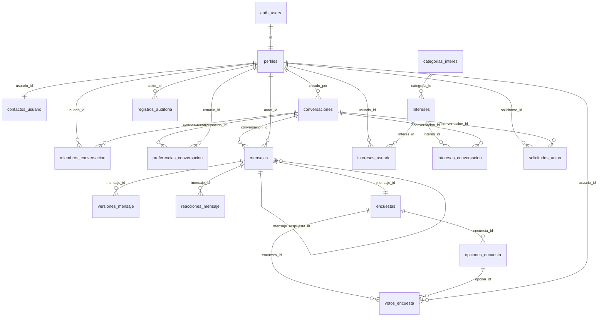

# Chatly — Modelo de datos

> **Estado:** diseño cerrado; `perfiles` y `contactos_usuario` implementadas (migración `0002_perfiles`). Las migraciones `0013_descubrimiento_social` y `0014_social_cron` están pendientes de implementar y probar.
> **Motor:** Supabase PostgreSQL (PostgreSQL 15+).
> **Migraciones:** Alembic, plantilla asíncrona.
> **Reglas de origen:** registro funcional consolidado `docs/chatly.md` (Q1–Q179). La ampliación social se implementa incrementalmente en las migraciones `0013_descubrimiento_social` y `0014_social_cron`.
> **Alcance:** define tablas, columnas, restricciones, índices y reglas de acceso a nivel de diseño. La matriz completa de políticas se detalla en `authorization-matrix.md`.

---

## 1. Convenciones

| Tema | Decisión |
|---|---|
| Nombres | **Tablas y columnas en español**; clases, funciones y variables de Python en inglés (AGENTS.md) |
| Claves primarias | `uuid` con `gen_random_uuid()` (nativo en PostgreSQL 13+); `registros_auditoria` usa `bigint generated always as identity` |
| Fechas | `timestamptz` siempre; nunca `timestamp` sin zona |
| Texto | `text` con `check` de longitud cuando la regla existe; no `varchar(n)` arbitrario |
| Enumeraciones | `text` + `check` (no tipos `enum`, para evitar migraciones rígidas) |
| Borrado lógico | `eliminado_en timestamptz`; las consultas normales filtran `eliminado_en is null` |
| Normalización | Alias y correo se guardan en minúsculas; los textos de comparación se comparan con `lower(btrim(...))` |
| Nombres de constraints | `pk_`, `fk_`, `uq_`, `ck_`, `ix_` mediante `naming_convention` de SQLAlchemy |
| Zona horaria | Toda la app opera en UTC y formatea en español en la capa de presentación |
| Propietario | Las tablas pertenecen al rol de migraciones; la app usa `chatly_app`, sin `BYPASSRLS` |

Los valores de catálogo de las tablas futuras siguen escritos en inglés (`direct`, `group`, `admin`, `member`, `text`, `system`, `poll`, `open`, `closed`). `genero` ya está implementado en español (`femenino`, `masculino`). Unificar el resto queda como decisión pendiente del equipo.

---

## 2. Diagrama entidad-relación



`auth.users` es gestionado por Supabase Auth. Alembic **no** crea ni altera sus columnas; solo añade como máximo un trigger de sincronización (sección 9.1).

---

## 3. `perfiles`

Perfil público de cada usuario. Se crea al registrarse y se sincroniza con `auth.users`.

```sql
create table public.perfiles (
    id                   uuid primary key references auth.users (id) on delete cascade,
    alias                text        not null,
    nombre_visible       text        not null,
    ruta_avatar          text,
    fecha_nacimiento     date        not null,
    genero               text        not null,
    correo_verificado_en timestamptz,
    alias_cambiado_en    timestamptz,
    eliminado_en         timestamptz,
    creado_en            timestamptz not null default now(),
    actualizado_en       timestamptz not null default now(),

    constraint ck_perfiles_formato_alias
        check (alias ~ '^[a-z][a-z0-9_]{2,19}$'),
    constraint ck_perfiles_alias_minusculas
        check (alias = lower(alias)),
    constraint ck_perfiles_longitud_nombre
        check (char_length(btrim(nombre_visible)) between 2 and 60),
    constraint ck_perfiles_genero
        check (genero in ('femenino','masculino')),
    constraint ck_perfiles_fecha_plausible
        check (fecha_nacimiento between date '1900-01-01' and date '2100-12-31')
);

create unique index uq_perfiles_alias on public.perfiles (lower(alias));
create index ix_perfiles_alias_prefijo on public.perfiles (lower(alias) text_pattern_ops)
    where eliminado_en is null;
create index ix_perfiles_activos on public.perfiles (id) where eliminado_en is null;
```

### Campos nuevos obligatorios (Q109, Q110)

| Campo | Tipo | Regla |
|---|---|---|
| `fecha_nacimiento` | `date` | Obligatorio. Edad 18–120 años. Se edita en el perfil. La edad **no se almacena**. |
| `genero` | `text` | Obligatorio. Catálogo cerrado: `femenino` o `masculino`. Sin opción «prefiero no decir». |

**Reglas confirmadas:** `fecha_nacimiento` y `genero` se exigen **en el registro**; sin ambos no se completa el alta y ambas columnas permanecen `NOT NULL`. La edad y el género son visibles para **cualquier usuario autenticado y verificado** en el perfil, **nunca** en los resultados de búsqueda (Q56) ni en la lista de participantes de un grupo.

**Por qué se guarda `fecha_nacimiento` y no `edad`:**
- Un campo generado `stored` no puede usar `current_date`, porque la expresión no es inmutable; PostgreSQL lo rechaza.
- Un `check` tampoco puede usar `current_date` por el mismo motivo.
- Guardar la edad obligaría a recalcularla cada cumpleaños con un proceso programado.
- `fecha_nacimiento` es la fuente de verdad; la edad se deriva al leer.

**Cálculo de la edad** — se resta el año y se ajusta si el cumpleaños aún no ocurrió:

```sql
-- SQL: años cumplidos, respetando mes y día
date_part('year', age(current_date, fecha_nacimiento))::int as edad
```

```python
# Python: misma semántica, sin depender de la base
def calculate_age(birth_date: date, today: date | None = None) -> int:
    today = today or date.today()
    years = today.year - birth_date.year
    if (today.month, today.day) < (birth_date.month, birth_date.day):
        years -= 1
    return years
```

Para el 29 de febrero, en años no bisiestos se considera cumplido el 1 de marzo (comportamiento de `age()`).

**Vista pública con edad calculada:**

```sql
create view app.perfiles_publicos
with (security_invoker = true) as
select
    p.id,
    p.alias,
    p.nombre_visible,
    p.ruta_avatar,
    date_part('year', age(current_date, p.fecha_nacimiento))::int as edad,
    p.genero,
    p.creado_en
from public.perfiles p
where p.eliminado_en is null;
```

La vista vive en el esquema no expuesto `app` y la usa únicamente el backend con el rol `chatly_app`, que tiene `select` sobre `perfiles`. El navegador nunca consulta `perfiles` ni esta vista: recibe nombre, alias, avatar, edad y género a través de la API. No se expone `fecha_nacimiento`; la fecha exacta solo se devuelve en el perfil propio.

**Validación de rango de edad** (los `check` no pueden usar `current_date`): trigger `BEFORE INSERT OR UPDATE OF fecha_nacimiento`.

```sql
create or replace function public.validar_fecha_nacimiento_perfil()
returns trigger language plpgsql as $$
declare
    v_edad int := date_part('year', age(current_date, new.fecha_nacimiento))::int;
begin
    if new.fecha_nacimiento > current_date then
        raise exception 'La fecha de nacimiento no puede ser futura' using errcode = '23514';
    end if;
    if v_edad < 18 or v_edad > 120 then
        raise exception 'La edad debe estar entre 18 y 120 años' using errcode = '23514';
    end if;
    return new;
end $$;

create trigger trg_perfiles_fecha_nacimiento
    before insert or update of fecha_nacimiento on public.perfiles
    for each row execute function public.validar_fecha_nacimiento_perfil();
```

**Reglas adicionales**

- `alias`: 3–20 caracteres, empieza por letra, admite letras, números y `_`; se guarda normalizado en minúsculas; único global (Q57, Q50).
- Cambio de alias: máximo uno cada 30 días (Q107). El servicio compara `now() - alias_cambiado_en >= interval '30 days'`; el valor anterior queda libre de inmediato (Q103) y el cambio se audita.
- `nombre_visible`: nombre visible en los resultados de búsqueda (Q56). Obligatorio en el registro, 2–60 caracteres, editable en cualquier momento y **no único**; el alias es lo que diferencia a los usuarios (Q111).
- Búsqueda por alias: se dispara con al menos **2 caracteres**, sin distinguir mayúsculas, y **excluye al propio usuario** de los resultados (Q112, extensión de Q7).
- `ruta_avatar`: ruta del objeto vigente en el bucket privado. Los archivos anteriores se conservan en Storage pero no se referencian (Q80).
- `correo_verificado_en`: espejo de `auth.users.email_confirmed_at`; es la fuente que consultan servicios y RLS para bloquear funciones de chat (Q15).
- `eliminado_en`: aunque la V1 no permite eliminar cuentas (Q42), el campo mantiene coherencia con el borrado lógico (Q31).

---

## 4. `contactos_usuario`

Correo normalizado, separado del perfil público (Q73).

```sql
create table public.contactos_usuario (
    usuario_id         uuid primary key references public.perfiles (id) on delete cascade,
    correo_normalizado text        not null,
    creado_en          timestamptz not null default now(),
    actualizado_en     timestamptz not null default now(),

    constraint ck_contactos_correo_minusculas
        check (correo_normalizado = lower(btrim(correo_normalizado))),
    constraint uq_contactos_correo unique (correo_normalizado)
);
```

- `ENABLE ROW LEVEL SECURITY` **sin política de `select`**: ni el navegador ni `chatly_app` pueden leerla directamente.
- Solo se permite al backend escribir el espejo del correo:

```sql
alter table public.contactos_usuario enable row level security;

create policy contactos_alta_backend on public.contactos_usuario
    for insert to chatly_app
    with check (usuario_id = (select app.current_actor_id()));

create policy contactos_actualizacion_backend on public.contactos_usuario
    for update to chatly_app
    using (usuario_id = (select app.current_actor_id()))
    with check (usuario_id = (select app.current_actor_id()));
```

- La lectura ocurre exclusivamente por la función `security definer` de más abajo, que devuelve solo datos públicos.

```sql
create or replace function app.buscar_usuario_por_correo(p_correo text)
returns table (usuario_id uuid, alias text, nombre_visible text, ruta_avatar text)
language sql
security definer
set search_path = app, public, pg_temp
as $$
    select p.id, p.alias, p.nombre_visible, p.ruta_avatar
    from public.contactos_usuario c
    join public.perfiles p on p.id = c.usuario_id
    where app.current_actor_id() is not null
      and p.id <> app.current_actor_id()
      and c.correo_normalizado = lower(btrim(p_correo))
      and p.eliminado_en is null;
$$;

revoke all on function app.buscar_usuario_por_correo(text) from public;
grant execute on function app.buscar_usuario_por_correo(text) to chatly_app;
```

- La función vive en el esquema **no expuesto** `app`, revoca `EXECUTE` de `PUBLIC`, exige contexto de actor (`app.current_actor_id() is not null`) y solo se concede al rol del backend. Cumple las tres precauciones de Supabase para `SECURITY DEFINER`.
- La función nunca devuelve el correo (Q19, Q56).
- Búsqueda por alias: consulta del backend contra `app.perfiles_publicos` con `lower(alias) like 'prefijo%'`, mínimo 2 caracteres y excluyendo al actor (Q112).

---

## 5. `conversaciones`

Una sola tabla para privadas y grupales (Q64).

```sql
create table public.conversaciones (
    id                    uuid primary key default gen_random_uuid(),
    tipo                  text        not null,
    nombre                text,
    creado_por            uuid        not null references public.perfiles (id),
    administrador_id      uuid        references public.perfiles (id),
    usuario_directo_menor uuid        references public.perfiles (id),
    usuario_directo_mayor uuid        references public.perfiles (id),
    archivada             boolean     not null default false,
    archivada_en          timestamptz,
    ultimo_mensaje_en     timestamptz,
    eliminado_en          timestamptz,
    creado_en             timestamptz not null default now(),
    actualizado_en        timestamptz not null default now(),

    constraint ck_conversaciones_tipo check (tipo in ('direct','group')),
    constraint ck_conversaciones_forma check (
        (tipo = 'direct'
            and usuario_directo_menor is not null
            and usuario_directo_mayor is not null
            and usuario_directo_menor < usuario_directo_mayor
            and nombre is null)
        or
        (tipo = 'group'
            and usuario_directo_menor is null
            and usuario_directo_mayor is null
            and nombre is not null)
    ),
    constraint ck_conversaciones_nombre_grupo check (
        tipo <> 'group' or char_length(btrim(nombre)) between 3 and 40
    ),
    constraint ck_conversaciones_archivo check (
        (archivada and archivada_en is not null)
        or (not archivada and archivada_en is null)
    )
);

create unique index uq_conversaciones_par_directo
    on public.conversaciones (usuario_directo_menor, usuario_directo_mayor)
    where tipo = 'direct';

create index ix_conversaciones_actividad
    on public.conversaciones (ultimo_mensaje_en desc nulls last)
    where eliminado_en is null;

create index ix_conversaciones_creado_por on public.conversaciones (creado_por);
create index ix_conversaciones_administrador on public.conversaciones (administrador_id);

-- Necesario para la FK compuesta que impide solicitudes de unión a conversaciones directas.
create unique index uq_conversaciones_id_tipo
    on public.conversaciones (id, tipo);
```

**Reglas**

- Conversación privada única por pareja (Q20): índice único parcial sobre la pareja ordenada. El servicio guarda siempre `least(a,b)` y `greatest(a,b)`.
- Grupos: nombre 3–40, sin recortes sobrantes; solo el administrador puede cambiarlo (Q46, Q87).
- `administrador_id` se replica para consultas rápidas, pero la autoridad real se valida con la membresía activa con rol `admin` (ver `miembros_conversacion`). Ambas fuentes se mantienen en la misma transacción.
- `ultimo_mensaje_en` se actualiza por trigger al insertar un mensaje visible; sirve para ordenar la lista por actividad (Q95).
- Archivo definitivo al salir el último integrante (Q45, Q91); no se reactiva. `eliminado_en` queda reservado para un borrado lógico administrativo.
- Límite de 10 integrantes (Q8): se valida en servicio dentro de una transacción con `SELECT ... FOR UPDATE` sobre la fila de `conversaciones`, lo que serializa las incorporaciones concurrentes. Un `check` no puede contar filas.

---

## 6. `miembros_conversacion`

Periodos históricos de pertenencia (Q35, Q36, Q58).

```sql
create table public.miembros_conversacion (
    id                      uuid primary key default gen_random_uuid(),
    conversacion_id         uuid        not null references public.conversaciones (id) on delete cascade,
    usuario_id              uuid        not null references public.perfiles (id),
    rol                     text        not null default 'member',
    estado                  text        not null default 'active',
    unido_en                timestamptz not null default now(),
    salido_en               timestamptz,
    agregado_por            uuid        references public.perfiles (id),
    retirado_por            uuid        references public.perfiles (id),
    ultimo_mensaje_leido_id uuid,       -- FK se añade en la migración 0004 (mensajes)
    ultimo_leido_en         timestamptz,
    creado_en               timestamptz not null default now(),
    actualizado_en          timestamptz not null default now(),

    constraint ck_miembros_rol check (rol in ('admin','member')),
    constraint ck_miembros_estado check (estado in ('active','left','removed')),
    constraint ck_miembros_periodo check (
        (salido_en is null and estado = 'active')
        or (salido_en is not null and estado in ('left','removed'))
    ),
    constraint ck_miembros_salida check (salido_en is null or salido_en >= unido_en)
);

-- Una sola membresía activa por usuario y conversación (Q58, Q86)
create unique index uq_miembros_activos
    on public.miembros_conversacion (conversacion_id, usuario_id)
    where salido_en is null;

-- Un solo administrador activo por grupo (Q8, Q47)
create unique index uq_miembros_un_admin
    on public.miembros_conversacion (conversacion_id)
    where rol = 'admin' and salido_en is null;

create index ix_miembros_usuario_periodo
    on public.miembros_conversacion (usuario_id, conversacion_id, unido_en);
create index ix_miembros_conversacion
    on public.miembros_conversacion (conversacion_id, unido_en);
create index ix_miembros_busqueda_politica
    on public.miembros_conversacion (conversacion_id, usuario_id, unido_en)
    include (salido_en);
create index ix_miembros_ultimo_leido
    on public.miembros_conversacion (conversacion_id, usuario_id, ultimo_leido_en);
```

**Reglas**

- Cada entrada crea una fila nueva; cada salida o expulsión fija `salido_en` y `estado`. Reincorporarse crea un periodo nuevo (Q36, Q98).
- `agregado_por` / `retirado_por` registran quién añadió o expulsó (auditoría funcional).
- `ultimo_mensaje_leido_id` + `ultimo_leido_en`: se guarda el último mensaje leído por periodo (Q67). `ultimo_leido_en` es una desnormalización del `creado_en` de ese mensaje para evitar un `join` en cada cálculo de no leídos y de ✓✓.
- `ultimo_mensaje_leido_id` no puede declararse en la creación de la tabla porque `mensajes` aún no existe. La FK se añade con `ALTER TABLE` en la migración `0004_mensajes`:

```sql
alter table public.miembros_conversacion
    add constraint fk_miembros_ultimo_leido
    foreign key (ultimo_mensaje_leido_id) references public.mensajes (id);
```
- Salida del administrador: el servicio asigna `rol = 'admin'` al integrante activo con `unido_en` más antiguo, en la misma transacción (Q21, Q47).
- «Salir y eliminar» no borra la membresía ni el grupo: fija `salido_en` y marca la preferencia de ocultación (Q30).
- Al salir el último integrante: se archiva la conversación, se cierran las encuestas abiertas y `administrador_id` queda en `null` (Q45, Q63).

---

## 7. `preferencias_conversacion`

Preferencia individual de ocultación (Q59, Q68).

```sql
create table public.preferencias_conversacion (
    conversacion_id uuid        not null references public.conversaciones (id) on delete cascade,
    usuario_id      uuid        not null references public.perfiles (id),
    oculta          boolean     not null default false,
    ocultada_en     timestamptz,
    creado_en       timestamptz not null default now(),
    actualizado_en  timestamptz not null default now(),

    primary key (conversacion_id, usuario_id),
    constraint ck_preferencias_ocultada_en check (oculta = (ocultada_en is not null))
);

create index ix_preferencias_usuario_oculta
    on public.preferencias_conversacion (usuario_id, oculta);
```

- Ocultar es individual y no altera la conversación de los demás (Q30, Q68).
- Un mensaje nuevo o una acción propia desmarcan `oculta` (Q76, Q105).
- La preferencia no impide acceder al historial si el usuario vuelve a abrir el chat (Q105).

---

## 8. `mensajes`

```sql
create table public.mensajes (
    id                   uuid primary key default gen_random_uuid(),
    conversacion_id      uuid        not null references public.conversaciones (id) on delete cascade,
    autor_id             uuid        references public.perfiles (id),
    tipo                 text        not null default 'text',
    contenido            text,
    evento_sistema       text,
    datos_evento         jsonb,
    mensaje_respuesta_id uuid,
    id_mensaje_cliente   uuid,
    editado_en           timestamptz,
    conteo_ediciones     integer     not null default 0,
    eliminado_en         timestamptz,
    eliminado_por        uuid        references public.perfiles (id),
    creado_en            timestamptz not null default now(),
    actualizado_en       timestamptz not null default now(),

    constraint ck_mensajes_tipo check (tipo in ('text','system','poll')),
    constraint ck_mensajes_contenido check (
        (tipo = 'text'
            and autor_id is not null
            and contenido is not null
            and char_length(btrim(contenido)) between 1 and 4000
            and evento_sistema is null)
        or (tipo = 'system'
            and autor_id is null
            and contenido is null
            and evento_sistema is not null)
        or (tipo = 'poll'
            and autor_id is not null
            and contenido is null
            and evento_sistema is null)
    ),
    constraint ck_mensajes_evento_sistema check (
        evento_sistema is null
        or evento_sistema in ('conversation_created','member_added','member_removed',
                              'member_left','admin_changed','name_changed')
    ),
    constraint ck_mensajes_ediciones check (conteo_ediciones >= 0),
    constraint ck_mensajes_sin_auto_respuesta check (
        mensaje_respuesta_id is null or mensaje_respuesta_id <> id
    ),

    constraint uq_mensajes_conversacion_id unique (conversacion_id, id),
    constraint fk_mensajes_respuesta
        foreign key (conversacion_id, mensaje_respuesta_id)
        references public.mensajes (conversacion_id, id)
);

create unique index uq_mensajes_id_cliente
    on public.mensajes (autor_id, id_mensaje_cliente)
    where id_mensaje_cliente is not null;

create index ix_mensajes_conversacion_cursor
    on public.mensajes (conversacion_id, creado_en desc, id desc);

create index ix_mensajes_visibles
    on public.mensajes (conversacion_id, creado_en desc, id desc)
    where eliminado_en is null;

create index ix_mensajes_respuesta on public.mensajes (mensaje_respuesta_id)
    where mensaje_respuesta_id is not null;

create index ix_mensajes_autor on public.mensajes (autor_id, creado_en desc);
```

**Reglas**

- Máximo 4.000 caracteres y saltos de línea permitidos (Q51). El `check` no recorta el contenido: solo comprueba que no sea solo espacios.
- Tipos: `text` (persona), `system` (eventos automáticos, Q100) y `poll` (encuesta, Q65). Los mensajes de sistema no tienen `autor_id` ni contenido editable.
- Edición: el servicio inserta la versión anterior en `versiones_mensaje` y actualiza `contenido`, `editado_en` y `conteo_ediciones` (Q11, Q33, Q66).
- Borrado: `eliminado_en` + `eliminado_por`; las consultas normales no devuelven `contenido` (Q85). Se conserva el registro y la versión vigente en `versiones_mensaje`.
- Respuesta: `mensaje_respuesta_id` con FK compuesta que garantiza que el mensaje citado pertenece a la misma conversación. Si el original se elimina, la referencia se muestra como «Se eliminó un mensaje» (Q75).
- Idempotencia offline: `id_mensaje_cliente` único por autor; el reenvío usa `on conflict do nothing` y devuelve el mensaje ya existente (Q40).
- Orden estable: `(creado_en, id)`; el cursor de paginación es la pareja `(creado_en, id)` del último mensaje cargado (Q94).
- `datos_evento` guarda el contexto del evento (por ejemplo `{"added_user_id": "...", "by": "..."}`); los mensajes de sistema cuentan para no leídos y para ✓✓ (Q106).
- Q100 enumera seis eventos: creación, incorporación, expulsión, salida, cambio de administrador y cambio de nombre. **No** se genera mensaje de sistema al archivar el grupo; el archivo se refleja solo en el estado de la conversación, salvo confirmación expresa del equipo.

**Trigger de actividad**

```sql
create or replace function public.tocar_actividad_conversacion()
returns trigger language plpgsql as $$
begin
    update public.conversaciones
       set ultimo_mensaje_en =
               greatest(coalesce(ultimo_mensaje_en, new.creado_en), new.creado_en),
           actualizado_en = now()
     where id = new.conversacion_id;
    return new;
end $$;

create trigger trg_mensajes_tocar_actividad
after insert on public.mensajes
for each row execute function public.tocar_actividad_conversacion();
```

El trigger no se dispara en ediciones ni borrados: el orden de la lista se rige por el mensaje más reciente (Q95).

---

## 9. `versiones_mensaje`

Historial de ediciones (Q33, Q66).

```sql
create table public.versiones_mensaje (
    id          uuid primary key default gen_random_uuid(),
    mensaje_id  uuid        not null references public.mensajes (id) on delete cascade,
    contenido   text        not null,
    editado_por uuid        not null references public.perfiles (id),
    creado_en   timestamptz not null default now(),

    constraint ck_versiones_mensaje_contenido
        check (char_length(btrim(contenido)) between 1 and 4000)
);

create index ix_versiones_mensaje_mensaje
    on public.versiones_mensaje (mensaje_id, creado_en desc);
```

- Se inserta una fila con el contenido **anterior** antes de cada edición (no se guarda como JSON dentro de `mensajes`).
- No hay interfaz de consulta en V1 (Q33); la tabla existe para trazabilidad.

---

## 10. `reacciones_mensaje`

```sql
create table public.reacciones_mensaje (
    id             uuid primary key default gen_random_uuid(),
    mensaje_id     uuid        not null references public.mensajes (id) on delete cascade,
    usuario_id     uuid        not null references public.perfiles (id),
    emoji          text        not null,
    eliminado_en   timestamptz,
    creado_en      timestamptz not null default now(),
    actualizado_en timestamptz not null default now(),

    constraint ck_reacciones_emoji
        check (emoji in ('👍','❤️','😂','😮','😢','🙏','✅'))
);

-- Una sola reacción vigente por usuario y mensaje (Q12, Q70)
create unique index uq_reacciones_activas
    on public.reacciones_mensaje (mensaje_id, usuario_id)
    where eliminado_en is null;

create index ix_reacciones_mensaje on public.reacciones_mensaje (mensaje_id)
    where eliminado_en is null;
```

- Cambiar de emoji actualiza la fila vigente; quitar la reacción fija `eliminado_en`.
- El conjunto de emojis es cerrado (Q12). `❤️` incluye el selector de variación; el frontend debe enviar exactamente el mismo valor.
- Las reacciones de antiguos integrantes no se pueden crear ni modificar; solo se muestran dentro de sus periodos visibles (Q104).

---

## 11. `encuestas`, `opciones_encuesta`, `votos_encuesta`

### 11.1 `encuestas`

```sql
create table public.encuestas (
    id              uuid primary key default gen_random_uuid(),
    mensaje_id      uuid        not null unique,
    conversacion_id uuid        not null references public.conversaciones (id) on delete cascade,
    creada_por      uuid        not null references public.perfiles (id),
    pregunta        text        not null,
    estado          text        not null default 'open',
    cerrada_en      timestamptz,
    cerrada_por     uuid        references public.perfiles (id),
    eliminado_en    timestamptz,
    creado_en       timestamptz not null default now(),
    actualizado_en  timestamptz not null default now(),

    constraint ck_encuestas_pregunta
        check (char_length(btrim(pregunta)) between 5 and 200),
    constraint ck_encuestas_estado check (estado in ('open','closed')),
    constraint ck_encuestas_cerrada
        check ((estado = 'open' and cerrada_en is null)
            or (estado = 'closed' and cerrada_en is not null)),
    constraint fk_encuestas_mensaje
        foreign key (conversacion_id, mensaje_id)
        references public.mensajes (conversacion_id, id)
        on delete cascade
);

create index ix_encuestas_conversacion on public.encuestas (conversacion_id, estado);
create index ix_encuestas_creada_por on public.encuestas (creada_por);
```

- La encuesta siempre cuelga de un mensaje `poll`; `mensaje_id` único evita duplicados (Q65).
- `conversacion_id` se replica para consultas y RLS.
- Editable solo por el creador y solo antes del primer voto (Q88, Q92). Se valida en servicio y se refuerza con la política de `update`.

### 11.2 `opciones_encuesta`

```sql
create table public.opciones_encuesta (
    id          uuid primary key default gen_random_uuid(),
    encuesta_id uuid        not null references public.encuestas (id) on delete cascade,
    texto       text        not null,
    posicion    smallint    not null,
    creado_en   timestamptz not null default now(),

    constraint ck_opciones_encuesta_texto
        check (char_length(btrim(texto)) between 1 and 80),
    constraint ck_opciones_encuesta_posicion check (posicion between 1 and 5),
    constraint uq_opciones_encuesta_posicion unique (encuesta_id, posicion),
    constraint uq_opciones_encuesta_id_encuesta unique (id, encuesta_id)
);

create unique index uq_opciones_encuesta_texto
    on public.opciones_encuesta (encuesta_id, lower(btrim(texto)));
```

- Entre 2 y 5 opciones (Q88): el mínimo y el máximo se validan en servicio al crear o editar; el `check` de `posicion` acota el máximo por fila.
- Sin duplicados ignorando mayúsculas y espacios: índice único por expresión.
- Tras el primer voto las opciones quedan bloqueadas (Q88).

### 11.3 `votos_encuesta`

```sql
create table public.votos_encuesta (
    id             uuid primary key default gen_random_uuid(),
    encuesta_id    uuid        not null references public.encuestas (id) on delete cascade,
    opcion_id      uuid        not null,
    usuario_id     uuid        not null references public.perfiles (id),
    creado_en      timestamptz not null default now(),
    actualizado_en timestamptz not null default now(),

    constraint uq_votos_encuesta_usuario unique (encuesta_id, usuario_id),
    constraint fk_votos_encuesta_opcion
        foreign key (opcion_id, encuesta_id)
        references public.opciones_encuesta (id, encuesta_id)
);

create index ix_votos_encuesta_opcion on public.votos_encuesta (opcion_id);
create index ix_votos_encuesta_encuesta on public.votos_encuesta (encuesta_id, creado_en);
```

- Un voto vigente por usuario y encuesta (Q69); cambiar el voto actualiza `opcion_id` en la misma fila.
- La FK compuesta impide votar por una opción de otra encuesta.
- Los votos emitidos permanecen aunque el usuario salga o sea expulsado (Q49). El servicio impide modificarlos si ya no es miembro activo o la encuesta está cerrada.
- Cierre definitivo (Q10); al archivar el grupo se cierran todas las encuestas abiertas (Q63).
- Borrado lógico de encuesta solo antes del primer voto (Q93); si hay votos, solo se cierra.

---

## 12. `registros_auditoria`

```sql
create table public.registros_auditoria (
    id                 bigint generated always as identity primary key,
    actor_id           uuid,
    accion             text        not null,
    tipo_entidad       text        not null,
    entidad_id         uuid,
    conversacion_id    uuid,
    valores_anteriores jsonb,
    valores_nuevos     jsonb,
    creado_en          timestamptz not null default now(),

    constraint ck_auditoria_accion check (char_length(btrim(accion)) > 0),
    constraint ck_auditoria_entidad check (char_length(btrim(tipo_entidad)) > 0)
);

create index ix_auditoria_entidad
    on public.registros_auditoria (tipo_entidad, entidad_id, creado_en desc);
create index ix_auditoria_actor on public.registros_auditoria (actor_id, creado_en desc);
create index ix_auditoria_conversacion
    on public.registros_auditoria (conversacion_id, creado_en desc);
```

- Sin claves foráneas: la auditoría sobrevive a cualquier cambio de estado y no bloquea borrados.
- Solo inserción: sin políticas de `update`/`delete`; `revoke update, delete` al rol de la app.
- `valores_anteriores` y `valores_nuevos` en JSONB (Q52, Q71).
- No se auditan eventos efímeros (escritura, presencia) (Q43).
- Se escribe en la misma transacción que la operación, para que no exista un cambio sin registro.

---

## 13. Resumen de acceso (RLS)

Las políticas completas se documentan en `authorization-matrix.md`. Resumen por tabla:

| Tabla | Lectura | Escritura |
|---|---|---|
| `perfiles` | Solo backend (`chatly_app`); el navegador no consulta la tabla ni la vista | Solo backend; el perfil propio pasa por el servicio |
| `contactos_usuario` | Nadie directamente; solo `buscar_usuario_por_correo` | Servicio, en la misma transacción del perfil |
| `conversaciones` | Quien tenga al menos un periodo de membresía | Creación por el actor; edición por el administrador activo |
| `miembros_conversacion` | Miembros con cualquier periodo en esa conversación | Servicio; el administrador añade/expulsa, el usuario sale |
| `preferencias_conversacion` | Solo el propio usuario | Solo el propio usuario |
| `mensajes` | Miembros cuyo periodo cubre `creado_en` | Miembros activos; edición/borrado solo del autor activo |
| `versiones_mensaje` | Solo backend (`chatly_app`) | Solo backend |
| `reacciones_mensaje` | Miembros cuyo periodo cubre el mensaje | Miembro activo, solo su reacción |
| `encuestas` | Miembros con periodo visible | Miembro activo; edición/cierre según Q88–Q108 |
| `opciones_encuesta` | Igual que `encuestas` | Solo backend, validado por servicio |
| `votos_encuesta` | Igual que `encuestas` | Miembro activo mientras la encuesta esté abierta |
| `categorias_interes`, `intereses` | Solo backend; lectura servida por API | Solo administración del catálogo mediante migraciones/datos de aplicación |
| `intereses_usuario` | Solo backend; nunca se consulta directamente desde el navegador | Servicio autenticado; solo modifica los intereses del actor |
| `intereses_conversacion` | Solo backend; la API filtra por descubribilidad | Solo administrador activo del grupo a través del servicio |
| `solicitudes_union` | Solo backend; actor solicitante o administrador del grupo según operación | Servicio; actor autenticado crea su solicitud y administrador resuelve la de su grupo |
| `registros_auditoria` | Nadie desde la app (solo herramientas administrativas) | Solo backend, insert |

- El navegador no recibe `select` sobre `perfiles` ni sobre `app.perfiles_publicos`; ambas son de uso del backend. Los datos públicos del perfil se sirven por la API y `fecha_nacimiento` solo aparece en la respuesta del perfil propio.

**Función de identidad y contexto**

```sql
create or replace function app.current_actor_id() returns uuid
language sql
stable
security definer
set search_path = public, pg_temp
as $$
    select coalesce(
        auth.uid(),
        nullif(current_setting('app.current_user_id', true), '')::uuid
    );
$$;
```

Reglas de operación:

- El backend fija `set_config('app.current_user_id', :uid, true)` dentro de cada transacción.
- El registro crea el usuario en Supabase Auth y fija `app.current_user_id` al id recién creado dentro de la transacción, para insertar `perfiles`, `contactos_usuario` e `intereses_usuario`. El id no proviene del cliente.
- El rol `chatly_app` no tiene `BYPASSRLS` ni es propietario de las tablas.
- Las políticas compartidas se declaran `TO authenticated, chatly_app` y exigen `app.current_actor_id()`; las exclusivas del backend, `TO chatly_app`. Las funciones de membresía y `app.current_actor_id()` son `security definer` para evitar la recursión de RLS y resolver `auth.uid()` sin heredar `authenticated` (ver `authorization-matrix.md` §3.1).
- `chatly_app` no hereda `authenticated`: se le revoca la membresía y solo recibe los `EXECUTE` y privilegios explícitos de §9.2 de la matriz.
- Para tablas exclusivas del backend (`contactos_usuario`, `versiones_mensaje`, `categorias_interes`, `intereses`, `intereses_usuario`, `intereses_conversacion`, `solicitudes_union`, `registros_auditoria`) las políticas se declaran `TO chatly_app`. El servicio aplica las comprobaciones de actor, visibilidad y membresía antes de devolver datos sociales.
- Se revocan privilegios innecesarios de `anon` y `authenticated` sobre tablas que el navegador no debe tocar.
- **Entorno de pruebas:** una base local no tiene el esquema `auth` de Supabase. Las pruebas crean un esquema mínimo `auth` con `auth.uid()` devolviendo `null`, de modo que todo el flujo dependa de `app.current_user_id` y se pueda verificar el aislamiento entre transacciones.

---

## 14. Consultas clave

### 14.1 Lista de conversaciones con último mensaje y no leídos

```sql
select
    c.id,
    c.tipo,
    c.nombre,
    c.ultimo_mensaje_en,
    (
        select count(*)
        from public.mensajes m
        where m.conversacion_id = c.id
          and m.eliminado_en is null
          and m.autor_id is distinct from :usuario_id
          and m.creado_en > coalesce(mem.ultimo_leido_en, mem.unido_en)
    ) as no_leidos
from public.conversaciones c
join public.miembros_conversacion mem
  on mem.conversacion_id = c.id
 and mem.usuario_id = :usuario_id
 and mem.salido_en is null
where c.eliminado_en is null
order by c.ultimo_mensaje_en desc nulls last;
```

Los mensajes de sistema (`autor_id` nulo) sí cuentan como no leídos gracias a `is distinct from` (Q106).

### 14.2 Paginación por cursor

```sql
-- Primera carga: últimos 50
select *
from public.mensajes
where conversacion_id = :cid
  and eliminado_en is null
order by creado_en desc, id desc
limit 50;

-- Páginas anteriores: 30 usando el cursor de la primera fila cargada
select *
from public.mensajes
where conversacion_id = :cid
  and eliminado_en is null
  and (creado_en, id) < (:cursor_creado_en, :cursor_id)
order by creado_en desc, id desc
limit 30;
```

### 14.3 ✓✓ (todos los elegibles leyeron)

```sql
select not exists (
    select 1
    from public.miembros_conversacion m, public.mensajes msg
    where msg.id = :mensaje_id
      and m.conversacion_id = msg.conversacion_id
      and m.usuario_id is distinct from msg.autor_id
      and m.unido_en <= msg.creado_en
      and (m.salido_en is null or m.salido_en > msg.creado_en)
      -- no leyó
      and (m.ultimo_leido_en is null or m.ultimo_leido_en < msg.creado_en)
      -- pero sigue contando: está activo o leyó antes de irse
      and (m.salido_en is null or m.ultimo_leido_en >= msg.creado_en)
) as todos_leyeron;
```

Cumple Q22, Q48 y Q104: no cuentan los nuevos integrantes, y quien se va sin leer deja de bloquear.

### 14.4 Resultado de encuesta con votantes

```sql
select
    o.id,
    o.texto,
    count(v.id) as votos,
    array_agg(v.usuario_id) filter (where v.usuario_id is not null) as votantes
from public.opciones_encuesta o
left join public.votos_encuesta v on v.opcion_id = o.id
where o.encuesta_id = :encuesta_id
group by o.id, o.texto, o.posicion
order by o.posicion;
```

---

## 15. Migraciones (orden propuesto)

| Revisión | Contenido |
|---|---|
| `0001_infra` | Esquema `app`, función `current_actor_id()`, convenciones y extensiones necesarias |
| `0002_perfiles` | `perfiles`, `contactos_usuario`, vista `app.perfiles_publicos`, trigger de edad, función `app.buscar_usuario_por_correo` **(aplicada)** |
| `0003_conversaciones` | `conversaciones`, `miembros_conversacion`, `preferencias_conversacion` |
| `0004_mensajes` | `mensajes`, `versiones_mensaje`, `reacciones_mensaje`, trigger de actividad y FK `miembros_conversacion.ultimo_mensaje_leido_id` |
| `0005_identidad_rol` | `app.current_actor_id()` `SECURITY DEFINER`, `revoke authenticated from chatly_app` y `noinherit` |
| `0005a_alias_exists` | Función `app.alias_exists(text)` `SECURITY DEFINER` para comprobar el alias antes del registro |
| `0005b_intereses` | Catálogo de intereses (`categorias_interes`, `intereses`), selección personal (`intereses_usuario`), `perfiles.visibilidad_publica`, `app.catalogo_intereses()` `SECURITY DEFINER`, RLS y grants **(aplicada)** |
| `0006_encuestas` | `encuestas`, `opciones_encuesta`, `votos_encuesta` |
| `0007_auditoria` | `registros_auditoria` |
| `0008_rls` | Políticas del resto de tablas y `security_invoker` de la vista |
| `0009_grants` | Rol `chatly_app`, privilegios mínimos, `revoke` de `anon`/`authenticated` |
| `0010_realtime` | Publicación `supabase_realtime` y políticas de `realtime.messages` |
| `0011_storage` | Bucket `avatars`, políticas de Storage y límites de tamaño/tipo |
| `0012_auth_sync` | Trigger de sincronización de `correo_verificado_en` (con guardia si `auth.users` no existe) |
| `0013_descubrimiento_social` | Descubribilidad y descripción de grupos, intereses de grupos (`intereses_conversacion`), solicitudes de unión, índices, reglas transaccionales, RLS y grants |
| `0014_social_cron` | Extensión `pg_cron`, función `app.publish_social_event(...)` y programación de `app.expire_pending_join_requests()` cada 15 minutos como `chatly_app` |

Cada migración incluye su prueba de `upgrade`/`downgrade` y se revisa por dos integrantes (A y B).

---

## 16. Decisiones nuevas sobre identidad y perfil

### 16.1 Decisiones incorporadas

**Q109 — Edad del usuario**
Se almacena `perfiles.fecha_nacimiento` (obligatorio) y la edad se calcula al leer restando el año y ajustando mes y día. No se almacena `edad`. Rango permitido: **18–120 años**, validado en servicio y por trigger. Se exige en el registro, es editable desde el perfil y queda auditado. Se muestra solo en el perfil y solo a usuarios autenticados y verificados.

**Q110 — Género del usuario**
Se almacena `perfiles.genero` (obligatorio) con catálogo cerrado a **`femenino`** y **`masculino`**. Se exige en el registro, es editable desde el perfil y queda auditado. Se muestra solo en el perfil y solo a usuarios autenticados y verificados.

**Q111 — Nombre visible**
`perfiles.nombre_visible` es obligatorio en el registro, admite 2–60 caracteres, es editable en cualquier momento y no es único; la diferenciación entre usuarios recae en el alias único.

**Q112 — Búsqueda por alias**
La búsqueda se dispara con un mínimo de 2 caracteres, no distingue mayúsculas y excluye al propio usuario de los resultados. Extiende Q7 y mantiene la regla de Q19: nunca se revela el correo.

> Las decisiones Q109–Q112 ya están incorporadas en `docs/chatly.md` (sección 13), manteniendo la trazabilidad.

### 16.2 Estado de confirmación

Sin pendientes sobre edad y género. Las reglas quedaron cerradas así:

1. Visibilidad: cualquier usuario autenticado y verificado los ve en el perfil; nunca en búsqueda ni en la lista de participantes.
2. Momento: se exigen en el registro; `fecha_nacimiento` y `genero` son `NOT NULL`.
3. Rango de edad: 18–120 años.
4. Dónde se muestra la edad: solo en el perfil.
5. Nombre visible: obligatorio en el registro, 2–60 caracteres, editable y no único.
6. Búsqueda por alias: mínimo 2 caracteres y sin incluir al propio usuario.

Sin pendientes funcionales sobre el perfil.


---

## 17. Ampliación del modelo para descubrimiento social (Q113–Q179)

Esta sección agrega las estructuras necesarias para la funcionalidad social sin crear una entidad separada de «amistad» ni otro tipo de conversación. Los grupos descubribles siguen siendo filas de `conversaciones` con `tipo = 'group'`.

> **Estrategia de migración:** las tablas `perfiles` y `conversaciones` ya forman parte de migraciones anteriores. Por eso, los nuevos campos se incorporan mediante `ALTER TABLE`; no se modifica retroactivamente el contenido de `0002_perfiles` ni `0003_conversaciones`.
>
> La **visibilidad pública del perfil (§17.1)** y el **catálogo y la selección de intereses (§17.2–17.3)** se aplican en `0005b_intereses`, que ya está en producción: el registro necesita el catálogo antes de que exista la funcionalidad social completa. El resto de §17 (intereses de grupos, solicitudes de unión y sus políticas) sigue en `0013_descubrimiento_social`.

### 17.1 Visibilidad pública de perfiles

> Aplicada en `0005b_intereses` (columna `perfiles.visibilidad_publica`, índice `ix_perfiles_visibles_descubrimiento` y vista `app.perfiles_publicos` ampliada). La interfaz para cambiarla y el resto de efectos sociales llegan con `0013_descubrimiento_social`.

```sql
alter table public.perfiles
    add column visibilidad_publica boolean not null default true;

create index ix_perfiles_visibles_descubrimiento
    on public.perfiles (id)
    where eliminado_en is null and visibilidad_publica = true;

-- Extiende la vista existente; conserva sus columnas anteriores y añade la bandera social.
create or replace view app.perfiles_publicos
with (security_invoker = true) as
select
    p.id,
    p.alias,
    p.nombre_visible,
    p.ruta_avatar,
    date_part('year', age(current_date, p.fecha_nacimiento))::int as edad,
    p.genero,
    p.creado_en,
    p.visibilidad_publica
from public.perfiles p
where p.eliminado_en is null;
```

Reglas:

- El valor inicial es `true` (Q116).
- `false` excluye al usuario de recomendaciones de personas y oculta sus intereses en el perfil público.
- Nombre visible, alias y fotografía siguen disponibles mediante búsqueda directa por alias o correo (Q120, Q139).
- La visibilidad del perfil no modifica la visibilidad de los grupos administrados (Q165).
- El perfil propio devuelve siempre sus intereses; el perfil público solo los devuelve cuando `visibilidad_publica = true`.

### 17.2 Datos de catálogo: `categorias_interes` e `intereses`

> Aplicadas en `0005b_intereses`, junto con la semilla inicial del catálogo y la función `app.catalogo_intereses()` `SECURITY DEFINER` que sirve el catálogo sin sesión (el registro lo consume antes de que exista cuenta).

El catálogo es administrado mediante los datos iniciales/migraciones de la aplicación. Los usuarios no crean ni editan categorías o intereses (Q149).

```sql
create table public.categorias_interes (
    id              uuid primary key default gen_random_uuid(),
    nombre          text        not null,
    orden           integer     not null default 0,
    activa           boolean     not null default true,
    creado_en       timestamptz not null default now(),
    actualizado_en  timestamptz not null default now(),

    constraint ck_categorias_interes_nombre check (char_length(btrim(nombre)) > 0)
);

create unique index uq_categorias_interes_nombre
    on public.categorias_interes (lower(btrim(nombre)));

create table public.intereses (
    id              uuid primary key default gen_random_uuid(),
    categoria_id    uuid        not null references public.categorias_interes (id),
    nombre          text        not null,
    activo          boolean     not null default true,
    creado_en       timestamptz not null default now(),
    actualizado_en  timestamptz not null default now(),

    constraint ck_intereses_nombre check (char_length(btrim(nombre)) > 0)
);

create unique index uq_intereses_nombre
    on public.intereses (lower(btrim(nombre)));
create index ix_intereses_categoria_activos
    on public.intereses (categoria_id, nombre)
    where activo = true;
```

Las categorías ordenan la interfaz; el usuario selecciona intereses individuales. Ejemplos iniciales: Tecnología (Programación, IA, Ciberseguridad, Desarrollo web), Negocios (Marketing, Ventas, Emprendimiento), Diseño (UI/UX, Diseño gráfico, Ilustración), Entretenimiento (Música, Cine, Videojuegos) y Deportes (Fútbol, Baloncesto, Fitness) (Q163, Q178).

### 17.3 Intereses personales: `intereses_usuario`

> Tabla aplicada en `0005b_intereses`. La política de lectura de intereses de terceros (perfiles públicos) no se crea todavía: depende de `app.is_verified_actor()`, que llega con `0013_descubrimiento_social`. Hoy solo existe la selección propia.

```sql
create table public.intereses_usuario (
    usuario_id  uuid        not null references public.perfiles (id),
    interes_id  uuid        not null references public.intereses (id),
    creado_en   timestamptz not null default now(),

    primary key (usuario_id, interes_id)
);

create index ix_intereses_usuario_interes
    on public.intereses_usuario (interes_id, usuario_id);
```

Reglas:

- Un usuario puede tener de 0 a 10 intereses. Cero es válido porque la selección es opcional durante el registro (Q117, Q124).
- La selección se solicita durante el registro, pero se puede omitir y completar/editar después desde el perfil (Q114, Q117).
- El límite de 10 se valida en el servicio dentro de una transacción que bloquea la fila correspondiente de `perfiles` (`SELECT ... FOR UPDATE`) antes de reemplazar la selección. No se puede expresar como un `CHECK` normal porque depende del número de filas relacionadas.
- En el registro el límite se valida antes de crear la cuenta (`422 interest_limit_exceeded`) y la inserción ocurre en la misma transacción que el perfil, con el filtro de intereses activos en el SQL.
- Solo se asocian intereses activos existentes en `intereses`.
- Se registra el cambio en `registros_auditoria` (Q43).
- Sin intereses no se recomiendan personas ni grupos automáticamente; la búsqueda manual de grupos por nombre permanece disponible (Q140).

### 17.4 Intereses de grupos: `intereses_conversacion`

Se reutiliza `conversaciones`; no se crea una tabla `comunidades`.

```sql
alter table public.conversaciones
    add column descripcion text,
    add column es_descubrible boolean not null default false;

alter table public.conversaciones
    add constraint ck_conversaciones_descubribles_solo_grupos
    check (tipo = 'group' or (es_descubrible = false and descripcion is null));

alter table public.conversaciones
    add constraint ck_conversaciones_descripcion_publica
    check (
        es_descubrible = false
        or (descripcion is not null and char_length(btrim(descripcion)) between 10 and 300)
    );

create table public.intereses_conversacion (
    conversacion_id uuid        not null references public.conversaciones (id),
    interes_id      uuid        not null references public.intereses (id),
    creado_en       timestamptz not null default now(),

    primary key (conversacion_id, interes_id)
);

create index ix_intereses_conversacion_interes
    on public.intereses_conversacion (interes_id, conversacion_id);

create index ix_conversaciones_descubribles
    on public.conversaciones (id)
    where tipo = 'group'
      and es_descubrible = true
      and archivada = false
      and eliminado_en is null;
```

Reglas:

- Todos los grupos se crean privados (`es_descubrible = false`) (Q131).
- Solo el administrador activo puede publicar, volver privado, cambiar descripción o intereses (Q142).
- Para activar la descubribilidad se exige una descripción de 10–300 caracteres y entre 1 y 5 intereses (Q121, Q134, Q167).
- El administrador puede cambiar los intereses posteriormente manteniendo el rango 1–5 (Q174).
- El límite de 5 intereses se valida en el servicio bloqueando la fila de `conversaciones` dentro de la transacción. Una validación de activación también comprueba que haya al menos un interés asociado.
- `descripcion` solo es obligatoria cuando `es_descubrible = true`; un grupo privado no tiene que publicarla.
- Los cambios de intereses afectan las recomendaciones en la próxima apertura/actualización de Descubrir (Q164, Q174).
- Los grupos archivados no aparecen en descubrimiento.
- Los datos públicos del grupo son nombre, descripción, intereses, cantidad de integrantes y plazas disponibles. La lista de integrantes y los mensajes nunca se exponen a usuarios externos (Q132).
- Al desactivar descubribilidad, los integrantes actuales permanecen, pero se rechazan en la misma transacción todas las solicitudes pendientes del grupo (Q137, Q143, Q175).

### 17.5 Solicitudes de unión: `solicitudes_union`

La columna constante `tipo = 'group'` y la FK compuesta impiden solicitudes a conversaciones directas. Requiere el índice único `uq_conversaciones_id_tipo` de §5.

```sql
create table public.solicitudes_union (
    id                  uuid primary key default gen_random_uuid(),
    conversacion_id     uuid        not null,
    tipo                text        not null default 'group',
    solicitante_id      uuid        not null references public.perfiles (id),
    estado              text        not null default 'pending',
    motivo_resolucion   text,
    creada_en           timestamptz not null default now(),
    vence_en            timestamptz not null default (now() + interval '14 days'),
    resuelta_en         timestamptz,
    resuelta_por        uuid        references public.perfiles (id),
    actualizado_en      timestamptz not null default now(),

    constraint ck_solicitudes_union_solo_grupos check (tipo = 'group'),
    constraint fk_solicitudes_union_grupo
        foreign key (conversacion_id, tipo)
        references public.conversaciones (id, tipo),
    constraint ck_solicitudes_union_estado
        check (estado in ('pending','accepted','rejected','expired')),
    constraint ck_solicitudes_union_motivo
        check (
            motivo_resolucion is null
            or motivo_resolucion in (
                'accepted_by_admin',
                'direct_add_same_group',
                'rejected_by_admin',
                'group_private',
                'group_full',
                'joined_other_group',
                'expired'
            )
        ),
    constraint ck_solicitudes_union_estado_resolucion
        check (
            (estado = 'pending' and resuelta_en is null and motivo_resolucion is null)
            or (estado <> 'pending' and resuelta_en is not null and motivo_resolucion is not null)
        ),
    constraint ck_solicitudes_union_motivo_por_estado
        check (
            (estado = 'pending' and motivo_resolucion is null)
            or (estado = 'accepted' and motivo_resolucion in ('accepted_by_admin','direct_add_same_group'))
            or (estado = 'rejected' and motivo_resolucion in ('rejected_by_admin','group_private','group_full','joined_other_group'))
            or (estado = 'expired' and motivo_resolucion = 'expired')
        ),
    constraint ck_solicitudes_union_vencimiento
        check (vence_en > creada_en)
);

-- Regla global: una sola solicitud pendiente por usuario en toda la aplicación.
create unique index uq_solicitudes_union_pendiente_usuario
    on public.solicitudes_union (solicitante_id)
    where estado = 'pending';

-- Bandeja del administrador: solicitudes pendientes en orden de llegada.
create index ix_solicitudes_union_pendientes_grupo
    on public.solicitudes_union (conversacion_id, creada_en, id)
    where estado = 'pending';

create index ix_solicitudes_union_vencimiento
    on public.solicitudes_union (vence_en)
    where estado = 'pending';

-- Consulta del periodo de espera: solo los rechazos manuales generan siete días.
create index ix_solicitudes_union_rechazo_manual
    on public.solicitudes_union (solicitante_id, conversacion_id, resuelta_en desc)
    where estado = 'rejected' and motivo_resolucion = 'rejected_by_admin';
```

Reglas:

- El solicitante se obtiene de la sesión autenticada; nunca de un `solicitante_id` enviado por el navegador.
- Solo se puede solicitar un grupo activo y descubrible. No hace falta compartir intereses con el grupo (Q141).
- El índice único parcial garantiza como máximo una solicitud pendiente global por usuario (Q151, Q159). La operación captura la violación de unicidad y devuelve `pending_join_request_exists`.
- No hay solicitudes duplicadas pendientes para el mismo grupo; el límite global ya impide dos pendientes del mismo usuario (Q152).
- Las solicitudes vencen a los 14 días. El job de `pg_cron` ejecuta `app.expire_pending_join_requests()`, que cambia `pending` a `expired`, establece `resuelta_en`, libera el índice parcial, escribe auditoría y publica `join_request.resolved` con `app.publish_social_event(...)` (Q160).
- Solo el rechazo manual (`motivo_resolucion = 'rejected_by_admin'`) activa el periodo de espera de siete días para ese mismo grupo. Los rechazos automáticos por grupo privado, grupo completo o incorporación a otro grupo no activan ese periodo (Q129, Q147, Q169).
- No existe estado `cancelled` ni operación para cancelar.
- Las solicitudes resueltas se conservan para trazabilidad y auditoría. No se ofrece una interfaz de historial «Mis solicitudes» (Q177).
- `resuelta_por` contiene al administrador/actor cuando la acción procede de una operación iniciada por una persona; puede ser `NULL` en la caducidad automática.
- Las solicitudes son solo para conversaciones de tipo `group`. La columna constante `tipo = 'group'` y la FK compuesta `(conversacion_id, tipo)` lo garantizan en la base; el servicio valida además que sea descubrible y no archivado antes de insertar.

### 17.6 Transacciones obligatorias para mantener las reglas

Todas las operaciones siguientes deben ejecutarse en una transacción de base de datos. La aplicación no debe implementar estas reglas como validaciones visuales solamente.

| Operación | Regla transaccional |
|---|---|
| Reemplazar intereses personales | Bloquear la fila `perfiles` del actor; validar catálogo y máximo de 10; reemplazar `intereses_usuario`; auditar. |
| Cambiar intereses de grupo | Bloquear `conversaciones`; comprobar administrador activo; validar que sea grupo y máximo 5; reemplazar `intereses_conversacion`; auditar. |
| Activar descubribilidad | Bloquear `conversaciones`; comprobar descripción 10–300 e intereses 1–5; establecer `es_descubrible = true`. |
| Crear solicitud | Expirar solicitudes vencidas del actor; comprobar grupo descubrible, capacidad, membresía, cooldown y ausencia de otra pendiente; insertar. El índice único parcial protege concurrencia. |
| Aceptar solicitud | Bloquear primero la fila del grupo (`SELECT ... FOR UPDATE`) y después la solicitud; comprobar estado, vencimiento, visibilidad y plazas; insertar membresía y cambiar solicitud a `accepted` atómicamente. |
| Aceptar cuando está completo | No insertar membresía; cambiar solicitud a `rejected` con `motivo_resolucion = 'group_full'`. |
| Añadir directamente al mismo grupo | Crear una sola membresía y pasar la solicitud pendiente del usuario para ese grupo a `accepted` con `direct_add_same_group`. |
| Añadir a otro grupo | Crear la membresía y rechazar la solicitud pendiente global del usuario con `joined_other_group`. |
| Alcanzar diez integrantes | Tras una incorporación que completa el grupo, rechazar las demás solicitudes pendientes del grupo con `group_full`. |
| Volver a privado | Establecer `es_descubrible = false` y rechazar las solicitudes pendientes del grupo con `group_private`. |
| Expirar solicitudes | Ejecutar `app.expire_pending_join_requests()` como `chatly_app` desde `pg_cron`; solo `pending` con `vence_en <= now()`; auditar y publicar `join_request.resolved`. |

El límite de diez integrantes ya se valida bloqueando la fila de `conversaciones`; todas las vías nuevas de incorporación deben reutilizar ese mecanismo (Q8, Q130, Q176). El orden de bloqueos debe mantenerse igual en todos los servicios para reducir interbloqueos.

### 17.7 Auditoría de operaciones sociales

Se registran en `registros_auditoria`:

- Cambio de `visibilidad_publica`.
- Selección o modificación de intereses personales.
- Publicación, despublicación y cambios de descripción/intereses de un grupo.
- Creación de solicitud.
- Aceptación o rechazo manual.
- Rechazos automáticos por grupo privado, grupo completo o incorporación a otro grupo.
- Expiración automática después de 14 días.

No se auditan eventos efímeros de presencia ni cada actualización visual. Los estados y los cambios persistentes de solicitudes sí se auditan (Q43, Q52, Q71).

### 17.8 Acceso y privacidad de las tablas sociales

- `categorias_interes` e `intereses`: escritura administrativa desde migraciones/semillas; lectura mediante API.
- `intereses_usuario`: acceso mediante backend. La API entrega al propietario su propia selección y solo entrega intereses de terceros cuando `visibilidad_publica = true`.
- `intereses_conversacion`: acceso mediante backend. Un usuario externo solo recibe los nombres de intereses del grupo si este sigue descubrible.
- `solicitudes_union`: acceso mediante backend. El solicitante solo consulta su solicitud pendiente; el administrador solo consulta solicitudes de su grupo. Ninguna consulta externa devuelve el correo. Al enviar una solicitud, el solicitante comparte con el administrador únicamente los intereses coincidentes con la temática del grupo, según la información aprobada para evaluar solicitudes (Q157); esto no modifica la visibilidad pública de su perfil.
- `conversaciones`: un grupo descubrible expone únicamente nombre, descripción, intereses, cantidad de integrantes y plazas. Nunca lista de integrantes ni mensajes.
- Los endpoints de descubrimiento requieren usuario autenticado y verificado. No se concede acceso a `anon`.

### 17.9 Consultas de descubrimiento y notificaciones

Las consultas de recomendaciones deben aplicar los criterios del contrato de API:

- Personas: visibilidad pública, mínimo un interés compartido, exclusión de conversaciones privadas existentes, orden por coincidencias y empate aleatorio estable durante la paginación.
- Grupos: `tipo = 'group'`, `es_descubrible = true`, no archivado, coincidencia mínima de un interés y exclusión de grupos donde el actor ya es miembro/administrador.
- Búsqueda manual de grupos: búsqueda parcial por nombre y únicamente `es_descubrible = true`; no exige coincidencias.

Las notificaciones de solicitudes se entregan como avisos visuales internos mediante eventos Realtime publicados con `app.publish_social_event(...)` (solicitud recibida al administrador; resultado/expiración al solicitante). La expiración la ejecuta el job de `pg_cron`. No se agrega una bandeja de historial ni una sección de solicitudes para el usuario. Los registros de `solicitudes_union` conservan el estado para la lógica de negocio.

### 17.10 Relaciones sociales expresamente excluidas

No se crean tablas de amistades, seguidores, solicitudes de contacto ni relaciones equivalentes. La interacción social se apoya en `conversaciones` de tipo `direct` y en `miembros_conversacion` para grupos (Q150, Q179).
