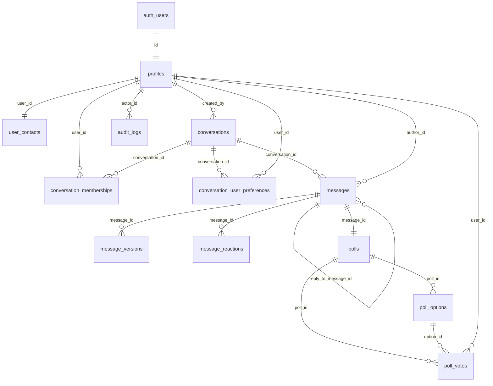

# Chatly — Modelo de datos

> **Estado:** propuesta para revisión del equipo.
> **Motor:** Supabase PostgreSQL (PostgreSQL 15+).
> **Migraciones:** Alembic, plantilla asíncrona.
> **Reglas de origen:** `docs/chatly.md` (Q1–Q108) más las decisiones nuevas Q109 y Q110 de la sección 9.
> **Alcance:** define tablas, columnas, restricciones, índices y reglas de acceso a nivel de diseño. La matriz completa de políticas se detalla en `authorization-matrix.md`.

---

## 1. Convenciones

| Tema | Decisión |
|---|---|
| Claves primarias | `uuid` con `gen_random_uuid()` (nativo en PostgreSQL 13+); `audit_logs` usa `bigint generated always as identity` |
| Fechas | `timestamptz` siempre; nunca `timestamp` sin zona |
| Texto | `text` con `check` de longitud cuando la regla existe; no `varchar(n)` arbitrario |
| Enumeraciones | `text` + `check` (no tipos `enum`, para evitar migraciones rígidas) |
| Borrado lógico | `deleted_at timestamptz`; las consultas normales filtran `deleted_at is null` |
| Normalización | Alias y correo se guardan en minúsculas; los textos de comparación se comparan con `lower(btrim(...))` |
| Nombres de constraints | `pk_`, `fk_`, `uq_`, `ck_`, `ix_` mediante `naming_convention` de SQLAlchemy |
| Zona horaria | Toda la app opera en UTC y formatea en español en la capa de presentación |
| Propietario | Las tablas pertenecen al rol de migraciones; la app usa `chatly_app`, sin `BYPASSRLS` |

---

## 2. Diagrama entidad-relación



`auth.users` es gestionado por Supabase Auth. Alembic **no** crea ni altera sus columnas; solo añade como máximo un trigger de sincronización (sección 9.1).

---

## 3. `profiles`

Perfil público de cada usuario. Se crea al registrarse y se sincroniza con `auth.users`.

```sql
create table public.profiles (
    id                uuid primary key references auth.users (id) on delete cascade,
    alias             text        not null,
    display_name      text        not null,
    avatar_path       text,
    birth_date        date        not null,
    gender            text        not null,
    email_verified_at timestamptz,
    alias_changed_at  timestamptz,
    deleted_at        timestamptz,
    created_at        timestamptz not null default now(),
    updated_at        timestamptz not null default now(),

    constraint ck_profiles_alias_format
        check (alias ~ '^[a-z][a-z0-9_]{2,19}$'),
    constraint ck_profiles_alias_lower
        check (alias = lower(alias)),
    constraint ck_profiles_display_name_len
        check (char_length(btrim(display_name)) between 2 and 60),
    constraint ck_profiles_gender
        check (gender in ('femenino','masculino')),
    constraint ck_profiles_birth_date_plausible
        check (birth_date between date '1900-01-01' and date '2100-12-31')
);

create unique index uq_profiles_alias on public.profiles (lower(alias));
create index ix_profiles_alias_prefix on public.profiles (lower(alias) text_pattern_ops)
    where deleted_at is null;
create index ix_profiles_active on public.profiles (id) where deleted_at is null;
```

### Campos nuevos obligatorios (Q109, Q110)

| Campo | Tipo | Regla |
|---|---|---|
| `birth_date` | `date` | Obligatorio. Edad 18–120 años. Se edita en el perfil. La edad **no se almacena**. |
| `gender` | `text` | Obligatorio. Catálogo cerrado: `femenino` o `masculino`. Sin opción «prefiero no decir». |

**Reglas confirmadas:** `birth_date` y `gender` se exigen **en el registro**; sin ambos no se completa el alta y ambas columnas permanecen `NOT NULL`. La edad y el género son visibles para **cualquier usuario autenticado y verificado** en el perfil, **nunca** en los resultados de búsqueda (Q56) ni en la lista de participantes de un grupo.

**Por qué se guarda `birth_date` y no `age`:**
- Un campo generado `stored` no puede usar `current_date`, porque la expresión no es inmutable; PostgreSQL lo rechaza.
- Un `check` tampoco puede usar `current_date` por el mismo motivo.
- Guardar la edad obligaría a recalcularla cada cumpleaños con un proceso programado.
- `birth_date` es la fuente de verdad; la edad se deriva al leer.

**Cálculo de la edad** — se resta el año y se ajusta si el cumpleaños aún no ocurrió:

```sql
-- SQL: años cumplidos, respetando mes y día
date_part('year', age(current_date, birth_date))::int as age
```

```python
# Python: misma semántica, sin depender de la base
def calculate_age(birth_date: date, today: date | None = None) -> int:
    today = today or date.today()
    years = today.year - birth_date.year
    if (today.month, today.day) < (birth_date.month, birth_date.day):
        years -= 1
    return years
```

Para el 29 de febrero, en años no bisiestos se considera cumplido el 1 de marzo (comportamiento de `age()`).

**Vista pública con edad calculada:**

```sql
create view app.profiles_public
with (security_invoker = true) as
select
    p.id,
    p.alias,
    p.display_name,
    p.avatar_path,
    date_part('year', age(current_date, p.birth_date))::int as age,
    p.gender,
    p.created_at
from public.profiles p
where p.deleted_at is null;
```

La vista vive en el esquema no expuesto `app` y la usa únicamente el backend con el rol `chatly_app`, que tiene `select` sobre `profiles`. El navegador nunca consulta `profiles` ni esta vista: recibe nombre, alias, avatar, edad y género a través de la API. No se expone `birth_date`; la fecha exacta solo se devuelve en el perfil propio.

**Validación de rango de edad** (los `check` no pueden usar `current_date`): trigger `BEFORE INSERT OR UPDATE OF birth_date`.

```sql
create or replace function public.validate_profile_birth_date()
returns trigger language plpgsql as $$
declare
    v_age int := date_part('year', age(current_date, new.birth_date))::int;
begin
    if new.birth_date > current_date then
        raise exception 'La fecha de nacimiento no puede ser futura' using errcode = '23514';
    end if;
    if v_age < 18 or v_age > 120 then
        raise exception 'La edad debe estar entre 18 y 120 años' using errcode = '23514';
    end if;
    return new;
end $$;
```

**Reglas adicionales**

- `alias`: 3–20 caracteres, empieza por letra, admite letras, números y `_`; se guarda normalizado en minúsculas; único global (Q57, Q50).
- Cambio de alias: máximo uno cada 30 días (Q107). El servicio compara `now() - alias_changed_at >= interval '30 days'`; el valor anterior queda libre de inmediato (Q103) y el cambio se audita.
- `display_name`: nombre visible en los resultados de búsqueda (Q56). Obligatorio en el registro, 2–60 caracteres, editable en cualquier momento y **no único**; el alias es lo que diferencia a los usuarios (Q111).
- Búsqueda por alias: se dispara con al menos **2 caracteres**, sin distinguir mayúsculas, y **excluye al propio usuario** de los resultados (Q112, extensión de Q7).
- `avatar_path`: ruta del objeto vigente en el bucket privado. Los archivos anteriores se conservan en Storage pero no se referencian (Q80).
- `email_verified_at`: espejo de `auth.users.email_confirmed_at`; es la fuente que consultan servicios y RLS para bloquear funciones de chat (Q15).
- `deleted_at`: aunque la V1 no permite eliminar cuentas (Q42), el campo mantiene coherencia con el borrado lógico (Q31).

---

## 4. `user_contacts`

Correo normalizado, separado del perfil público (Q73).

```sql
create table public.user_contacts (
    user_id          uuid primary key references public.profiles (id) on delete cascade,
    email_normalized text        not null,
    created_at       timestamptz not null default now(),
    updated_at       timestamptz not null default now(),

    constraint ck_user_contacts_email_lower
        check (email_normalized = lower(btrim(email_normalized))),
    constraint uq_user_contacts_email unique (email_normalized)
);
```

- `ENABLE ROW LEVEL SECURITY` **sin política de `select`**: ni el navegador ni `chatly_app` pueden leerla directamente.
- Solo se permite al backend escribir el espejo del correo:

```sql
alter table public.user_contacts enable row level security;

create policy user_contacts_backend_insert on public.user_contacts
    for insert to chatly_app
    with check (user_id = (select app.current_actor_id()));

create policy user_contacts_backend_update on public.user_contacts
    for update to chatly_app
    using (user_id = (select app.current_actor_id()))
    with check (user_id = (select app.current_actor_id()));
```

- La lectura ocurre exclusivamente por la función `security definer` de más abajo, que devuelve solo datos públicos.

```sql
create or replace function app.find_user_by_email(p_email text)
returns table (user_id uuid, alias text, display_name text, avatar_path text)
language sql
security definer
set search_path = app, public, pg_temp
as $$
    select p.id, p.alias, p.display_name, p.avatar_path
    from public.user_contacts c
    join public.profiles p on p.id = c.user_id
    where app.current_actor_id() is not null
      and p.id <> app.current_actor_id()
      and c.email_normalized = lower(btrim(p_email))
      and p.deleted_at is null;
$$;

revoke all on function app.find_user_by_email(text) from public;
grant execute on function app.find_user_by_email(text) to chatly_app;
```

- La función vive en el esquema **no expuesto** `app`, revoca `EXECUTE` de `PUBLIC`, exige contexto de actor (`app.current_actor_id() is not null`) y solo se concede al rol del backend. Cumple las tres precauciones de Supabase para `SECURITY DEFINER`.
- La función nunca devuelve el correo (Q19, Q56).
- Búsqueda por alias: consulta del backend contra `app.profiles_public` con `lower(alias) like 'prefijo%'`, mínimo 2 caracteres y excluyendo al actor (Q112).

---

## 5. `conversations`

Una sola tabla para privadas y grupales (Q64).

```sql
create table public.conversations (
    id                uuid primary key default gen_random_uuid(),
    type              text        not null,
    name              text,
    created_by        uuid        not null references public.profiles (id),
    admin_id          uuid        references public.profiles (id),
    direct_user_low   uuid        references public.profiles (id),
    direct_user_high  uuid        references public.profiles (id),
    is_archived       boolean     not null default false,
    archived_at       timestamptz,
    last_message_at   timestamptz,
    deleted_at        timestamptz,
    created_at        timestamptz not null default now(),
    updated_at        timestamptz not null default now(),

    constraint ck_conversations_type check (type in ('direct','group')),
    constraint ck_conversations_shape check (
        (type = 'direct'
            and direct_user_low is not null
            and direct_user_high is not null
            and direct_user_low < direct_user_high
            and name is null)
        or
        (type = 'group'
            and direct_user_low is null
            and direct_user_high is null
            and name is not null)
    ),
    constraint ck_conversations_group_name check (
        type <> 'group' or char_length(btrim(name)) between 3 and 40
    ),
    constraint ck_conversations_archive check (
        (is_archived and archived_at is not null)
        or (not is_archived and archived_at is null)
    )
);

create unique index uq_conversations_direct_pair
    on public.conversations (direct_user_low, direct_user_high)
    where type = 'direct';

create index ix_conversations_activity
    on public.conversations (last_message_at desc nulls last)
    where deleted_at is null;

create index ix_conversations_created_by on public.conversations (created_by);
create index ix_conversations_admin on public.conversations (admin_id);
```

**Reglas**

- Conversación privada única por pareja (Q20): índice único parcial sobre la pareja ordenada. El servicio guarda siempre `least(a,b)` y `greatest(a,b)`.
- Grupos: nombre 3–40, sin recortes sobrantes; solo el administrador puede cambiarlo (Q46, Q87).
- `admin_id` se replica para consultas rápidas, pero la autoridad real se valida con la membresía activa con rol `admin` (ver `conversation_memberships`). Ambas fuentes se mantienen en la misma transacción.
- `last_message_at` se actualiza por trigger al insertar un mensaje visible; sirve para ordenar la lista por actividad (Q95).
- Archivo definitivo al salir el último integrante (Q45, Q91); no se reactiva. `deleted_at` queda reservado para un borrado lógico administrativo.
- Límite de 10 integrantes (Q8): se valida en servicio dentro de una transacción con `SELECT ... FOR UPDATE` sobre la fila de `conversations`, lo que serializa las incorporaciones concurrentes. Un `check` no puede contar filas.

---

## 6. `conversation_memberships`

Periodos históricos de pertenencia (Q35, Q36, Q58).

```sql
create table public.conversation_memberships (
    id                  uuid primary key default gen_random_uuid(),
    conversation_id     uuid        not null references public.conversations (id) on delete cascade,
    user_id             uuid        not null references public.profiles (id),
    role                text        not null default 'member',
    status              text        not null default 'active',
    joined_at           timestamptz not null default now(),
    left_at             timestamptz,
    added_by            uuid        references public.profiles (id),
    removed_by          uuid        references public.profiles (id),
    last_read_message_id uuid,       -- FK se añade en la migración 0004 (messages)
    last_read_at        timestamptz,
    created_at          timestamptz not null default now(),
    updated_at          timestamptz not null default now(),

    constraint ck_memberships_role check (role in ('admin','member')),
    constraint ck_memberships_status check (status in ('active','left','removed')),
    constraint ck_memberships_state check (
        (left_at is null and status = 'active')
        or (left_at is not null and status in ('left','removed'))
    ),
    constraint ck_memberships_period check (left_at is null or left_at >= joined_at)
);

-- Una sola membresía activa por usuario y conversación (Q58, Q86)
create unique index uq_memberships_active
    on public.conversation_memberships (conversation_id, user_id)
    where left_at is null;

-- Un solo administrador activo por grupo (Q8, Q47)
create unique index uq_memberships_one_admin
    on public.conversation_memberships (conversation_id)
    where role = 'admin' and left_at is null;

create index ix_memberships_user_period
    on public.conversation_memberships (user_id, conversation_id, joined_at);
create index ix_memberships_conversation
    on public.conversation_memberships (conversation_id, joined_at);
create index ix_memberships_policy_lookup
    on public.conversation_memberships (conversation_id, user_id, joined_at)
    include (left_at);
create index ix_memberships_last_read
    on public.conversation_memberships (conversation_id, user_id, last_read_at);
```

**Reglas**

- Cada entrada crea una fila nueva; cada salida o expulsión fija `left_at` y `status`. Reincorporarse crea un periodo nuevo (Q36, Q98).
- `added_by` / `removed_by` registran quién añadió o expulsó (auditoría funcional).
- `last_read_message_id` + `last_read_at`: se guarda el último mensaje leído por periodo (Q67). `last_read_at` es una desnormalización del `created_at` de ese mensaje para evitar un `join` en cada cálculo de no leídos y de ✓✓.
- `last_read_message_id` no puede declararse en la creación de la tabla porque `messages` aún no existe. La FK se añade con `ALTER TABLE` en la migración `0004_messages`:

```sql
alter table public.conversation_memberships
    add constraint fk_memberships_last_read
    foreign key (last_read_message_id) references public.messages (id);
```
- Salida del administrador: el servicio asigna `role = 'admin'` al integrante activo con `joined_at` más antiguo, en la misma transacción (Q21, Q47).
- «Salir y eliminar» no borra la membresía ni el grupo: fija `left_at` y marca la preferencia de ocultación (Q30).
- Al salir el último integrante: se archiva la conversación, se cierran las encuestas abiertas y `admin_id` queda en `null` (Q45, Q63).

---

## 7. `conversation_user_preferences`

Preferencia individual de ocultación (Q59, Q68).

```sql
create table public.conversation_user_preferences (
    conversation_id uuid        not null references public.conversations (id) on delete cascade,
    user_id         uuid        not null references public.profiles (id),
    hidden          boolean     not null default false,
    hidden_at       timestamptz,
    created_at      timestamptz not null default now(),
    updated_at      timestamptz not null default now(),

    primary key (conversation_id, user_id),
    constraint ck_prefs_hidden_at check (hidden = (hidden_at is not null))
);

create index ix_prefs_user_hidden on public.conversation_user_preferences (user_id, hidden);
```

- Ocultar es individual y no altera la conversación de los demás (Q30, Q68).
- Un mensaje nuevo o una acción propia desmarcan `hidden` (Q76, Q105).
- La preferencia no impide acceder al historial si el usuario vuelve a abrir el chat (Q105).

---

## 8. `messages`

```sql
create table public.messages (
    id                  uuid primary key default gen_random_uuid(),
    conversation_id     uuid        not null references public.conversations (id) on delete cascade,
    author_id           uuid        references public.profiles (id),
    type                text        not null default 'text',
    content             text,
    system_event        text,
    system_data         jsonb,
    reply_to_message_id uuid,
    client_message_id   uuid,
    edited_at           timestamptz,
    edit_count          integer     not null default 0,
    deleted_at          timestamptz,
    deleted_by          uuid        references public.profiles (id),
    created_at          timestamptz not null default now(),
    updated_at          timestamptz not null default now(),

    constraint ck_messages_type check (type in ('text','system','poll')),
    constraint ck_messages_content check (
        (type = 'text'
            and author_id is not null
            and content is not null
            and char_length(btrim(content)) between 1 and 4000
            and system_event is null)
        or (type = 'system'
            and author_id is null
            and content is null
            and system_event is not null)
        or (type = 'poll'
            and author_id is not null
            and content is null
            and system_event is null)
    ),
    constraint ck_messages_system_event check (
        system_event is null
        or system_event in ('conversation_created','member_added','member_removed',
                            'member_left','admin_changed','name_changed')
    ),
    constraint ck_messages_edit check (edit_count >= 0),
    constraint ck_messages_no_self_reply check (reply_to_message_id is null or reply_to_message_id <> id),

    constraint uq_messages_conversation_id unique (conversation_id, id),
    constraint fk_messages_reply
        foreign key (conversation_id, reply_to_message_id)
        references public.messages (conversation_id, id)
);

create unique index uq_messages_client_id
    on public.messages (author_id, client_message_id)
    where client_message_id is not null;

create index ix_messages_conversation_cursor
    on public.messages (conversation_id, created_at desc, id desc);

create index ix_messages_visible
    on public.messages (conversation_id, created_at desc, id desc)
    where deleted_at is null;

create index ix_messages_reply on public.messages (reply_to_message_id)
    where reply_to_message_id is not null;

create index ix_messages_author on public.messages (author_id, created_at desc);
```

**Reglas**

- Máximo 4.000 caracteres y saltos de línea permitidos (Q51). El `check` no recorta el contenido: solo comprueba que no sea solo espacios.
- Tipos: `text` (persona), `system` (eventos automáticos, Q100) y `poll` (encuesta, Q65). Los mensajes de sistema no tienen `author_id` ni contenido editable.
- Edición: el servicio inserta la versión anterior en `message_versions` y actualiza `content`, `edited_at` y `edit_count` (Q11, Q33, Q66).
- Borrado: `deleted_at` + `deleted_by`; las consultas normales no devuelven `content` (Q85). Se conserva el registro y la versión vigente en `message_versions`.
- Respuesta: `reply_to_message_id` con FK compuesta que garantiza que el mensaje citado pertenece a la misma conversación. Si el original se elimina, la referencia se muestra como «Se eliminó un mensaje» (Q75).
- Idempotencia offline: `client_message_id` único por autor; el reenvío usa `on conflict do nothing` y devuelve el mensaje ya existente (Q40).
- Orden estable: `(created_at, id)`; el cursor de paginación es la pareja `(created_at, id)` del último mensaje cargado (Q94).
- `system_data` guarda el contexto del evento (por ejemplo `{"added_user_id": "...", "by": "..."}`); los mensajes de sistema cuentan para no leídos y para ✓✓ (Q106).
- Q100 enumera seis eventos: creación, incorporación, expulsión, salida, cambio de administrador y cambio de nombre. **No** se genera mensaje de sistema al archivar el grupo; el archivo se refleja solo en el estado de la conversación, salvo confirmación expresa del equipo.

**Trigger de actividad**

```sql
create or replace function public.touch_conversation_activity()
returns trigger language plpgsql as $$
begin
    update public.conversations
       set last_message_at = greatest(coalesce(last_message_at, new.created_at), new.created_at),
           updated_at = now()
     where id = new.conversation_id;
    return new;
end $$;

create trigger trg_messages_touch_conversation
after insert on public.messages
for each row execute function public.touch_conversation_activity();
```

El trigger no se dispara en ediciones ni borrados: el orden de la lista se rige por el mensaje más reciente (Q95).

---

## 9. `message_versions`

Historial de ediciones (Q33, Q66).

```sql
create table public.message_versions (
    id         uuid primary key default gen_random_uuid(),
    message_id uuid        not null references public.messages (id) on delete cascade,
    content    text        not null,
    edited_by  uuid        not null references public.profiles (id),
    created_at timestamptz not null default now(),

    constraint ck_message_versions_content
        check (char_length(btrim(content)) between 1 and 4000)
);

create index ix_message_versions_message
    on public.message_versions (message_id, created_at desc);
```

- Se inserta una fila con el contenido **anterior** antes de cada edición (no se guarda como JSON dentro de `messages`).
- No hay interfaz de consulta en V1 (Q33); la tabla existe para trazabilidad.

---

## 10. `message_reactions`

```sql
create table public.message_reactions (
    id         uuid primary key default gen_random_uuid(),
    message_id uuid        not null references public.messages (id) on delete cascade,
    user_id    uuid        not null references public.profiles (id),
    emoji      text        not null,
    deleted_at timestamptz,
    created_at timestamptz not null default now(),
    updated_at timestamptz not null default now(),

    constraint ck_reactions_emoji
        check (emoji in ('👍','❤️','😂','😮','😢','🙏','✅'))
);

-- Una sola reacción vigente por usuario y mensaje (Q12, Q70)
create unique index uq_reactions_active
    on public.message_reactions (message_id, user_id)
    where deleted_at is null;

create index ix_reactions_message on public.message_reactions (message_id)
    where deleted_at is null;
```

- Cambiar de emoji actualiza la fila vigente; quitar la reacción fija `deleted_at`.
- El conjunto de emojis es cerrado (Q12). `❤️` incluye el selector de variación; el frontend debe enviar exactamente el mismo valor.
- Las reacciones de antiguos integrantes no se pueden crear ni modificar; solo se muestran dentro de sus periodos visibles (Q104).

---

## 11. `polls`, `poll_options`, `poll_votes`

### 11.1 `polls`

```sql
create table public.polls (
    id              uuid primary key default gen_random_uuid(),
    message_id      uuid        not null unique,
    conversation_id uuid        not null references public.conversations (id) on delete cascade,
    created_by      uuid        not null references public.profiles (id),
    question        text        not null,
    status          text        not null default 'open',
    closed_at       timestamptz,
    closed_by       uuid        references public.profiles (id),
    deleted_at      timestamptz,
    created_at      timestamptz not null default now(),
    updated_at      timestamptz not null default now(),

    constraint ck_polls_question
        check (char_length(btrim(question)) between 5 and 200),
    constraint ck_polls_status check (status in ('open','closed')),
    constraint ck_polls_closed
        check ((status = 'open' and closed_at is null)
            or (status = 'closed' and closed_at is not null)),
    constraint fk_polls_message
        foreign key (conversation_id, message_id)
        references public.messages (conversation_id, id)
        on delete cascade
);

create index ix_polls_conversation on public.polls (conversation_id, status);
create index ix_polls_created_by on public.polls (created_by);
```

- La encuesta siempre cuelga de un mensaje `poll`; `message_id` único evita duplicados (Q65).
- `conversation_id` se replica para consultas y RLS.
- Editable solo por el creador y solo antes del primer voto (Q88, Q92). Se valida en servicio y se refuerza con la política de `update`.

### 11.2 `poll_options`

```sql
create table public.poll_options (
    id         uuid primary key default gen_random_uuid(),
    poll_id    uuid        not null references public.polls (id) on delete cascade,
    text       text        not null,
    position   smallint    not null,
    created_at timestamptz not null default now(),

    constraint ck_poll_options_text
        check (char_length(btrim(text)) between 1 and 80),
    constraint ck_poll_options_position check (position between 1 and 5),
    constraint uq_poll_options_position unique (poll_id, position),
    constraint uq_poll_options_id_poll unique (id, poll_id)
);

create unique index uq_poll_options_text
    on public.poll_options (poll_id, lower(btrim(text)));
```

- Entre 2 y 5 opciones (Q88): el mínimo y el máximo se validan en servicio al crear o editar; el `check` de `position` acota el máximo por fila.
- Sin duplicados ignorando mayúsculas y espacios: índice único por expresión.
- Tras el primer voto las opciones quedan bloqueadas (Q88).

### 11.3 `poll_votes`

```sql
create table public.poll_votes (
    id         uuid primary key default gen_random_uuid(),
    poll_id    uuid        not null references public.polls (id) on delete cascade,
    option_id  uuid        not null,
    user_id    uuid        not null references public.profiles (id),
    created_at timestamptz not null default now(),
    updated_at timestamptz not null default now(),

    constraint uq_poll_votes_user unique (poll_id, user_id),
    constraint fk_poll_votes_option
        foreign key (option_id, poll_id)
        references public.poll_options (id, poll_id)
);

create index ix_poll_votes_option on public.poll_votes (option_id);
create index ix_poll_votes_poll on public.poll_votes (poll_id, created_at);
```

- Un voto vigente por usuario y encuesta (Q69); cambiar el voto actualiza `option_id` en la misma fila.
- La FK compuesta impide votar por una opción de otra encuesta.
- Los votos emitidos permanecen aunque el usuario salga o sea expulsado (Q49). El servicio impide modificarlos si ya no es miembro activo o la encuesta está cerrada.
- Cierre definitivo (Q10); al archivar el grupo se cierran todas las encuestas abiertas (Q63).
- Borrado lógico de encuesta solo antes del primer voto (Q93); si hay votos, solo se cierra.

---

## 12. `audit_logs`

```sql
create table public.audit_logs (
    id            bigint generated always as identity primary key,
    actor_id      uuid,
    action        text        not null,
    entity_type   text        not null,
    entity_id     uuid,
    conversation_id uuid,
    old_values    jsonb,
    new_values    jsonb,
    created_at    timestamptz not null default now(),

    constraint ck_audit_action check (char_length(btrim(action)) > 0),
    constraint ck_audit_entity check (char_length(btrim(entity_type)) > 0)
);

create index ix_audit_entity on public.audit_logs (entity_type, entity_id, created_at desc);
create index ix_audit_actor on public.audit_logs (actor_id, created_at desc);
create index ix_audit_conversation on public.audit_logs (conversation_id, created_at desc);
```

- Sin claves foráneas: la auditoría sobrevive a cualquier cambio de estado y no bloquea borrados.
- Solo inserción: sin políticas de `update`/`delete`; `revoke update, delete` al rol de la app.
- `old_values` y `new_values` en JSONB (Q52, Q71).
- No se auditan eventos efímeros (escritura, presencia) (Q43).
- Se escribe en la misma transacción que la operación, para que no exista un cambio sin registro.

---

## 13. Resumen de acceso (RLS)

Las políticas completas se documentan en `authorization-matrix.md`. Resumen por tabla:

| Tabla | Lectura | Escritura |
|---|---|---|
| `profiles` | Solo backend (`chatly_app`); el navegador no consulta la tabla ni la vista | Solo backend; el perfil propio pasa por el servicio |
| `user_contacts` | Nadie directamente; solo `find_user_by_email` | Servicio, en la misma transacción del perfil |
| `conversations` | Quien tenga al menos un periodo de membresía | Creación por el actor; edición por el administrador activo |
| `conversation_memberships` | Miembros con cualquier periodo en esa conversación | Servicio; el administrador añade/expulsa, el usuario sale |
| `conversation_user_preferences` | Solo el propio usuario | Solo el propio usuario |
| `messages` | Miembros cuyo periodo cubre `created_at` | Miembros activos; edición/borrado solo del autor activo |
| `message_versions` | Solo backend (`chatly_app`) | Solo backend |
| `message_reactions` | Miembros cuyo periodo cubre el mensaje | Miembro activo, solo su reacción |
| `polls` | Miembros con periodo visible | Miembro activo; edición/cierre según Q88–Q108 |
| `poll_options` | Igual que `polls` | Solo backend, validado por servicio |
| `poll_votes` | Igual que `polls` | Miembro activo mientras la encuesta esté abierta |
| `audit_logs` | Nadie desde la app (solo herramientas administrativas) | Solo backend, insert |

- El navegador no recibe `select` sobre `profiles` ni sobre `app.profiles_public`; ambas son de uso del backend. Los datos públicos del perfil se sirven por la API y `birth_date` solo aparece en la respuesta del perfil propio.

**Función de identidad y contexto**

```sql
create or replace function app.current_actor_id() returns uuid
language sql stable as $$
    select coalesce(
        auth.uid(),
        nullif(current_setting('app.current_user_id', true), '')::uuid
    );
$$;
```

Reglas de operación:

- El backend fija `set_config('app.current_user_id', :uid, true)` dentro de cada transacción.
- El rol `chatly_app` no tiene `BYPASSRLS` ni es propietario de las tablas.
- Las políticas compartidas se declaran `TO authenticated, chatly_app` y exigen `app.current_actor_id()`; las exclusivas del backend, `TO chatly_app`. Las funciones de membresía son `security definer` para evitar la recursión de RLS (ver `authorization-matrix.md` §3.1).
- Para tablas exclusivas del backend (`user_contacts`, `message_versions`, `audit_logs`) las políticas se declaran `TO chatly_app`.
- Se revocan privilegios innecesarios de `anon` y `authenticated` sobre tablas que el navegador no debe tocar.
- **Entorno de pruebas:** una base local no tiene el esquema `auth` de Supabase. Las pruebas crean un esquema mínimo `auth` con `auth.uid()` devolviendo `null`, de modo que todo el flujo dependa de `app.current_user_id` y se pueda verificar el aislamiento entre transacciones.

---

## 14. Consultas clave

### 14.1 Lista de conversaciones con último mensaje y no leídos

```sql
select
    c.id,
    c.type,
    c.name,
    c.last_message_at,
    (
        select count(*)
        from public.messages m
        where m.conversation_id = c.id
          and m.deleted_at is null
          and m.author_id is distinct from :user_id
          and m.created_at > coalesce(mem.last_read_at, mem.joined_at)
    ) as unread_count
from public.conversations c
join public.conversation_memberships mem
  on mem.conversation_id = c.id
 and mem.user_id = :user_id
 and mem.left_at is null
where c.deleted_at is null
order by c.last_message_at desc nulls last;
```

Los mensajes de sistema (`author_id` nulo) sí cuentan como no leídos gracias a `is distinct from` (Q106).

### 14.2 Paginación por cursor

```sql
-- Primera carga: últimos 50
select *
from public.messages
where conversation_id = :cid
  and deleted_at is null
order by created_at desc, id desc
limit 50;

-- Páginas anteriores: 30 usando el cursor de la primera fila cargada
select *
from public.messages
where conversation_id = :cid
  and deleted_at is null
  and (created_at, id) < (:cursor_created_at, :cursor_id)
order by created_at desc, id desc
limit 30;
```

### 14.3 ✓✓ (todos los elegibles leyeron)

```sql
select not exists (
    select 1
    from public.conversation_memberships m, public.messages msg
    where msg.id = :message_id
      and m.conversation_id = msg.conversation_id
      and m.user_id is distinct from msg.author_id
      and m.joined_at <= msg.created_at
      and (m.left_at is null or m.left_at > msg.created_at)
      -- no leyó
      and (m.last_read_at is null or m.last_read_at < msg.created_at)
      -- pero sigue contando: está activo o leyó antes de irse
      and (m.left_at is null or m.last_read_at >= msg.created_at)
) as all_read;
```

Cumple Q22, Q48 y Q104: no cuentan los nuevos integrantes, y quien se va sin leer deja de bloquear.

### 14.4 Resultado de encuesta con votantes

```sql
select
    o.id,
    o.text,
    count(v.id) as votes,
    array_agg(v.user_id) filter (where v.user_id is not null) as voter_ids
from public.poll_options o
left join public.poll_votes v on v.option_id = o.id
where o.poll_id = :poll_id
group by o.id, o.text, o.position
order by o.position;
```

---

## 15. Migraciones (orden propuesto)

| Revisión | Contenido |
|---|---|
| `0001_infra` | Esquema `app`, función `current_actor_id()`, convenciones y extensiones necesarias |
| `0002_profiles` | `profiles`, `user_contacts`, vista `app.profiles_public`, trigger de edad, función `app.find_user_by_email` |
| `0003_conversations` | `conversations`, `conversation_memberships`, `conversation_user_preferences` |
| `0004_messages` | `messages`, `message_versions`, `message_reactions`, trigger de actividad y FK `conversation_memberships.last_read_message_id` |
| `0005_polls` | `polls`, `poll_options`, `poll_votes` |
| `0006_audit` | `audit_logs` |
| `0007_rls` | Políticas de todas las tablas y `security_invoker` de la vista |
| `0008_grants` | Rol `chatly_app`, privilegios mínimos, `revoke` de `anon`/`authenticated` |
| `0009_realtime` | Publicación `supabase_realtime` y políticas de `realtime.messages` |
| `0010_storage` | Bucket `avatars`, políticas de Storage y límites de tamaño/tipo |
| `0011_auth_sync` | Trigger de sincronización de `email_verified_at` (con guardia si `auth.users` no existe) |

Cada migración incluye su prueba de `upgrade`/`downgrade` y se revisa por dos integrantes (A y B).

---

## 16. Decisiones nuevas sobre identidad y perfil

### 16.1 Decisiones incorporadas

**Q109 — Edad del usuario**
Se almacena `profiles.birth_date` (obligatorio) y la edad se calcula al leer restando el año y ajustando mes y día. No se almacena `age`. Rango permitido: **18–120 años**, validado en servicio y por trigger. Se exige en el registro, es editable desde el perfil y queda auditado. Se muestra solo en el perfil y solo a usuarios autenticados y verificados.

**Q110 — Género del usuario**
Se almacena `profiles.gender` (obligatorio) con catálogo cerrado a **`femenino`** y **`masculino`**. Se exige en el registro, es editable desde el perfil y queda auditado. Se muestra solo en el perfil y solo a usuarios autenticados y verificados.

**Q111 — Nombre visible**
`profiles.display_name` es obligatorio en el registro, admite 2–60 caracteres, es editable en cualquier momento y no es único; la diferenciación entre usuarios recae en el alias único.

**Q112 — Búsqueda por alias**
La búsqueda se dispara con un mínimo de 2 caracteres, no distingue mayúsculas y excluye al propio usuario de los resultados. Extiende Q7 y mantiene la regla de Q19: nunca se revela el correo.

> Las decisiones Q109–Q112 ya están incorporadas en `docs/chatly.md` (sección 13), manteniendo la trazabilidad.

### 16.2 Estado de confirmación

Sin pendientes sobre edad y género. Las reglas quedaron cerradas así:

1. Visibilidad: cualquier usuario autenticado y verificado los ve en el perfil; nunca en búsqueda ni en la lista de participantes.
2. Momento: se exigen en el registro; `birth_date` y `gender` son `NOT NULL`.
3. Rango de edad: 18–120 años.
4. Dónde se muestra la edad: solo en el perfil.
5. Nombre visible: obligatorio en el registro, 2–60 caracteres, editable y no único.
6. Búsqueda por alias: mínimo 2 caracteres y sin incluir al propio usuario.

Sin pendientes funcionales sobre el perfil.
