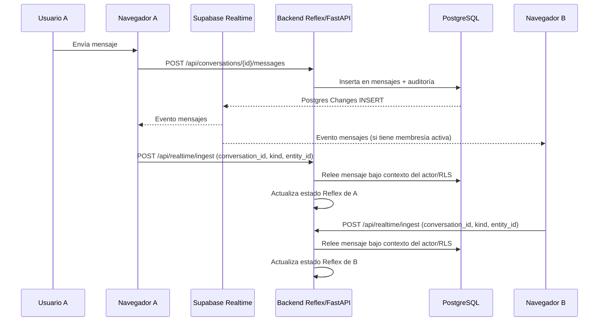
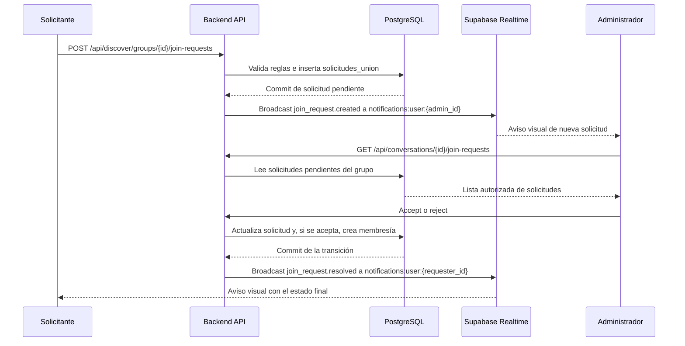
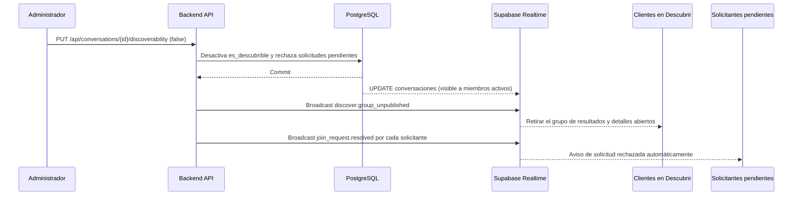

# Chatly — Eventos y tiempo real

> **Estado:** aprobado para implementación; los eventos y políticas deben probarse en el proyecto Supabase.  
> **Base funcional:** decisiones Q1–Q179 consolidadas en `docs/chatly.md`.  
> **Contratos relacionados:** `docs/api-contracts.md` (secciones 9 y 16).  
> **Modelo de datos relacionado:** `docs/database-schema.md` (secciones 5–8 y 17).  
> **Implementación:** Supabase Realtime desde el navegador mediante `supabase-js` y una capa JavaScript pequeña integrada con Reflex. La lógica de negocio y la autorización final permanecen en Python/FastAPI y PostgreSQL.

Este documento conserva el mecanismo Realtime original para mensajería y añade únicamente los eventos necesarios para presencia social, cambios de visibilidad y notificaciones de solicitudes de unión. No incorpora amistades, seguidores, solicitudes de contacto, bloqueo ni una bandeja histórica de notificaciones.

---

## 1. Principios

1. **Canal privado por conversación.** El topic `conversation:<uuid>` transporta cambios persistidos de esa conversación y el evento efímero `typing`. Solo se suscriben participantes con membresía activa.
2. **Presencia por usuario.** El topic `presence:user:<uuid>` permite calcular si un usuario tiene al menos una sesión activa, sin depender de que tenga una conversación abierta. El propietario siempre puede suscribirse; otros usuarios verificados solo cuando el perfil objetivo tenga `visibilidad_publica = true`.
3. **Notificaciones privadas por usuario.** El topic `notifications:user:<uuid>` se utiliza para avisos puntuales de solicitudes de unión y revocación de acceso. Solo el propietario puede suscribirse. Los eventos los publica `app.publish_social_event(...)` desde el backend, nunca el navegador.
4. **Invalidaciones de Descubrir.** El topic `discover:global` distribuye únicamente avisos mínimos para retirar de resultados visibles un perfil que desactiva su visibilidad pública o un grupo que deja de ser descubrible. No transmite perfiles, intereses, mensajes ni datos de integrantes.
5. **El navegador no decide contenido ni permisos.** Los eventos de Postgres Changes pueden contener datos de fila, pero el cliente los trata solo como señales. Envía identificadores al backend y nunca utiliza el payload recibido como fuente autoritativa para actualizar mensajes, miembros, encuestas o datos sociales.
6. **La base de datos es la fuente de verdad.** El backend vuelve a consultar los registros bajo el contexto del actor y RLS antes de actualizar el estado de Reflex. Los avisos Broadcast no sustituyen las consultas de la API.
7. **Sin polling de mensajes ni presencia.** Los cambios normales llegan por Realtime. La carga inicial y la recuperación de huecos se realizan por REST.
8. **Sin persistencia de eventos efímeros.** Presencia, escritura e invalidaciones Broadcast no se guardan ni se auditan como eventos independientes. Las solicitudes sí permanecen en `solicitudes_union` y sus transiciones se auditan.
9. **Realtime no es una frontera de seguridad.** Los canales privados y las políticas RLS limitan la suscripción. El backend vuelve a validar el acceso al procesar cada señal relevante.
10. **Sin Redis.** El registro de sesiones de Reflex vive en memoria del proceso porque la demo utiliza una sola instancia del backend.

---

## 2. Requisitos previos en Supabase

| Requisito | Configuración |
|---|---|
| Publicación | `supabase_realtime` incluye las tablas persistidas de la sección 4. |
| Canales privados | Habilitar Realtime Authorization y desactivar el acceso público a los canales. |
| Políticas | Definir políticas de lectura/escritura en `realtime.messages` para cada topic y extensión. Ver `authorization-matrix.md`. |
| RLS en tablas fuente | Habilitar las políticas correspondientes a conversaciones, membresías, mensajes, reacciones y encuestas. |
| Solicitudes sociales | `solicitudes_union` se consulta exclusivamente mediante el backend; no se publica para lectura directa del navegador. |
| Expiración | `pg_cron` habilitado; job cada 15 min ejecutado como `chatly_app`. |
| Publicación social | `app.publish_social_event(...)` `SECURITY DEFINER`; `EXECUTE` solo a `chatly_app`. |
| JWT | Ejecutar `supabase.realtime.setAuth(access_token)` antes de suscribirse. |
| Duración del JWT | Aproximadamente 10 minutos, según la configuración de autenticación vigente (Q61). |
| Despliegue | Una instancia del backend Reflex/FastAPI; sin Redis. |

> `realtime.messages` ya dispone de RLS en Supabase. Las migraciones crean o actualizan políticas; no deben volver a ejecutar `ALTER TABLE realtime.messages ENABLE ROW LEVEL SECURITY`.

### 2.1 Reglas mínimas de autorización de topics

| Topic | Quién puede suscribirse | Quién puede publicar |
|---|---|---|
| `conversation:<uuid>` | Usuarios autenticados y verificados con membresía activa en esa conversación. | Participantes activos; solo para el evento `typing`. |
| `presence:user:<uuid>` | El propio usuario; además, otros usuarios verificados si el perfil objetivo tiene `visibilidad_publica = true`. | El propietario del topic y solo con su propio `user_id`/sesión. |
| `notifications:user:<uuid>` | Únicamente el usuario cuyo UUID aparece en el topic. | Solo `app.publish_social_event` ejecutada por `chatly_app`. Los clientes no pueden publicar. |
| `discover:global` | Usuarios autenticados y verificados. | Solo `app.publish_social_event` ejecutada por `chatly_app`. Los clientes no pueden publicar. |

Las políticas deben diferenciar `broadcast` de `presence`: permitir el tracking de la propia presencia no debe habilitar al cliente a falsificar avisos de solicitudes o cambios de descubribilidad. La clave de usuario del topic se compara con `auth.uid()` y la visibilidad del perfil se consulta desde `perfiles` cuando corresponda.

La clave de servicio de Supabase, si se utiliza para publicar Broadcast desde el backend, nunca se envía al navegador.

---

## 3. Modelo de canales y ciclo de vida

### 3.1 Topics utilizados

```text
conversation:<uuid>
├── postgres_changes  (conversaciones, miembros_conversacion, mensajes,
│                     reacciones_mensaje, encuestas, opciones_encuesta,
│                     votos_encuesta)
└── broadcast         (typing)

presence:user:<uuid>
└── presence          (sesiones activas del usuario)

notifications:user:<uuid>
└── broadcast         (join_request.created, join_request.resolved,
                      conversation.access_revoked)

discover:global
└── broadcast         (discover.person_hidden, discover.group_unpublished)
```

Los topics `presence:user:<uuid>` y `notifications:user:<uuid>` son independientes intencionalmente: quienes pueden ver la presencia de un perfil público no deben recibir las notificaciones privadas destinadas a su propietario.

### 3.2 Ciclo de vida

```text
login confirmado
 ├─ setAuth(access_token)
 ├─ suscribirse a notifications:user:<actor_id>
 ├─ suscribirse a presence:user:<actor_id> y trackear la sesión
 └─ suscribirse a discover:global

abrir conversación
 ├─ comprobar si existe conversation:<conversation_id>
 ├─ reutilizar el canal si ya está activo
 ├─ registrar handlers de Postgres Changes y typing
 └─ suscribirse

abrir Descubrir / recibir recomendaciones
 └─ suscribirse a presence:user:<id> para los perfiles públicos mostrados

cerrar Descubrir / retirar resultados
 └─ desuscribir los topics de presencia de perfiles que ya no se muestran

logout
 ├─ desuscribir todos los canales
 ├─ removeAllChannels()
 └─ limpiar IndexedDB y el estado local de la sesión (Q62)
```

Reglas de ciclo de vida:

- Al cambiar de conversación se desuscribe el canal anterior si no sigue siendo necesario en otra vista.
- Al abandonar Descubrir o reemplazar una página de resultados, se eliminan las suscripciones de presencia que ya no se necesitan.
- Al cerrar sesión se desuscriben todos los topics y se elimina la caché local de la cuenta.
- Al renovar el token se ejecuta `supabase.realtime.setAuth(newToken)`. Si un canal se cerró o perdió autorización, se vuelve a suscribir.
- Al salir voluntariamente de una conversación, el propio cliente desuscribe su canal.
- Al expulsar a un integrante, el backend le envía `conversation.access_revoked` por su topic privado de notificaciones. El cliente debe desuscribir inmediatamente `conversation:<id>` y limpiar los datos de esa conversación que ya no pueda consultar.
- Las políticas siguen siendo la protección definitiva: un cliente que ignore el evento de revocación no conserva autorización para nuevas consultas ni para volver a suscribirse.

---

## 4. Catálogo de Postgres Changes

Las tablas persistidas de mensajería y conversación se publican en `supabase_realtime` usando los nombres reales del modelo de datos en español.

```sql
alter publication supabase_realtime add table
    public.conversaciones,
    public.miembros_conversacion,
    public.mensajes,
    public.reacciones_mensaje,
    public.encuestas,
    public.opciones_encuesta,
    public.votos_encuesta;
```

Si una tabla ya pertenece a la publicación, la migración debe comprobarlo antes de añadirla de nuevo.

| Tabla publicada | Eventos | Filtro | Uso en la interfaz |
|---|---|---|---|
| `mensajes` | `INSERT`, `UPDATE` | `conversacion_id=eq.<id>` | Nuevo mensaje, edición, borrado lógico y mensaje de encuesta. |
| `reacciones_mensaje` | `INSERT`, `UPDATE` | Sin filtro de conversación; RLS limita filas y el backend relaciona el mensaje con la conversación. | Actualizar reacciones del mensaje visible. |
| `encuestas` | `INSERT`, `UPDATE` | `conversacion_id=eq.<id>` | Creación, edición previa al primer voto y cierre. |
| `opciones_encuesta` | `INSERT`, `UPDATE` | Sin filtro de conversación; RLS limita filas. | Cambios en opciones de una encuesta. |
| `votos_encuesta` | `INSERT`, `UPDATE` | Sin filtro de conversación; RLS limita filas. | Conteos, opción elegida y votantes. |
| `conversaciones` | `UPDATE` | `id=eq.<id>` | Nombre, archivo, descripción y configuración de descubribilidad del grupo. |
| `miembros_conversacion` | `INSERT`, `UPDATE` | `conversacion_id=eq.<id>` | Incorporación, salida, expulsión, cambio de administrador y cursores de lectura. |

Notas importantes:

- `reacciones_mensaje`, `opciones_encuesta` y `votos_encuesta` no contienen `conversacion_id`. El backend obtiene la conversación mediante sus relaciones (`mensajes` o `encuestas`) y verifica el acceso antes de devolver un DTO.
- No se depende de eventos `DELETE`: los borrados funcionales son lógicos, mediante `UPDATE` de `eliminado_en` (Q31, Q85). Los eventos `DELETE` físicos no forman parte del flujo normal de la aplicación.
- Los mensajes `system` de `mensajes` siguen llegando como `INSERT`; representan creación, incorporación, expulsión, salida, cambio de administrador y cambio de nombre (Q100).
- Un evento de `conversaciones` causado por un cambio de intereses del grupo debe hacer que el backend relea los metadatos autorizados. Para ello, el servicio que modifica `intereses_conversacion` también actualiza `conversaciones.actualizado_en` dentro de la misma transacción.
- No se publican `perfiles`, `contactos_usuario`, `intereses_usuario`, `categorias_interes`, `intereses`, `intereses_conversacion` ni `solicitudes_union`. Estas tablas se consultan mediante la API y/o se notifican con Broadcast controlado, para no exponer información privada ni saltarse el backend.
- Supabase Postgres Changes puede entregar valores de fila en el payload. El cliente debe ignorarlos como fuente de contenido y pasar solamente el tipo de evento y el identificador al endpoint de ingest.

### 4.1 Suscripción de ejemplo — conversación

```javascript
const channel = supabase.channel(`conversation:${conversationId}`, {
  config: { private: true },
})

const enqueueIngest = (kind, payload) => {
  const entityId = payload.new?.id ?? payload.old?.id
  if (!entityId) return

  return fetch('/api/realtime/ingest', {
    method: 'POST',
    credentials: 'same-origin',
    headers: { 'Content-Type': 'application/json' },
    body: JSON.stringify({
      conversation_id: conversationId,
      kind,
      event: payload.eventType,
      entity_id: entityId,
      sent_at: payload.commit_timestamp ?? new Date().toISOString(),
    }),
  })
}

channel
  .on('postgres_changes', {
    event: '*', schema: 'public', table: 'mensajes',
    filter: `conversacion_id=eq.${conversationId}`,
  }, (payload) => enqueueIngest('message', payload))
  .on('postgres_changes', {
    event: '*', schema: 'public', table: 'reacciones_mensaje',
  }, (payload) => enqueueIngest('reaction', payload))
  .on('postgres_changes', {
    event: '*', schema: 'public', table: 'encuestas',
    filter: `conversacion_id=eq.${conversationId}`,
  }, (payload) => enqueueIngest('poll', payload))
  .on('postgres_changes', {
    event: '*', schema: 'public', table: 'opciones_encuesta',
  }, (payload) => enqueueIngest('poll_option', payload))
  .on('postgres_changes', {
    event: '*', schema: 'public', table: 'votos_encuesta',
  }, (payload) => enqueueIngest('poll_vote', payload))
  .on('postgres_changes', {
    event: '*', schema: 'public', table: 'conversaciones',
    filter: `id=eq.${conversationId}`,
  }, (payload) => enqueueIngest('conversation', payload))
  .on('postgres_changes', {
    event: '*', schema: 'public', table: 'miembros_conversacion',
    filter: `conversacion_id=eq.${conversationId}`,
  }, (payload) => enqueueIngest('membership', payload))
  .on('broadcast', { event: 'typing' }, ({ payload }) => {
    // El evento es efímero. No modifica permisos ni datos persistidos.
    showTyping(payload.user_id, payload.is_typing)
  })
  .subscribe()
```

`enqueueIngest` es ilustrativo: en la implementación debe manejar errores de red, respuestas `204`, reintentos acotados y duplicados sin bloquear el hilo de interfaz. No debe enviar el objeto `payload` completo al backend.

---

## 5. Eventos sociales por Broadcast

Los eventos sociales que no requieren una lectura directa del navegador sobre una tabla protegida se publican desde el backend después de confirmar la transacción de base de datos.

### 5.1 Solicitudes de unión

La tabla `public.solicitudes_union` **no se añade** a `supabase_realtime`. Su acceso es exclusivo del backend (ver `database-schema.md` §17.8). En su lugar, los servicios que crean o resuelven solicitudes publican eventos mínimos mediante `app.publish_social_event(...)` en la misma transacción; Realtime los entrega después del commit.

| Evento | Destinatario | Cuándo se emite | Payload mínimo |
|---|---|---|---|
| `join_request.created` | Administrador actual del grupo | Se crea una solicitud `pending`. | `request_id`, `conversation_id`, `sent_at` |
| `join_request.resolved` | Solicitante | La solicitud pasa a `accepted`, `rejected` o `expired`. | `request_id`, `conversation_id`, `status`, `reason_code`, `sent_at` |

Ejemplos:

```json
{
  "event": "join_request.created",
  "payload": {
    "request_id": "uuid",
    "conversation_id": "uuid",
    "sent_at": "2026-11-07T14:00:00Z"
  }
}
```

```json
{
  "event": "join_request.resolved",
  "payload": {
    "request_id": "uuid",
    "conversation_id": "uuid",
    "status": "rejected",
    "reason_code": "group_full",
    "sent_at": "2026-11-07T14:05:00Z"
  }
}
```

`reason_code` puede ser `accepted_by_admin`, `direct_add_same_group`, `rejected_by_admin`, `group_private`, `group_full`, `joined_other_group` o `expired`, según `solicitudes_union.motivo_resolucion`.

Reglas de emisión:

- Al crear la solicitud, el backend obtiene el administrador actual desde `conversaciones.administrador_id` y publica `join_request.created` en `notifications:user:<admin_id>`.
- Al aceptar, rechazar o expirar una solicitud, publica `join_request.resolved` en `notifications:user:<solicitante_id>`.
- También se emite para los rechazos automáticos por grupo privado, grupo completo o incorporación del usuario a otro grupo.
- Si el administrador añade directamente al solicitante al mismo grupo, la solicitud pasa a `accepted` y se notifica al solicitante; la incorporación también genera los eventos normales de membresía y mensaje de sistema.
- Si cambia el administrador, las solicitudes pendientes se conservan. El nuevo administrador puede consultarlas mediante `GET /api/conversations/{conversation_id}/join-requests`; no se requiere una notificación histórica ni un nuevo estado de solicitud.
- La expiración a los 14 días debe emitir el mismo aviso que cualquier otra transición a `expired`, desde el job de `pg_cron` que ejecuta `app.expire_pending_join_requests()`.
- Los avisos se insertan en `realtime.messages` dentro de la misma transacción; Realtime los entrega después del commit y una reversión no publica nada. El estado definitivo siempre se consulta en `solicitudes_union` mediante los endpoints de API autorizados.
- El payload no contiene correo, mensajes, lista de integrantes ni información privada del perfil. El administrador obtiene los datos aprobados para evaluar la solicitud mediante `GET /api/conversations/{conversation_id}/join-requests`.
- No se crea una tabla de notificaciones ni una sección «Mis solicitudes». Los avisos son visuales y efímeros; el registro persistido de la solicitud es la fuente de verdad.

El navegador que recibe `join_request.created` actualiza el indicador visual de solicitudes y vuelve a consultar el endpoint del administrador. El solicitante que recibe `join_request.resolved` muestra el resultado comunicado por el evento; no debe construir el estado a partir de un payload enviado por otro cliente.

### 5.2 Revocación de acceso a una conversación

Cuando un administrador expulsa a un integrante, el backend publica el evento privado `conversation.access_revoked` en `notifications:user:<removed_user_id>`:

```json
{
  "event": "conversation.access_revoked",
  "payload": {
    "conversation_id": "uuid",
    "reason": "removed",
    "sent_at": "2026-11-07T14:05:00Z"
  }
}
```

El cliente desuscribe el topic `conversation:<conversation_id>` y elimina de su estado cualquier contenido que ya no tenga permitido consultar. El backend mantiene la protección mediante RLS y los endpoints REST. El usuario conserva únicamente el historial de sus periodos de membresía en modo de solo lectura, según Q35, Q36, Q58 y Q104; el aviso de revocación no concede acceso a mensajes posteriores.

Una salida voluntaria iniciada por el propio usuario no necesita este aviso: el cliente conoce la operación y desuscribe el canal tras recibir la respuesta de la API.

### 5.3 Invalidaciones de Descubrir

El topic privado `discover:global` permite retirar datos que ya no deben mostrarse en listas abiertas de Descubrir. No se utiliza para enviar recomendaciones completas ni para recalcularlas automáticamente.

| Evento | Cuándo se emite | Payload mínimo | Acción del cliente |
|---|---|---|---|
| `discover.person_hidden` | `perfiles.visibilidad_publica` cambia de `true` a `false`. | `user_id`, `sent_at` | Retirar esa persona de las recomendaciones actualmente cargadas y limpiar su tarjeta de descubrimiento. |
| `discover.group_unpublished` | `conversaciones.es_descubrible` cambia de `true` a `false`. | `conversation_id`, `sent_at` | Retirar ese grupo de recomendaciones/búsqueda y cerrar o invalidar su detalle público si está abierto. |

Reglas:

- El backend los publica con `app.publish_social_event(..., null, payload)` en la misma transacción que cambia la visibilidad; Realtime los entrega después del commit.
- No se incluyen nombre, alias, intereses, integrantes ni mensajes en el evento.
- Las consultas `GET /api/discover/people`, `GET /api/discover/groups`, búsqueda y detalle siguen aplicando las condiciones actuales del modelo. Una solicitud posterior para un grupo que ya es privado responde `404`.
- Al activar visibilidad pública o publicar un grupo, no se envían recomendaciones por Broadcast. El usuario vuelve a abrir o actualizar Descubrir para recalcular los resultados, como se acordó.
- Los cambios de intereses personales o de grupo tampoco se distribuyen como listas por Realtime. Se reflejan en la siguiente consulta de recomendaciones.
- Este canal solo permite recibir invalidaciones del backend; los clientes no pueden publicar eventos en `discover:global`.

---

## 6. Presencia

La presencia se administra por usuario, no por conversación. Así el estado online representa una sesión activa de Chatly incluso cuando el usuario todavía no abrió un chat.

### 6.1 Contrato de presencia

Cada sesión autenticada mantiene su propio topic `presence:user:<user_id>` y registra un identificador de pestaña diferente:

```javascript
const presenceChannel = supabase.channel(`presence:user:${targetUserId}`, {
  config: { private: true, presence: { key: `${currentUser.id}:${tabSessionKey}` } },
})

presenceChannel
  .on('presence', { event: 'sync' }, () => {
    updateOnlineState(targetUserId, presenceChannel.presenceState())
  })
  .subscribe(async (status) => {
    if (status === 'SUBSCRIBED' && targetUserId === currentUser.id) {
      await presenceChannel.track({
        user_id: currentUser.id,
        session_key: tabSessionKey,
        online_at: new Date().toISOString(),
      })
    }
  })
```

El propietario registra su presencia en su propio topic. Los demás usuarios únicamente se suscriben al topic de perfiles públicos que necesitan mostrar; no envían estado de presencia en nombre de terceros.

### 6.2 Reglas

| Aspecto | Regla |
|---|---|
| Unidad | Sesión/pestaña del navegador. |
| Clave | `user_id:session_key`, única por pestaña. |
| Online | Existe al menos una sesión Presence activa del usuario. |
| Offline | Se cierra o desconecta la última sesión activa. |
| Persistencia | Ninguna; Presence es efímero. |
| Visibilidad para terceros | Solo perfiles con `visibilidad_publica = true` y espectadores autenticados/verificados. |
| Propietario | Siempre puede consultar el estado de su propia presencia para mantener la sesión. |
| Datos publicados | Solo UUID de usuario, clave de sesión y hora de conexión. No se publica alias ni correo. |
| Última conexión | No se muestra «última vez visto» (Q13). |

La interfaz agrupa las sesiones por `user_id`: el usuario se mantiene online mientras al menos una pestaña siga conectada. Para tarjetas de personas, el estado online se muestra cuando la suscripción al topic de ese perfil público está disponible. El DTO REST `PersonRecommendation` no incluye `online`; la tarjeta lo calcula con esta suscripción. Al dejar de mostrar una persona, se elimina su suscripción de presencia.

---

## 7. Escritura («escribiendo…»)

La escritura continúa usando Broadcast en el topic de la conversación activa.

| Aspecto | Regla |
|---|---|
| Evento | `typing` |
| Dirección | Cliente → `conversation:<uuid>` |
| Payload | `conversation_id`, `user_id`, `is_typing`, `sent_at` |
| Frecuencia | Máximo un evento por segundo por usuario. |
| Expiración | 5 segundos sin eventos (Q77). |
| Cierre | Enviar `is_typing: false` al enviar, vaciar el campo, cambiar de conversación o perder el foco. |
| Persistencia | Ninguna. |
| Auditoría | Ninguna. |

Ejemplo:

```javascript
channel.send({
  type: 'broadcast',
  event: 'typing',
  payload: {
    conversation_id: conversationId,
    user_id: currentUser.id,
    is_typing: true,
    sent_at: new Date().toISOString(),
  },
})
```

La política de escritura de `realtime.messages` debe exigir que el actor sea miembro activo del topic y que `payload.user_id` coincida con `auth.uid()`. El evento solo sirve para una indicación visual: nunca concede permisos ni altera mensajes.

---

## 8. Lecturas y contadores

No se utiliza un Broadcast `read` como fuente de verdad. Las lecturas se registran en `miembros_conversacion` y se propagan mediante Postgres Changes.

1. El mensaje se considera leído cuando la conversación está abierta y la pestaña de Chatly está visible/activa (Q60).
2. El cliente llama a `POST /api/conversations/{id}/read` con el último mensaje visible.
3. El backend valida la membresía activa y actualiza `ultimo_mensaje_leido_id` y `ultimo_leido_en` en el periodo vigente de `miembros_conversacion`.
4. Postgres Changes notifica la actualización de `miembros_conversacion` a los participantes autorizados.
5. El cliente envía `kind = "membership"` al endpoint `/api/realtime/ingest`; el backend relee la membresía y recalcula los contadores y ✓✓.
6. Los mensajes de sistema también cuentan para no leídos y confirmaciones de lectura (Q100, Q106).

Para ✓✓ se aplican las reglas ya establecidas: no cuenta el emisor; se consideran los participantes que correspondían al mensaje cuando se envió; los nuevos integrantes no cuentan para mensajes anteriores y quienes salen o son expulsados dejan de bloquear la confirmación (Q22, Q48, Q96, Q101).

---

## 9. Contrato del endpoint de ingest

### 9.1 Request

El contrato sigue siendo `POST /api/realtime/ingest`, definido en `api-contracts.md` §9. El navegador envía solo identificadores y metadatos mínimos:

```http
POST /api/realtime/ingest
Content-Type: application/json
Cookie: chatly_at=...
```

```json
{
  "conversation_id": "6f0f8f7e-4d1a-4a39-9d1a-2f5b3f0b8a11",
  "kind": "message",
  "event": "INSERT",
  "entity_id": "b1c2d3e4-0000-4000-8000-000000000001",
  "sent_at": "2026-11-07T14:22:31.004Z"
}
```

| Campo | Obligatorio | Valores |
|---|---|---|
| `conversation_id` | Sí | UUID de la conversación asociada al canal. |
| `kind` | Sí | `message`, `reaction`, `poll`, `poll_option`, `poll_vote`, `conversation`, `membership`. |
| `event` | Sí | `INSERT`, `UPDATE` o `DELETE`; los borrados funcionales normales son `UPDATE`. |
| `entity_id` | Sí | UUID de la fila afectada. |
| `sent_at` | Sí | Fecha ISO 8601 UTC del evento; sirve para observabilidad, no para autorizar. |

Los eventos `typing`, `join_request.*`, `conversation.access_revoked` y `discover.*` no pasan por este endpoint: son Broadcast efímeros y se procesan en sus topics privados correspondientes.

### 9.2 Procesamiento en el backend

```text
1. Validar JWT/sesión y correo confirmado.
2. Obtener el actor desde la sesión; nunca aceptar user_id del payload como identidad.
3. Abrir la transacción y establecer el contexto de actor que usa app.current_actor_id().
4. Releer la fila por entity_id y derivar/validar conversation_id bajo RLS.
   - Si no existe o no es visible para el actor: responder 204.
5. Construir el DTO mediante los mismos servicios de lectura que utiliza la API REST.
6. Actualizar el estado de Reflex para las sesiones conectadas del actor:
   app.modify_state(BaseStateToken(ident=token, cls=RealtimeState))
   - Si la conversación está abierta: aplicar el DTO autorizado.
   - Si no está abierta: actualizar lista, orden y contador de no leídos.
7. Responder 202 { "accepted": true }.
```

El backend no confía en `event`, `entity_id` ni `conversation_id` para conceder acceso. Son pistas para localizar el cambio; la fila y las políticas de autorización determinan lo que se puede devolver.

### 9.3 Respuestas

| Respuesta | Significado |
|---|---|
| `202` `{ "accepted": true }` | Evento autorizado y aplicado al estado. |
| `204` | Fila inexistente, no visible, duplicada o irrelevante. |
| `401` | Sesión inválida o expirada. |
| `403` | Sesión válida, pero operación no autorizada según el contrato de API. |
| `422` | Payload inválido. |

### 9.4 Registro de sesiones Reflex

- En `on_load`, el estado registra `user_id → set[client_token]` en un diccionario protegido por `asyncio.Lock`.
- Se elimina el token al cerrar sesión y al expirar la conexión de Reflex.
- El mapa vive en memoria del proceso. Se acepta esta limitación porque la V1 utiliza una sola instancia y no incorpora Redis.

### 9.5 Idempotencia y orden

- Cada DTO incorpora `actualizado_en` (o el campo equivalente del contrato serializado). El estado descarta una versión si ya aplicó otra más reciente.
- Los mensajes se ordenan siempre por `(creado_en, id)`, nunca por orden de llegada.
- Un `INSERT` repetido se resuelve por `id`; un `UPDATE`, por `(id, actualizado_en)`.
- El endpoint de ingest no escribe en tablas de negocio: solo relee datos autorizados y actualiza estado.
- Los Broadcast pueden llegar duplicados; el cliente deduplica por `request_id` + estado para avisos de solicitud y por UUID de grupo para invalidaciones.

---

## 10. Reconexión y recuperación

| Situación | Acción |
|---|---|
| `TIMED_OUT` / `CHANNEL_ERROR` | Reintentar con backoff exponencial: 1, 2, 4, 8, 16 y 30 segundos. |
| Reconexión del canal de conversación | Re-suscribir y pedir por REST los últimos 50 mensajes de la conversación abierta. |
| JWT expirado | Renovar mediante `/api/auth/refresh`, ejecutar `setAuth` y volver a suscribir si hace falta. |
| Pestaña en segundo plano | Mantener presencia mientras la conexión siga viva; no marcar mensajes leídos y pausar typing (Q60). |
| Cambio de red | Aplicar el mismo flujo de reconexión y resincronización. |
| Usuario expulsado | Procesar `conversation.access_revoked`, desuscribir el canal y limpiar el estado no autorizado. |
| Descubrir pierde conexión | Revalidar grupos/personas mediante REST al reabrir o refrescar la sección. |
| Aviso de solicitud durante desconexión | No hay bandeja persistente. Al volver, la información disponible se consulta en los endpoints autorizados: cola pendiente del administrador o detalle del grupo/solicitud del actor. |
| Ingreso offline | No se reciben eventos; al volver se resincroniza desde REST. |

La resincronización evita depender de la entrega exacta de eventos. Los Broadcast no constituyen una cola durable: si el usuario estaba desconectado, el evento visual puede perderse. Los datos persistidos que sustentan las decisiones permanecen en PostgreSQL.

---

## 11. Secuencias principales

### 11.1 Envío de mensaje



### 11.2 Solicitud para unirse a un grupo



### 11.3 Grupo que deja de ser descubrible



---

## 12. Errores y observabilidad

- `subscribe` puede devolver `SUBSCRIBED`, `TIMED_OUT`, `CLOSED` o `CHANNEL_ERROR`; registrar estado y motivo sin incluir tokens.
- El ingest responde `202` aceptado, `204` no visible/duplicado, `401` sesión inválida, `403` sin acceso y `422` payload inválido.
- Registrar métricas básicas: eventos Postgres Changes recibidos, ingest aceptados/descartados, latencia de relectura, Broadcast enviados, presencia y reconexiones.
- Un fallo de `realtime.send` se registra como `WARNING` y no revierte la transacción; el estado persistido se recupera desde la API y no se promete entrega durable del aviso.
- Nunca registrar JWT, cookies, contraseñas, correos ni contenido de mensajes en logs.
- No registrar la presencia ni los eventos de escritura como auditoría.

---

## 13. Pruebas de aceptación

### Mensajería y grupos

1. Un mensaje enviado por A aparece en B sin recargar.
2. Editar un mensaje actualiza el texto y la etiqueta «editado» en ambos clientes.
3. Eliminar un mensaje muestra «Se eliminó un mensaje» y no revela el contenido eliminado.
4. Una reacción nueva o cambiada se refleja en los clientes autorizados.
5. Un voto nuevo o cambiado actualiza conteos y votantes en los clientes autorizados.
6. Los mensajes de sistema de incorporación, expulsión, salida, cambio de administrador y nombre llegan por `mensajes`.
7. Un usuario ajeno no puede suscribirse al topic de una conversación.
8. Un usuario expulsado procesa `conversation.access_revoked`, deja de recibir eventos y no puede volver a suscribirse.
9. Los nuevos integrantes no reciben mensajes anteriores a su primera incorporación; los antiguos integrantes solo reciben los periodos que permite su historial de membresía.
10. Tras reconectar, se recuperan los mensajes faltantes sin duplicados y se conserva el orden `(creado_en, id)`.

### Presencia, escritura y lectura

11. Un usuario aparece online al tener una sesión activa y sigue online con dos pestañas.
12. Al cerrar la última sesión, el usuario pasa a offline.
13. Un usuario no puede publicar presencia con el UUID de otra persona.
14. Un perfil con `visibilidad_publica = false` no expone su presencia a terceros.
15. «Escribiendo…» aparece para miembros activos y desaparece después de 5 segundos sin actividad.
16. Un evento `typing` no puede modificar mensajes ni permisos.
17. Abrir un chat en una pestaña en segundo plano no marca mensajes como leídos.
18. Las actualizaciones de `miembros_conversacion` propagan las lecturas y permiten recalcular ✓✓ sin Broadcast `read`.

### Descubrimiento social y solicitudes

19. Una modificación de intereses personales no publica intereses ni perfiles por Realtime; las recomendaciones se recalculan al abrir o refrescar Descubrir.
20. Al desactivar la visibilidad pública, se emite `discover.person_hidden` y las tarjetas existentes se retiran; las consultas posteriores tampoco devuelven al usuario en recomendaciones.
21. Al desactivar `es_descubrible`, se emite `discover.group_unpublished`, se retira el grupo de resultados y las consultas posteriores de búsqueda/detalle ya no lo exponen.
22. Al crear una solicitud, solo el administrador actual recibe `join_request.created`.
23. Al aceptar, rechazar o expirar, solo el solicitante recibe `join_request.resolved`.
24. Los rechazos automáticos por grupo privado, grupo completo o incorporación a otro grupo generan el aviso correcto y respetan el periodo de espera acordado.
25. Al cambiar el administrador, las solicitudes pendientes siguen disponibles para el nuevo administrador mediante la API.
26. `solicitudes_union` no se expone por Postgres Changes ni a navegadores; el backend entrega solo los avisos mínimos.
27. Un tercero no puede suscribirse a `notifications:user:<uuid>` de otra persona ni leer sus eventos.
28. No existe tabla ni bandeja histórica de notificaciones; las solicitudes persisten en PostgreSQL y sus avisos Broadcast son efímeros.
29. No se generan eventos ni tablas para amistades, seguidores, solicitudes de contacto o bloqueo.
30. Cerrar sesión desuscribe todos los topics, elimina la presencia propia y limpia IndexedDB.
31. El job de `pg_cron` expira solicitudes vencidas y emite `join_request.resolved` sin depender de Render.
32. `app.publish_social_event` rechaza eventos fuera de la lista blanca y topics no autorizados.

---

## 14. Limitaciones conocidas

- **Revocación de canales ya abiertos:** la autorización de Realtime puede tardar en reevaluarse sobre una conexión ya establecida. `conversation.access_revoked` ordena al cliente cerrar el canal inmediatamente; RLS y la expiración/renovación del JWT siguen siendo la protección final.
- **Broadcast no durable:** si un usuario está desconectado, puede perder el aviso visual de una solicitud o invalidación. No existe historial de notificaciones en V1; los registros persistidos y la API siguen siendo la fuente de verdad.
- **Sin Redis:** el mapeo de sesiones Reflex vive en memoria y no sobrevive a reinicios ni permite escalar horizontalmente sin rediseñar esa parte.
- **Sin publicación directa de solicitudes:** `solicitudes_union` es de acceso backend. Se emiten avisos mediante Broadcast para no entregar filas sociales privadas a todos los suscriptores de Postgres Changes.
- **Sin publicación directa de intereses:** `intereses_usuario` e `intereses_conversacion` se consultan mediante API; las recomendaciones se recalculan al abrir o refrescar Descubrir.
- **Sin canal público de datos:** `discover:global` solo transporta invalidaciones mínimas; nunca transmite fichas completas de personas o grupos.
- **Expiración en la base:** si `pg_cron` está deshabilitado, la expiración perezosa sigue liberando el límite global, pero el aviso puede llegar tarde.
- **Sin clave de publicador:** los Broadcast sociales se publican con `app.publish_social_event`; no hay credencial de publicador en el backend.
- **La API REST sigue siendo necesaria:** primera carga, detalle de perfiles/grupos, cola de solicitudes y recuperación tras reconexión siempre se consultan mediante los endpoints definidos en `api-contracts.md`.
