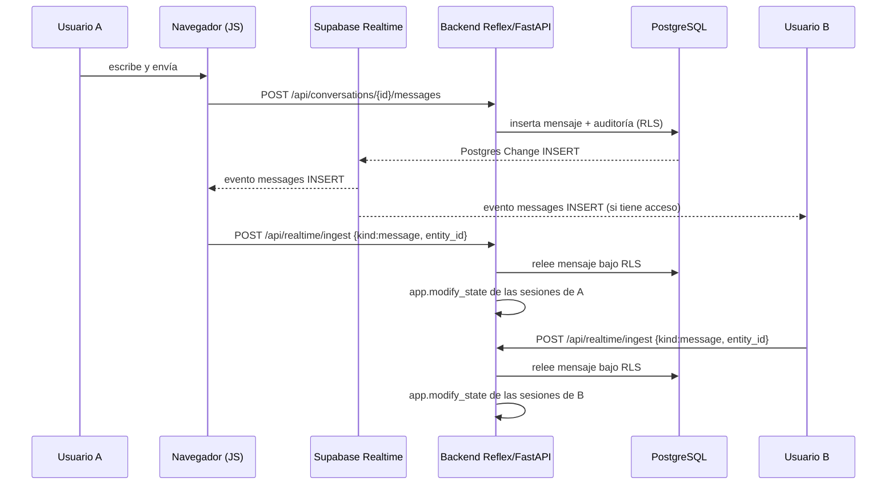

# Chatly — Eventos y tiempo real

> **Estado:** propuesta para revisión del equipo.
> **Base:** Q13, Q16, Q22, Q37, Q38, Q44, Q60, Q61, Q77, Q78, Q83, Q95, Q96, Q100, Q101, Q106.
> **Mecanismo:** Supabase Realtime (Postgres Changes, Presence y Broadcast) desde el navegador, con una capa JS pequeña. La lógica de negocio y la autorización final permanecen en Python.

---

## 1. Principios

1. **Un canal privado por conversación.** Topic `conversation:<uuid>` con `private: true`. En el mismo canal conviven Postgres Changes, Presence y Broadcast.
2. **El navegador no decide contenido.** Los eventos de Realtime solo aportan identificadores; el backend relee la fila autoritativa bajo RLS antes de actualizar el estado de Reflex.
3. **Sin polling.** No se consultan mensajes por intervalo (Q16).
4. **Sin eventos efímeros en la base.** Presencia y escritura no se persisten ni se auditan (Q43, Q77).
5. **La base es la fuente de verdad.** Un evento perdido se recupera al reconectar con una resincronización por REST.
6. **Realtime no es frontera de seguridad.** RLS en `realtime.messages` y en las tablas fuente decide qué llega a cada conexión; aun así, el ingest valida de nuevo.

---

## 2. Requisitos previos en Supabase

| Requisito | Valor |
|---|---|
| Publicación | `supabase_realtime` con las tablas de la sección 4 |
| Canales privados | Habilitar «Realtime Authorization» y desactivar el acceso público en la configuración de Realtime |
| Políticas | `realtime.messages` para Broadcast/Presence (ver `authorization-matrix.md`) |
| JWT | `supabase.realtime.setAuth(access_token)` antes de suscribirse |
| Duración del JWT | ~10 minutos (Q61) |
| Modo | Una sola instancia del backend; sin Redis |

> La tabla `realtime.messages` ya tiene RLS activado. En Alembic solo se crean políticas; nunca `ALTER TABLE realtime.messages ENABLE ROW LEVEL SECURITY`.

---

## 3. Modelo de canal

```text
conversation:<uuid>
├── postgres_changes   (mensajes, reacciones, encuestas, votos, conversación, membresías)
├── presence           (online/offline por sesión)
└── broadcast          (typing, lectura)
```

**Por qué un solo canal:** una conversación abierta necesita los tres flujos a la vez; compartir topic simplifica la autorización (`app.is_active_member`) y evita multiplicar conexiones.

**Ciclo de vida**

```text
login
  └─ setAuth(access_token)
       └─ abrir conversación
            ├─ ¿canal existente? → reutilizar o desuscribir el anterior
            ├─ supabase.channel("conversation:<id>", { config: { private: true } })
            ├─ registrar handlers
            ├─ subscribe()
            └─ al recibir SUBSCRIBED → channel.track({...presence...})
```

- Al cambiar de conversación: `channel.unsubscribe()` y `supabase.removeChannel(channel)`.
- Al cerrar sesión: desuscribir todo, `supabase.removeAllChannels()` y limpiar IndexedDB (Q62).
- Al refrescar el token: `supabase.realtime.setAuth(newToken)`. Supabase recalcula las políticas al recibir el nuevo JWT; si el canal se cerró, se vuelve a suscribir.
- Al ser expulsado o salir: el cliente desuscribe al recibir `membership_changed` propio; además, el backend deja de autorizar y el JWT expira (Q61).

---

## 4. Catálogo de eventos

### 4.1 Postgres Changes

Se publican las tablas necesarias:

```sql
alter publication supabase_realtime add table
    public.conversations,
    public.conversation_memberships,
    public.messages,
    public.message_reactions,
    public.polls,
    public.poll_options,
    public.poll_votes;
```

| Tabla | Eventos | Filtro | Uso en la UI |
|---|---|---|---|
| `messages` | `INSERT`, `UPDATE` | `conversation_id=eq.<id>` | Nuevo mensaje, edición, borrado lógico, encuesta nueva |
| `message_reactions` | `INSERT`, `UPDATE` | sin filtro (RLS acota) | Reacciones del mensaje abierto |
| `polls` | `INSERT`, `UPDATE` | `conversation_id=eq.<id>` | Estado abierto/cerrado |
| `poll_options` | `INSERT`, `UPDATE` | sin filtro (RLS acota) | Opciones y texto |
| `poll_votes` | `INSERT`, `UPDATE` | sin filtro (RLS acota) | Conteo y votantes |
| `conversations` | `UPDATE` | `id=eq.<id>` | Nombre, archivo |
| `conversation_memberships` | `INSERT`, `UPDATE` | `conversation_id=eq.<id>` | Integrantes, administrador, lecturas |

Notas:

- `message_reactions`, `poll_options` y `poll_votes` no tienen `conversation_id`; se suscriben sin filtro y RLS descarta las filas ajenas. Con cinco usuarios de demostración el volumen es despreciable. Si creciera, se añadiría `conversation_id` denormalizado.
- No se depende de eventos `DELETE`: los borrados son `UPDATE` con `deleted_at` (Q85).
- Si se necesitaran registros `old`, se configuraría `replica identity full` en la tabla.

**Suscripción de ejemplo (lado JS):**

```javascript
const channel = supabase.channel(`conversation:${conversationId}`, {
  config: { private: true },
})

channel
  .on(
    'postgres_changes',
    {
      event: '*',
      schema: 'public',
      table: 'messages',
      filter: `conversation_id=eq.${conversationId}`,
      select: ['id', 'conversation_id', 'author_id', 'type', 'content',
               'system_event', 'system_data', 'reply_to_message_id',
               'edited_at', 'edit_count', 'deleted_at', 'deleted_by',
               'created_at', 'updated_at'],
    },
    (payload) => ingest({ kind: 'message', event: payload.eventType,
                          entity_id: payload.new?.id ?? payload.old?.id,
                          conversation_id: conversationId }),
  )
  .on(
    'postgres_changes',
    { event: '*', schema: 'public', table: 'message_reactions' },
    (payload) => ingest({ kind: 'reaction', event: payload.eventType,
                          entity_id: payload.new.id, conversation_id: conversationId }),
  )
  .on(
    'postgres_changes',
    { event: '*', schema: 'public', table: 'poll_votes' },
    (payload) => ingest({ kind: 'poll_vote', event: payload.eventType,
                          entity_id: payload.new.id, conversation_id: conversationId }),
  )
  .on('presence', { event: 'sync' }, () => {
    presenceState.set(channel.presenceState())
  })
  .on('broadcast', { event: 'typing' }, ({ payload }) => {
    showTyping(payload)
  })
  .on('broadcast', { event: 'read' }, ({ payload }) => {
    ingest({ kind: 'read', entity_id: payload.message_id, conversation_id: conversationId })
  })
  .subscribe(async (status) => {
    if (status === 'SUBSCRIBED') {
      await channel.track({
        user_id: currentUser.id,
        alias: currentUser.alias,
        session_key: tabSessionKey,
        online_at: new Date().toISOString(),
      })
    }
  })
```

### 4.2 Broadcast

| Evento | Dirección | Payload | Persistencia |
|---|---|---|---|
| `typing` | cliente → canal | `{ conversation_id, user_id, alias, is_typing, sent_at }` | No |
| `read` | cliente → canal | `{ conversation_id, message_id, user_id, read_at }` | No (la fuente es la membresía) |

```javascript
channel.send({
  type: 'broadcast',
  event: 'typing',
  payload: { conversation_id, user_id, alias, is_typing: true, sent_at: new Date().toISOString() },
})
```

- `typing` se emite con throttling de ~1 s y `is_typing: false` al vaciar el campo, enviar o perder el foco.
- El receptor apaga el indicador tras **5 s** sin eventos (Q77).
- `read` es una optimización para actualizar ✓✓ sin esperar el Postgres Change de la membresía; el dato autoritativo sigue siendo `last_read_at`.

### 4.3 Presence

```javascript
await channel.track({
  user_id: currentUser.id,
  alias: currentUser.alias,
  session_key: tabSessionKey, // distinto por pestaña
  online_at: new Date().toISOString(),
})
```

- La clave de presencia incluye la pestaña para soportar varias sesiones (Q78).
- La UI muestra «en línea» si existe al menos una sesión del usuario.
- Nunca se muestra «última vez visto» (Q13).
- Al cerrar la pestaña, Supabase elimina la presencia automáticamente.

---

## 5. Contrato del ingest

El JS no aplica el payload de Realtime al estado. Envía solo identificadores; el backend relee y decide.

### 5.1 Request

```http
POST /api/realtime/ingest
Authorization: cookie de sesión
Content-Type: application/json
```

```json
{
  "conversation_id": "6f0f8f7e-4d1a-4a39-9d1a-2f5b3f0b8a11",
  "kind": "message",
  "event": "INSERT",
  "entity_id": "b1c2d3e4-0000-4000-8000-000000000001",
  "sent_at": "2026-11-01T18:22:31.004Z"
}
```

| Campo | Obligatorio | Valores |
|---|---|---|
| `conversation_id` | sí | UUID de una conversación visible para el actor |
| `kind` | sí | `message`, `reaction`, `poll`, `poll_option`, `poll_vote`, `conversation`, `membership`, `read` |
| `event` | sí | `INSERT`, `UPDATE`, `DELETE` |
| `entity_id` | sí | UUID de la fila afectada |
| `sent_at` | sí | ISO 8601 UTC |

Para `kind = typing`, el payload no se envía por aquí: viaja por Broadcast; si en el futuro se necesitara fan-out servidor, se añadiría `typing` al ingest sin escritura en base.

### 5.2 Procesamiento en el backend

```text
1. Verificar JWT y correo confirmado.
2. Abrir sesión y fijar app.current_user_id en la transacción.
3. Releer la entidad por entity_id aplicando RLS y la regla de periodo.
   - Si no existe o no es visible: responder 204 y terminar.
4. Serializar el DTO con el mismo formato de la API.
5. Para cada client_token registrado del actor:
   app.modify_state(BaseStateToken(ident=token, cls=RealtimeState))
   → aplicar DTO si la conversación está abierta
   → si no, actualizar lista, orden y contador de no leídos
6. Responder 202 { "accepted": true }.
```

**Por qué releer:** el payload de Realtime podría ser manipulado por un cliente; el contenido que llega a la UI siempre proviene de una consulta autorizada. El coste es una lectura por evento, aceptable con cinco usuarios.

### 5.3 Registro de sesiones

- En `on_load`, el estado registra `user_id → set[client_token]` en un diccionario protegido por `asyncio.Lock`.
- Se elimina al cerrar sesión y al expirar la conexión de Reflex.
- Limitación asumida: memoria del proceso, una sola instancia, sin Redis.

### 5.4 Idempotencia, orden y duplicados

- Cada DTO incluye `updated_at`; el estado descarta un evento si ya aplicó una versión con `updated_at` mayor o igual.
- Los mensajes se ordenan siempre por `(created_at, id)`, nunca por orden de llegada.
- Un `INSERT` duplicado se resuelve por `id`; un `UPDATE` por `(id, updated_at)`.
- El ingest es seguro de reintentar: no escribe en base, solo actualiza estado.

---

## 6. Presencia y escritura

### 6.1 Presencia

| Aspecto | Regla |
|---|---|
| Unidad | Sesión/pestaña |
| Clave | `user_id:session_key` |
| Online | Al menos una sesión activa |
| Offline | Última sesión cerrada o desconectada |
| Persistencia | Ninguna |
| Privacidad | Solo integrantes activos del canal |

La UI consume `channel.presenceState()` y agrupa por `user_id`. No se guarda en Postgres.

### 6.2 Escritura

| Aspecto | Regla |
|---|---|
| Emisión | Broadcast `typing` |
| Frecuencia | Máximo 1 evento por segundo por usuario |
| Expiración | 5 s sin eventos |
| Cierre | `is_typing: false` al enviar, vaciar o cambiar de conversación |
| Persistencia | Ninguna |
| Auditoría | Ninguna |

---

## 7. Lecturas y contadores

1. La conversación se considera leída solo si está abierta **y** la pestaña está visible (Q60).
2. El cliente llama a `POST /api/conversations/{id}/read` con el último mensaje visible.
3. El backend actualiza `last_read_message_id` y `last_read_at` de la membresía activa.
4. El cambio se propaga por Postgres Changes de `conversation_memberships`, y opcionalmente por el Broadcast `read` para reducir latencia.
5. El estado recalcula ✓✓ con la consulta de `database-schema.md` §14.3.
6. El contador de no leídos de la lista se actualiza con cada `INSERT` de mensaje y con cada lectura.

Los mensajes de sistema cuentan para no leídos y para ✓✓ (Q106).

---

## 8. Reconexión y recuperación

| Situación | Acción |
|---|---|
| `TIMED_OUT` / `CHANNEL_ERROR` | Reintentar con backoff exponencial 1, 2, 4, 8, 16, 30 s |
| Reconexión exitosa | Re-suscribir y pedir por REST los últimos 50 mensajes de la conversación abierta |
| JWT expirado | Renovar con `/api/auth/refresh` y `setAuth`; luego re-suscribir si hace falta |
| Pestaña en segundo plano | Mantener presencia; no marcar leídos (Q60); pausar typing |
| Cambio de red | Mismo flujo que reconexión |
| Ingreso offline | No se reciben eventos; al volver se resincroniza desde REST |

La resincronización por REST evita depender de la entrega exacta de eventos y cubre los huecos de la ventana de reconexión.

---

## 9. Secuencia completa



---

## 10. Errores y observabilidad

- `subscribe` devuelve `SUBSCRIBED`, `TIMED_OUT`, `CLOSED` o `CHANNEL_ERROR`; se registra el estado y el motivo en el cliente (sin tokens).
- El ingest responde `202` aceptado, `204` no visible o duplicado, `401` sesión inválida, `403` sin acceso, `422` payload inválido.
- Se registran métricas básicas: eventos recibidos, ingest aceptados, descartados por autorización, latencia del reread y reconexiones.
- Nunca se registran JWT, cookies ni contenido de mensajes en logs.

---

## 11. Pruebas de aceptación

1. Un mensaje enviado por A aparece en B sin recargar.
2. Editar un mensaje actualiza el texto y la etiqueta «editado» en ambos clientes.
3. Eliminar un mensaje muestra «Se eliminó un mensaje» y no revela el contenido.
4. Una reacción nueva o cambiada se refleja en ambos clientes.
5. Un voto nuevo o cambiado actualiza conteos y votantes en ambos clientes.
6. La presencia muestra online con una pestaña y sigue online con dos; pasa a offline al cerrar la última.
7. «Escribiendo…» aparece y desaparece a los 5 s.
8. Un usuario expulsado deja de recibir eventos en la ventana documentada y no puede re-suscribirse.
9. Un usuario ajeno no puede suscribirse al topic de una conversación que no le pertenece.
10. Tras reconectar, no faltan mensajes y no hay duplicados.
11. Los eventos fuera de orden no rompen el orden `(created_at, id)`.
12. Cerrar sesión desuscribe todos los canales y limpia IndexedDB.

---

## 12. Limitaciones conocidas

- **Revocación no instantánea:** las políticas de Realtime se cachean por conexión. Un cliente que no coopere puede seguir recibiendo eventos hasta renovar el JWT o expirar (~10 min). Se mitiga con desuscripción en cliente, validación en el ingest y JWT corto (Q61).
- **Sin Redis:** el registro de sesiones vive en memoria y no sobrevive reinicios ni escala horizontalmente.
- **`DELETE` no autorizado por RLS:** por eso todos los borrados son lógicos.
- **Suscripción sin filtro** en reacciones, opciones y votos: RLS acota, pero el volumen de eventos es mayor. Aceptable para cinco usuarios.
- **Realtime no sustituye la API:** la primera carga y la recuperación tras reconexión siempre se hacen por REST.
